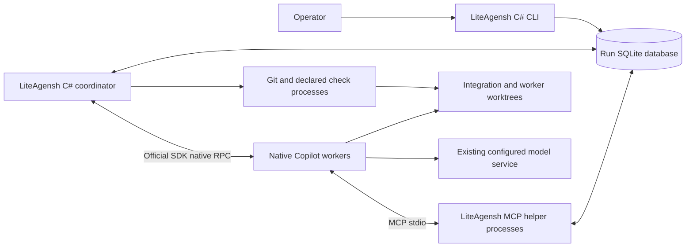
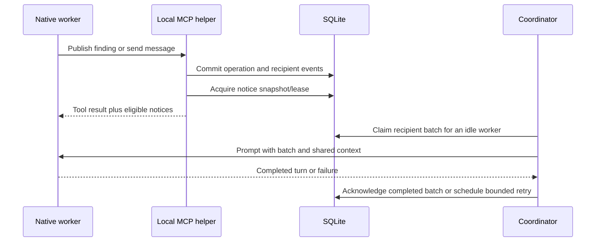

# LiteAgensh Architecture

This design realizes the [requirements](requirements.md); it is not an
implemented-system description. Upstream findings and replacement rationale
belong in the [migration map](upstream-migration.md).

## Context and dependency ownership

The operator controls a trusted local repository and several native coding
agents. LiteAgensh coordinates their work; it does not implement their reasoning
or model/tool loop. Use the official Copilot .NET SDK to host the existing
complete runtime, not a model-provider SDK, another agent framework or a model
HTTP proxy. The [migration findings](upstream-migration.md#native-interface-selection)
explain why this replaces the initial ACP-only choice.

The platform view below is a C4 container-level view: boxes are applications or
stores, not Docker containers.

Use one C# application with CLI/coordinator/MCP modes, not a separately deployed
service per responsibility. A stdio MCP child is an adapter mode of the same
application, not a new server installation. The .NET SDK/target framework,
central package versions, test infrastructure and NBGV follow existing monorepo
authorities; do not select a separate toolchain here.

| Dependency                             | Delegated responsibility                                                                                         | Lite-owned responsibility                                                                                                               |
| -------------------------------------- | ---------------------------------------------------------------------------------------------------------------- | --------------------------------------------------------------------------------------------------------------------------------------- |
| Copilot runtime and official SDK       | Reasoning, editing/shell tools, provider transport/authentication, compaction, native RPC/session/event behavior | Process/session association, supported settings/readback, permission responses, dispatch/cancellation and reported-usage reconciliation |
| SQLite through `Microsoft.Data.Sqlite` | Transactions, file locking, persistence and documented busy-timeout behavior                                     | Schema, atomic domain/event changes, dedup/cursor semantics, finite timeouts and useful failure results                                 |
| Git executable                         | Objects, commits, branches, worktrees, merge/conflict mechanics                                                  | Run refs, serialized candidate integration, exact identities, check/review binding and owner-checkout preservation                      |
| Host process APIs                      | Process start, redirected pipes and observable process exit                                                      | Ownership, bounded waits, log separation and stopping only owned processes                                                              |

The [implementation contracts](implementation-contracts.md) select exact CPM
dependencies, the official C# MCP SDK's stdio server and the official Copilot
.NET SDK's typed native boundary. They also own operation inputs/results and shared
integration boundaries. Those choices do not establish tested interoperability
or introduce another model orchestration layer.

## Configuration input boundary

Treat YAML plus Markdown as a human-editable initialization input, not a
second live coordination store. A configuration loader resolves and validates
the selected input into the existing `RunConfiguration` before opening run
state. JSON retains its existing inline goal and absolute-path semantics.
YAML uses a goal-file reference and configuration-directory-relative paths;
its exact field and failure contract belongs in the
[implementation contracts](implementation-contracts.md#configuration-input).

Use the repository-selected YamlDotNet parser rather than another
configuration framework. Existing .NET JSON serialization, typed validation
and persisted configuration remain the execution boundary. Resume and
reconnect read that persisted snapshot, not mutable input files. Keep
executable names, command arguments and Git revisions unchanged by path
resolution.

A project-owned JSON Schema supplies structural guidance to the existing
VS Code YAML extension through normal schema association. It is an editor
consumer of the input contract, not a replacement for runtime path and
cross-field validation. Editor extensions and network schema retrieval are
not runtime prerequisites; no Markdown-frontmatter language service or
custom editor extension is introduced.

## State and transaction boundary

Keep one database and persistent state directory per run. Conceptual records
are run/segments, workers/session/process associations, tasks/comments,
channels/messages/threads, board revisions and recent-view metadata,
recipient events/batches, notice leases/cursors/shown notices,
changes/reviews/checks and operator control requests. This inventory does not
require one repository interface or class per table.

Both CLI and MCP modes use the same local operation implementation. A task,
message or board write commits its domain mutation and recipient events in one
short transaction. The coordinator polls durable events/control requests;
notifications are an optimization, not the only copy of work.

Enable WAL for a local filesystem. Use separate connections for concurrent
operations; do not share a connection/command/reader concurrently. Keep
transactions short, end them before native-agent, Git or check execution, and
use finite provider timeouts rather than infinite retry layers. SQLite permits
one pending writer; it does not provide parallel database writers.
`Microsoft.Data.Sqlite` async ADO.NET methods execute synchronously, so do not
claim asynchronous storage I/O or wrap each small operation in an unnecessary
thread-pool task. See the [official storage findings](upstream-migration.md#mutable-contracts).

Create schema changes transactionally, record schema compatibility and reject
unknown incompatible state before starting workers. Do not silently discard or
recreate a failed existing database. Persist source-defined board policy and
queue behavior rather than preserving MySQL SQL syntax or row-lock assumptions.

Only the coordinator performs integration and process/lifecycle operations.
MCP/CLI integration and lifecycle operations enqueue requests and return their
identities; they do not announce a merge or pause as completed before the
coordinator records the outcome.

## Native SDK, MCP and instruction boundary

Launch and register one owned installed Copilot headless runtime per worker in
its assigned worktree. Use its documented auto-assigned loopback endpoint and a
process-local connection token, then connect with the SDK's
`RuntimeConnection.ForUri`. Keep native readiness/output and stderr separate
from application output. The host owns the actual process handle and durable
lease; the SDK owns RPC framing, events and session operations. No application
HTTP server, SDK-private RPC copy, VS Code installation or AHP host is needed.

Reuse the installed CLI, disable its automatic update, and disable SDK build-time
CLI acquisition. Verify the matched runtime version, explicit session identity,
absolute working directory and native applied session limit before paid
dispatch. Configure local stdio MCP and supported tool filters through typed
SDK session settings. Disable recursive native team spawning where supported.
Native policy still overrides an application request.

Use explicit persistent session IDs. Bind reservation/session/worker identity
atomically before any model send. SDK events are notifications, not the sole
usage ledger: cumulative typed metrics and their completeness govern charging.
Neither context occupancy nor a premium-request multiplier is AI-credit spend.

### Shared credit allocation

The opt-in shared mode keeps credit allocation in the existing coordinator,
worker adapter and transactional campaign SQLite ledger. It does not add a
service, model proxy, central task scheduler or native cross-session pool.
The host backs each active native spending window from the smaller remaining
run/campaign allowance; no waiting peer owns a permanent equal share.

Use renewable grants of at most 100 credits, and at least the existing
30-credit application admission minimum. This bounds concurrent authorization
without making 100 a worker's lifetime budget. Persist the grant before applying
the native cap. While a call is in flight, its unused authorization remains
committed; never lend it to another worker. A completed SDK turn with complete
cumulative usage closes that grant and returns its unused backing. Every
subsequent send needs fresh backing and a verified finite cap. Trust the SDK's
documented completed-turn boundary; silence or canceled awaits are not closure.

Use the supported mutable session-limit and exhausted-limit response APIs.
For a running session, relate its cap to the saved current-window baseline,
not the session's entire historical cumulative total. A renewal must preserve
the session, cumulative spend and run/campaign ceilings; it is not permission
to clear a native limit or reset usage. Missing/mismatched readback,
incomplete usage or unsupported mutation stops the affected path.

When credit is temporarily committed to other in-flight calls, wait
cancellably for their settlement rather than declaring the pool spent.
The existing run deadline and stop controls still apply. If the remaining
allowance cannot fund the application minimum, report credit exhaustion.
Native limits check after model responses and can overshoot; backing grants
do not establish a hard aggregate prepaid ceiling.

### Local cooperation and instructions

The helper is bound at launch to its run and worker; tool arguments do not
choose an arbitrary actor/run. It exposes the
[local capability vocabulary](upstream-migration.md#collaboration-mcp-map).
Before implementing an operation, its slice must accept the relevant input,
result, failure and candidate/cursor identity contract. The inventory is a
complete semantic map, not a frozen JSON schema or an upstream compatibility
promise.

Compose upstream cooperation/focus/lifecycle instructions with local tool
descriptions for a new native session's bootstrap. After confirmed bootstrap,
same-session turns carry pending events and fresh unread board context, not
another copy of the goal, cooperation guide or whole task/change snapshot.
Full state remains available through the local tools. This limits
application-owned redundancy without replacing native context compaction.
Preserve the target repository's own instructions. Do not write a generated
cooperation guide over tracked `AGENTS.md`.

Bootstrap confirmation belongs to the exact native session and is retained
after a completed turn, independently of event acknowledgement. Exact-session
reconnect reuses that confirmation; explicit fresh-summary resume and a fresh
load-fallback session require bootstrap again. An unconfirmed bootstrap may
replay with interrupted events; do not infer native history from a new
coordinator loop or claim exactly-once presentation.

Permission callbacks honor the operator's explicit run policy and native
enterprise policy. The trusted-host choice does not mean automatically
approving unknown actions or modifying saved authentication/sandbox settings.
If required behavior is unavailable under existing policy, stop that path and
report it rather than broadening permissions.

## Delivery ordering and notices

### Worker admission ramp-up

The coordinator owns configurable admission timing, not intelligent task
assignment. With a positive start interval, start each ordinary native session
only when its admission is due and begin that peer's loop without waiting for
the whole team. Poll existing controls, process peer work and observe deadlines
between admissions. Do not warm every session and merely delay its first prompt:
an interrupted, never-dispatched native session has different accounting
requirements from a reservation whose native worker was never started.

Keep the existing all-session startup path when the interval is zero. Planning
release still gates peers; a positive interval does not admit waiting peers
before that release. Exact recovery, budget admission and native settlement
retain their existing contracts. No new scheduler service or worker role is
introduced.

### Controlled native dependency in scenarios

Keep the coordinator's native-worker dependency internal and replaceable in
controlled scenarios. Its production factory always constructs the real
SDK-backed worker and performs settled-session usage recovery through
`RuntimeConnection.ForUri`. An internal constructor may accept a test factory;
there is no CLI/configuration backend selector, alternate production transport
or plugin registry.

This boundary serves the current cooperation/fresh-resume journey and failed
turn, incomplete-usage and unsettled-stop scenarios without launching models or
binding a test listener. Keep real SQLite credit admission and coordinator
association checks above the substitute. The factory's recovery operation may
return usage only after its session/runtime is settled; otherwise it fails.

Injected execution is automatically classified as controlled dependency
evidence in results and receipt bindings. Controlled preflight/calibration
receipts are stored separately and cannot admit production SDK execution.
Tests obtain them through coordinator operations, not direct receipt insertion.
These scenarios do not establish the real worker's association atomicity,
SDK settings/wire behavior, billing, cancellation or persistence. The
[validation basis](validation.md) retains their separate evidence obligations.

There is one in-flight prompt per worker. Preserve upstream event transitions,
attempt counting, batch ordering, backoff and recovery of interrupted sends.
Do not retry a successful turn merely because later bookkeeping fails.
Notice snapshots, leases, displayed ledgers and queue reconciliation prevent
ordinary double presentation without promising exactly-once model actions.
Appending notices to collaboration tool results does not interrupt an unrelated
tool or expose a general native-runtime injection hook.

## Git integration

Record the explicit base commit and allocate run integration and worker refs
without touching the original checkout. Workers submit a change with a captured
head. The coordinator serializes the following path:

1. Capture the integration head, submitted head and applicable review identity.
2. Construct the proposed merged candidate in an owned integration/check
   worktree. Preserve conflict information for the submitting agent.
3. Execute declared candidate checks against that exact merged candidate and
   record command, tree/commit, result and logs.
4. Confirm the integration head, submitted head and applicable approvals still
   match, then advance the integration ref. Otherwise report staleness and
   re-evaluate rather than merging using old evidence.

Checking the actual merged candidate is a LiteAgensh design decision, not a
claimed upstream invariant. Preflight unsupported Git states and report a
bounded failure; do not repair the user's unrelated work or force-update refs.
The local merge gate can enforce the application's own path only. With shared
host permissions, it cannot prevent arbitrary direct Git or database edits.

HealthGate's source-defined 15/60-minute transitions remain scheduling policy.
The restriction lift does not change candidate or final-check results.
Finalization reports a local branch and evidence, not an automatic remote push.

## Lifecycle, ownership and recovery

Use a lifetime-held local exclusive ownership handle and durable process/session
associations for one coordinator per run. A stale timestamp is not permission
to take over a live writer. After a crash, inspect surviving owned processes
and worktrees before replacement; ambiguous ownership blocks automation.
No distributed lease service is needed.

| Path                           | Required behavior                                                                                                                                                           |
| ------------------------------ | --------------------------------------------------------------------------------------------------------------------------------------------------------------------------- |
| Start                          | Validate state/config/backend prerequisites, own the run, allocate worktrees and native sessions, then dispatch                                                             |
| Crash reconnect                | Resolve old writer ownership; resume the exact saved native session with pending work continuation and transcript recovery disabled, then verify identity, limits and usage |
| Session load unavailable/fails | Record the failed reconnect and use the explicit fresh-session-with-summary recovery path; never claim an uninterrupted continuation or silently lose queued work           |
| Pause                          | Stop new dispatch, request native cancellation, settle owned processes and retain durable work                                                                              |
| Explicit resume                | Start fresh native sessions with repository/task/change/board summary and preserved run state                                                                               |
| Finalize                       | Quiesce workers, perform final checks and retain local delivery and unresolved work                                                                                         |
| Cleanup                        | Require an explicit request; inspect outcomes/ownership and remove only identified owned resources                                                                          |

Use bounded cancellation grace and process-specific cleanup. Native silence does
not prove exit. If a child remains unaccounted for, preserve state and report
the unresolved operation rather than starting a duplicate or claiming a clean
pause. Process enumeration is evidence about the local host, not proof about
every possible external session.

Cancel a turn explicitly through the SDK; cancellation of a local await is not
proof that native work stopped. Quiesce event handlers, reconcile available
complete usage, disconnect the SDK and settle the host-owned runtime before
replacement. SDK disposal preserves on-disk session data; do not call its
permanent session deletion API during pause, finalization or reconnect.
On exact resume, use no more than the reservation's remaining allowance as the
native window limit. Verify cumulative metrics against the saved baseline;
unknown or regressing usage stops paid work rather than regranting a full cap.

Retain SQLite together with its live journal state and worktrees through
pause/finalize; do not copy a live main database file and call it a backup.
Portable sealed backup/export is outside this product outcome.

## Trust and unsupported guarantees

This is a trusted same-user development tool. Agent code and check commands run
with the host user's permissions and may use that user's configured provider;
worktrees are not a security sandbox. SQLite and the local review path are not
tamper-resistant against peers with the same permissions.

Use existing native authentication; do not harvest, copy or proxy credentials.
Keep diagnostics and native session data local by default, since they may
contain repository content. Public acceptance evidence uses a disposable
self-authored repository and sanitized observations, not raw user sessions.
There is no aggregate token-cutoff, cross-backend normalization, history
confidentiality or hosted-gate equivalence claim.

Validate dependency-use assumptions and recovery at the levels required by the
[validation basis](validation.md), relying on supported platform contracts
rather than reimplementing their internals.
