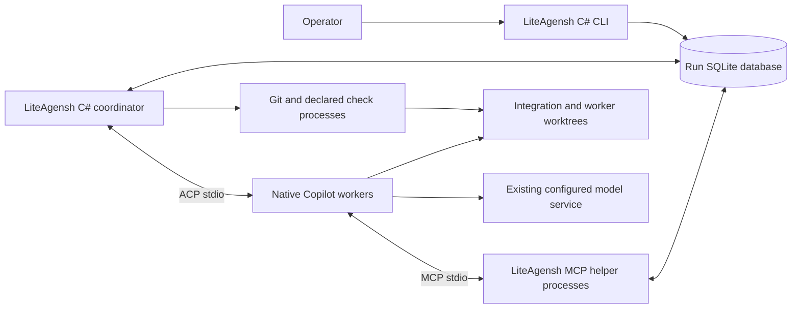
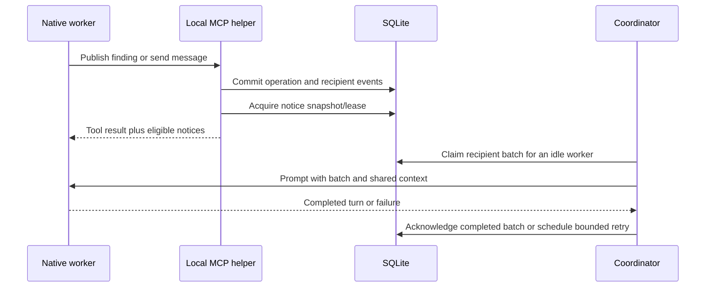

# LiteAgensh Architecture

This design realizes the [requirements](requirements.md); it is not an
implemented-system description. Upstream findings and replacement rationale
belong in the [migration map](upstream-migration.md).

## Context and dependency ownership

The operator controls a trusted local repository and several native coding
agents. LiteAgensh coordinates their work; it does not implement their reasoning
or model/tool loop. Use documented Copilot ACP stdio initially. A model provider
SDK, another agent framework or a model HTTP proxy is not needed merely to host
an existing complete agent runtime.

The platform view below is a C4 container-level view: boxes are applications or
stores, not Docker containers.

Use one C# application with CLI/coordinator/MCP modes, not a separately deployed
service per responsibility. A stdio MCP child is an adapter mode of the same
application, not a new server installation. The .NET SDK/target framework,
central package versions, test infrastructure and NBGV follow existing monorepo
authorities; do not select a separate toolchain here.

| Dependency                             | Delegated responsibility                                                                                         | Lite-owned responsibility                                                                                                                 |
| -------------------------------------- | ---------------------------------------------------------------------------------------------------------------- | ----------------------------------------------------------------------------------------------------------------------------------------- |
| Copilot runtime                        | Reasoning, editing/shell tools, provider transport/authentication, compaction, supported native session behavior | Process/session association, supported launch settings, capability negotiation, permission responses, dispatch/cancellation and reporting |
| SQLite through `Microsoft.Data.Sqlite` | Transactions, file locking, persistence and documented busy-timeout behavior                                     | Schema, atomic domain/event changes, dedup/cursor semantics, finite timeouts and useful failure results                                   |
| Git executable                         | Objects, commits, branches, worktrees, merge/conflict mechanics                                                  | Run refs, serialized candidate integration, exact identities, check/review binding and owner-checkout preservation                        |
| Host process APIs                      | Process start, redirected pipes and observable process exit                                                      | Ownership, bounded waits, log separation and stopping only owned processes                                                                |

`Microsoft.Data.Sqlite` is the selected lightweight .NET storage API, not an
assertion that integration is already tested. Add its exact version through CPM
only in an accepted implementation slice. Choose a maintained C# MCP library
against the required stdio contract during that slice; this capability design
does not freeze a package version or justify writing a general MCP stack.
ACP framing may use a maintained compatible client or a narrow typed
NDJSON/JSON-RPC client; resolve that packaging choice before its implementation.
Neither choice adds another model orchestration layer.

## State and transaction boundary

Keep one database and persistent state directory per run. Conceptual records
are run/segments, workers/session/process associations, tasks/comments,
channels/messages/threads, board revisions and recent-view metadata,
recipient events/batches, notice leases/cursors/shown notices,
changes/reviews/checks and operator control requests. This inventory does not
require one repository interface or class per table.

Both CLI and MCP modes use the same local operation implementation. A task,
message or board write commits its domain mutation and recipient events in one
short transaction. The coordinator polls durable events/control requests;
notifications are an optimization, not the only copy of work.

Enable WAL for a local filesystem. Use separate connections for concurrent
operations; do not share a connection/command/reader concurrently. Keep
transactions short, end them before native-agent, Git or check execution, and
use finite provider timeouts rather than infinite retry layers. SQLite permits
one pending writer; it does not provide parallel database writers.
`Microsoft.Data.Sqlite` async ADO.NET methods execute synchronously, so do not
claim asynchronous storage I/O or wrap each small operation in an unnecessary
thread-pool task. See the [official storage findings](upstream-migration.md#mutable-contracts).

Create schema changes transactionally, record schema compatibility and reject
unknown incompatible state before starting workers. Do not silently discard or
recreate a failed existing database. Persist source-defined board policy and
queue behavior rather than preserving MySQL SQL syntax or row-lock assumptions.

Only the coordinator performs integration and process/lifecycle operations.
MCP/CLI integration and lifecycle operations enqueue requests and return their
identities; they do not announce a merge or pause as completed before the
coordinator records the outcome.

## ACP, MCP and instruction boundary

Start each native worker in its assigned worktree with redirected stdio;
stdout is ACP NDJSON only and diagnostics use separate stderr/log streams.
Negotiate protocol/capabilities before session creation. Supply absolute cwd and
local stdio MCP configuration at the documented session boundary. Apply tool
filters/reasoning settings at server startup where Copilot requires them; do
not put unsupported settings into `session/new`.

The helper is bound at launch to its run and worker; tool arguments do not
choose an arbitrary actor/run. It exposes the
[local capability vocabulary](upstream-migration.md#collaboration-mcp-map).
Before implementing an operation, its slice must accept the relevant input,
result, failure and candidate/cursor identity contract. The inventory is a
complete semantic map, not a frozen JSON schema or an upstream compatibility
promise.

Compose upstream cooperation/focus/lifecycle instructions with local tool
descriptions, and supply them as runtime kickoff/continuation context. Preserve
the target repository's own instructions. Do not write a generated cooperation
guide over tracked `AGENTS.md`.

Permission callbacks honor the operator's explicit run policy and native
enterprise policy. The trusted-host choice does not mean automatically
approving unknown actions or modifying saved authentication/sandbox settings.
If required behavior is unavailable under existing policy, stop that path and
report it rather than broadening permissions.

## Delivery ordering and notices

There is one in-flight prompt per worker. Preserve upstream event transitions,
attempt counting, batch ordering, backoff and recovery of interrupted sends.
Do not retry a successful turn merely because later bookkeeping fails.
Notice snapshots, leases, displayed ledgers and queue reconciliation prevent
ordinary double presentation without promising exactly-once model actions.
Appending notices to collaboration tool results does not interrupt an unrelated
tool or expose a general native-runtime injection hook.

## Git integration

Record the explicit base commit and allocate run integration and worker refs
without touching the original checkout. Workers submit a change with a captured
head. The coordinator serializes the following path:

1. Capture the integration head, submitted head and applicable review identity.
2. Construct the proposed merged candidate in an owned integration/check
   worktree. Preserve conflict information for the submitting agent.
3. Execute declared candidate checks against that exact merged candidate and
   record command, tree/commit, result and logs.
4. Confirm the integration head, submitted head and applicable approvals still
   match, then advance the integration ref. Otherwise report staleness and
   re-evaluate rather than merging using old evidence.

Checking the actual merged candidate is a LiteAgensh design decision, not a
claimed upstream invariant. Preflight unsupported Git states and report a
bounded failure; do not repair the user's unrelated work or force-update refs.
The local merge gate can enforce the application's own path only. With shared
host permissions, it cannot prevent arbitrary direct Git or database edits.

HealthGate's source-defined 15/60-minute transitions remain scheduling policy.
The restriction lift does not change candidate or final-check results.
Finalization reports a local branch and evidence, not an automatic remote push.

## Lifecycle, ownership and recovery

Use a lifetime-held local exclusive ownership handle and durable process/session
associations for one coordinator per run. A stale timestamp is not permission
to take over a live writer. After a crash, inspect surviving owned processes
and worktrees before replacement; ambiguous ownership blocks automation.
No distributed lease service is needed.

| Path                           | Required behavior                                                                                                                                                 |
| ------------------------------ | ----------------------------------------------------------------------------------------------------------------------------------------------------------------- |
| Start                          | Validate state/config/backend prerequisites, own the run, allocate worktrees and native sessions, then dispatch                                                   |
| Crash reconnect                | Resolve old writer ownership; load the exact saved native session only if its advertised capability supports it                                                   |
| Session load unavailable/fails | Record the failed reconnect and use the explicit fresh-session-with-summary recovery path; never claim an uninterrupted continuation or silently lose queued work |
| Pause                          | Stop new dispatch, request native cancellation, settle owned processes and retain durable work                                                                    |
| Explicit resume                | Start fresh native sessions with repository/task/change/board summary and preserved run state                                                                     |
| Finalize                       | Quiesce workers, perform final checks and retain local delivery and unresolved work                                                                               |
| Cleanup                        | Require an explicit request; inspect outcomes/ownership and remove only identified owned resources                                                                |

Use bounded cancellation grace and process-specific cleanup. ACP silence does
not prove exit. If a child remains unaccounted for, preserve state and report
the unresolved operation rather than starting a duplicate or claiming a clean
pause. Process enumeration is evidence about the local host, not proof about
every possible external session.

Retain SQLite together with its live journal state and worktrees through
pause/finalize; do not copy a live main database file and call it a backup.
Portable sealed backup/export is outside this product outcome.

## Trust and unsupported guarantees

This is a trusted same-user development tool. Agent code and check commands run
with the host user's permissions and may use that user's configured provider;
worktrees are not a security sandbox. SQLite and the local review path are not
tamper-resistant against peers with the same permissions.

Use existing native authentication; do not harvest, copy or proxy credentials.
Keep diagnostics and native session data local by default, since they may
contain repository content. Public acceptance evidence uses a disposable
self-authored repository and sanitized observations, not raw user sessions.
There is no aggregate token-cutoff, cross-backend normalization, history
confidentiality or hosted-gate equivalence claim.

Validate dependency-use assumptions and recovery at the levels required by the
[validation basis](validation.md), relying on supported platform contracts
rather than reimplementing their internals.
