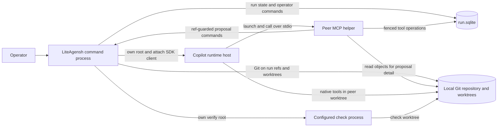
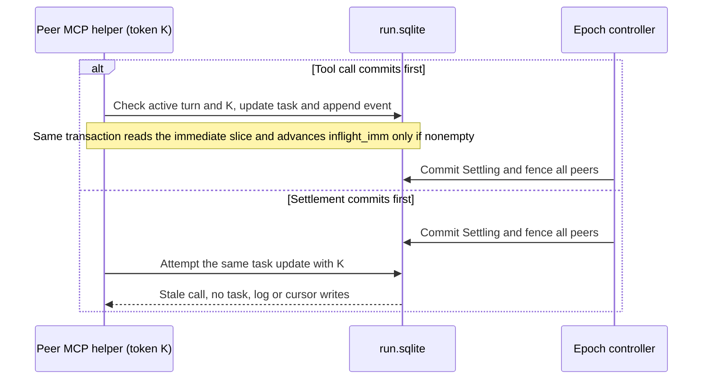

# LiteAgensh Architecture

This is the design for the clean-slate v2 executable. Its inputs are the
[product requirements](requirements.md), [TLA+ coordination model](../specs/),
and [concrete contracts](implementation-contracts.md). The v1 classes,
database layout, and test fixtures are not compatibility requirements.

## V2 run journey

The operator starts a local command process. During `run`, that process is the
coordinator; there is no separate coordination service. Within an epoch the
admitted peers share one Copilot runtime, not a conversation or worktree.
The `mcp` helper is a separate process of the LiteAgensh executable, not the
peer's reasoning loop. This view shows processes and stores on one host:



1. **Prepare.** `init` validates the YAML and Markdown goal, snapshots the
   resolved configuration and base commit, and creates the run's SQLite state,
   target ref, and isolated worktrees without changing the operator's checkout.
   `preflight` checks Git, state, containment, and the required SDK session
   capabilities on a temporary host; it settles that host without dispatching
   a model turn.
2. **Admit and dispatch.** `run` takes `coordinator.lock` and selects the
   [activation or recovery path](#activation-recovery-and-finalization) from
   durable state. In `Open`, the controller admits peers at the configured
   interval, binds each session to its worktree and channel, and starts turns
   for unread work or an idle wake. Before dispatch it records `Running` and
   the turn snapshot together (`ComposedBeginTurn`); the SDK call is outside
   that transaction. The controller schedules turns, not assignments.
3. **Cooperate.** Each peer gathers tasks, messages, and typed context, makes
   advisory claims, and works on its own branch. The Copilot runtime executes
   the turn and permitted native tools; the actor-bound helper handles
   [collaboration calls](#causal-log-and-mcp-transaction-discipline).
   The operator can participate as `owner` through `tool`, or inspect `status`
   without changing the run. On a completed turn the controller commits the
   cursor progress, execution state, and observed usage together
   (`ComposedCompleteTurn`); a tool reply is not a turn completion.
4. **Integrate.** Any peer, not just the author, can request integration of an
   open proposal. The request does not move the target ref. The coordinator's
   `WorkspaceIntegrator` drives the [check and Git CAS protocol](#two-phase-git-integration-and-protecteddiff)
   and records candidate and integration check results separately; neither is a
   final verdict.
5. **Stop and retain the result.** Time expiry closes admission and allows a
   bounded drain of in-flight work. A pause, goal-convergence signal, fault,
   or soft-cost cutoff in `Open` goes directly to settlement. The controller
   fences the cohort, settles in-flight integration, accounts for turns, and
   establishes that owned processes have stopped before declaring the epoch
   `Quiescent`. Closing the root task can signal `GoalConverged`; only
   `finalize` can record `Passed`. The target and run state remain available
   until explicit `cleanup`.

## Layered TLA+ refinement and horizontal composition

[`specs/`](../specs/) follows Lamport's two-dimensional TLA+ discipline—**vertical
layered refinement** (`Tier 0 <- Tier 1 <- Tier 2` via nontrivial state-function
refinement mappings) combined with **horizontal orthogonal composition** across
three Tier-1 coordination planes:

- **Tier 0 (`What` — [`AtomicOrganization.tla`](../specs/AtomicOrganization.tla)):**
  Specifies external behavior as single-step atomic transitions without cursors,
  channel tokens, intermediate `committing`/`eval` states, OS scopes, or ghost
  variables: `AtomicObserveTurn` updates `acked[p]` index sets (where `NoKey`
  items are delivered verbatim and keyed updates satisfy `UpToDateOn`),
  `AtomicIntegrate` advances `targetRef` and `status := "integrated"`
  atomically, and lifecycle transitions govern `runEpoch`, `phase`, `peerExec`,
  sum-type `meter`, and `finalVerdict`.
- **Tier 1 (`How` — [`AgenshOrganization.tla`](../specs/AgenshOrganization.tla)):**
  Composes the three protocol sub-planes horizontally (`THEOREM Spec =>
SubPlane!SafetySpec`) while refining Tier 0 vertically (`THEOREM Spec =>
HighOrg!Spec`, covering safety, fairness, and `BoundedTermination` liveness):

1. **Single Causal Log & Co-Axial Cursors ([`CausalStream.tla`](../specs/CausalStream.tla)):**
    - Refines Tier-0 `(acked, bootstrapped)` via `MappedAcked(p) == {i \in
1..immCursor[p] : VisibleTo(p, log[i]) /\ (i <= baseCursor[p] \/
log[i].imm)}` and `~needsBootstrap[p]` (`THEOREM Spec =>
HighStream!StreamSafetySpec`).
    - All inter-peer and operator coordination appends to one global immutable
      causal `log` carrying `imm \in BOOLEAN` and an optional coalescing `key`
      (`NoKey` for discussion messages, comments, and shared-context posts;
      `'task:<id>'` or `'proposal:<id>'` for state transitions; unfenced
      external `owner` appends are verified in `CausalStream.tla` via
      `AllActors \ Peers`, while `AgenshOrganization.tla` composes the peer
      cohort `AllActors <- Peers`).
    - Durable progress uses `0 <= baseCursor <= immCursor <= |log|` paired with
      ephemeral `(turnSnap, inflightImm)` (`turnSnap = -1` when idle; turn
      aborts discard ephemeral cursors with zero persistent cursor writes) and
      fencing `(needsBootstrap, signed chan \in -MaxChan..MaxChan, InTurn ==
turnSnap >= 0)`.
2. **Two-Phase Cross-Store CAS ([`WorkspaceCas.tla`](../specs/WorkspaceCas.tla)):**
    - Refines Tier-0 single-step `AtomicIntegrate` via `MappedProposals`
      (mapping `status = "committing"` to `"integrated"` iff `head \in
ancestors[targetRef]` else `"open"`, linearizing three-step cross-store
      CAS + crash recovery at `ExecuteArtifactCas` with zero ghost variables,
      `THEOREM Spec => HighWorkspace!WorkspaceSafetySpec`).
    - Trusts Git for merge-base and three-way tree merging through an abstract
      partial-order `ancestors` DAG (including `PeerSyncMerge`) plus a
      nondeterministic merge + `ProtectedDiff` oracle.
3. **Fenced Epoch, Hierarchical Scopes & Sum-Type Meter ([`EpochLifecycle.tla`](../specs/EpochLifecycle.tla)):**
    - Refines Tier-0 `Spec` (safety + liveness, `THEOREM Spec =>
HighLifecycle!Spec`) by hiding `scopeState`, `chan`, and `crashesLeft`
      over `Idle -> Open -> Draining -> Settling -> Quiescent`, three-state
      `peerExec \in {Idle, Running, Unmeasured}`, and unclamped sum-type `meter
\in Exact(cost) | Indeterminate`.

- **Tier 2 (OS/SQLite Scope Protocol — [`OsScopeRefinement.tla`](../specs/OsScopeRefinement.tla)):**
  Refines Tier-1 `EpochLifecycle` (`THEOREM Spec => Tier1Lifecycle!SafetySpec`)
  via `AbstractScope(s)` onto asymmetric SQLite `effect_scopes` and OS
  containment across Windows `KILL_ON_JOB_CLOSE` (breakaway disabled) and
  cooperative POSIX `setsid` process groups (assuming child tools do not call
  `setsid`/`setpgid` to escape `pgid == rootPid`): separates root write-ahead
  `PrePidAmbiguous`, OS `SpawnOsRootProcess`, and SQLite `PersistRootPid`
  (failing closed on pre-PID crashes without speculative disk witnesses),
  models surviving POSIX `mcp Main` self-registration (`OrphanChildMaterializes`,
  `NoPrePidAmbiguousOnPeerChannel`), and proves `ZeroOrphanWhenAbstractStopped`
  via `kill(-pid, 0) == ESRCH` even when group leaders exit before children.

## Downward refinement onto local primitives

### State ownership and lifetime

| Model state                                          | Source of truth and lifetime                                                                                                                      | Write responsibility                                                                                                                                           |
| ---------------------------------------------------- | ------------------------------------------------------------------------------------------------------------------------------------------------- | -------------------------------------------------------------------------------------------------------------------------------------------------------------- |
| `log` and entity changes                             | `tasks` and `proposals` hold current state; `causal_log` retains events across epochs.                                                            | Peer calls, owner tools, and the integrator append through `CausalLogStore` in the same transaction as their domain change.                                    |
| `baseCursor`, `immCursor`, `turnSnap`, `inflightImm` | In `peers`, the first two survive turns; the snapshot and in-flight cursor are provisional even though they are SQLite fields.                    | The coordinator begins, commits, or aborts the turn. A live MCP call advances only the in-flight cursor, not the acknowledged cursors.                         |
| `needsBootstrap`, `chan`, `InTurn`                   | The saved session and bootstrap flag can survive reattachment; `chan_token` fences one attachment and `turn_snap >= 0` identifies an active turn. | The coordinator reserves or invalidates the token. The collaboration handler checks the helper's launch token in the transaction, including forwarded calls.   |
| `proposals`, `eval`                                  | Proposal heads, reviews, and check results survive a restart; the in-progress evaluation snapshot does not.                                       | Collaboration tools record heads, reviews, and requests. `WorkspaceIntegrator` checks the snapshot and owns the transition through `committing` to settlement. |
| `peerRef`, `targetRef`, `ancestors`                  | Git refs and history, not a SQLite status, determine whether a head has landed.                                                                   | Peers commit and sync their own branches. `WorkspaceIntegrator` conditionally advances the run's target ref and reads its ancestry on recovery.                |
| `runEpoch`, `phase`, `peerExec`, `meter`             | `epochs` records each epoch; `session_meters` and `meta['meter']` retain session execution state and run-wide usage.                              | Under `coordinator.lock`, `EpochController` changes phase and accounts for SDK usage. The operator's `pause` command records a signal, not a phase change.     |
| `scopeState`                                         | `effect_scopes` preserves launch intent and process identities across restart; the OS supplies exit evidence.                                     | The coordinator records root intent and settles scopes. A channel helper registers itself in `mcp Main` but cannot declare itself stopped.                     |

These are module responsibilities, not one C# interface per row. `McpHost`
and the operator's `tool` command enter the same collaboration operations
with different identities: only a peer call consumes a peer's immediate
slice. A mutation owns its transaction; writing a task and publishing its
notification are not independently committable operations.

The handoff from collaboration to `WorkspaceIntegrator` is the durable
proposal request, not an MCP call waiting for checks. `EpochController`
drives pending integrations and owns the `verify` scope; the integrator needs
SQLite, Git, and configured checks, not a live peer session. `SdkHost`, in
contrast, has a reason for a replaceable boundary: [controlled scenarios](validation.md#layered-verification-strategy)
use an in-process runtime in place of a live Copilot host.

The controller is one event loop with at most one turn per admitted peer and
one workspace evaluation, not one blocking loop per CLI command. It waits for
SDK/check completions or the next admission, idle-wake, or stop deadline,
with a bounded poll of SQLite for cross-process signals, visible work, and
pending integration requests. Recheck guards in the transaction:
a wakeup is a hint, not permission to dispatch. Service eligible peers and
pending requests fairly (rotate past the last one served); a slow peer,
review, or check must not block processing a stop. The peer prompt supplies
the goal, worktree/target, collaboration tools and, when needed, a bootstrap
summary of durable tasks, proposals, active claims and peer progress. The
peer decides what to do; no task assignment or correctness decision is made
from prompt text.

Across module boundaries pass _facts needed for the decision_: the
collaboration handler takes an actor and a command; the integrator takes a
proposal ID and returns a recorded outcome; the check runner takes an
immutable input OID, stage and command and returns exit/timeout evidence;
the SDK adapter returns session identity, terminal-turn observations and
cumulative usage, not cursor or stop decisions. The scope owner supplies
launch/stop evidence for both runtime and check processes. SQLite transactions
belong to the operation that enforces the invariant. There is no need for a
generic repository per table, an event bus, or an interchangeable Git backend.

### Causal log and MCP transaction discipline

Keep one WAL-enabled `run.sqlite` per run, opening short-lived logical
connections and ending every transaction before invoking SDK RPC, Git, or check
processes:

- **Single causal log without double storage:** Messages, task/proposal
  comments, shared-context entries (`FACT`, `OBSERVED`, `FAIL`, `CLAIM`,
  `PATCH_SUMMARY` with `immediate = 1` and optional `replaces_seq`), and keyed
  `task:<id>` / `proposal:<id>` status updates append directly to `causal_log`
  in the same SQLite `IMMEDIATE` transaction as any `tasks`/`proposals` row or
  post-CAS status update. (`AgenshOrganization.tla` intentionally omits coupling
  proposal row mutations and post-CAS settlement to `log` appends so finite
  `MaxLogItems` never starves workspace liveness, while `FencedWsCall` still
  enforces `McpLive` fencing and atomic immediate-slice piggybacking; the
  [controlled refinement scenarios](validation.md#required-scenario-matrix)
  must establish atomic row-plus-`causal_log` commits in SQLite.)
- **Co-axial cursors and signed `chan_token` fencing:** `BindOrRecoverChannel`
  sets `chan_token = ABS(chan_token) + 1` (`> 0`) and launches
  `mcp --channel <K>`, preserving `saved_session_id` and `needs_bootstrap`
  (`needs_bootstrap` becomes `1` only at `init`, on `Paused` continuation, or on
  safe fresh-session fallback when `exec_state != 'Unmeasured'`). `BeginTurn`
  snapshots `T = COALESCE(MAX(seq), 0)` into `(turn_snap = T, inflight_imm = T)`
  under `chan_token > 0`, delivering `UnreadTurnIdx(peer, T)` (preserving
  `dedup_key IS NULL` rows verbatim while folding each key across `(base_cursor..T]`,
  including already-piggybacked `immediate = 1` rows `<= imm_cursor`) plus
  bootstrap context iff `needs_bootstrap = 1`. Every peer MCP call checks
  `turn_snap >= 0 AND chan_token = $launchChannel`, piggybacking visible
  `immediate = 1` rows in `(inflight_imm..MAX(seq)]` and advancing
  `inflight_imm` iff that visible slice is non-empty. `CommitTurn` sets `base_cursor = turn_snap`, `imm_cursor = inflight_imm`,
  `turn_snap = -1`, and `needs_bootstrap = 0`; every transition into `Settling`
  (turn abort, timeout, helper launch failure, `Paused`/`GoalConverged`, drain
  expiry, or soft cost limit) **atomically** negates `chan_token =
-ABS(chan_token)` and resets `turn_snap = -1` across **all** peers (committing
  the completing peer's cursors/`needs_bootstrap = 0` on `SoftCostLimit`
  completion while resetting `inflight_imm = imm_cursor` with zero writes to
  `base_cursor`, `imm_cursor`, or `needs_bootstrap` for every non-completing
  peer), tearing down the `runtime` container (`RuntimeGroupEmpty`) before
  re-attaching under `+(K + 1)` in the next epoch (`CausalStream.tla`,
  `OsScopeRefinement.tla`).

**A peer tool call races with `pause`.** The signal has already been recorded;
the race is between the controller acting on it and a task update during an
unfinished turn. Each request to SQLite below is one transaction.



In the first ordering the task and event survive `pause`; aborting the turn
discards its provisional cursor, not the committed mutation. In neither
ordering does the unfinished turn advance `base_cursor` or `imm_cursor`.

### Two-phase Git integration and `ProtectedDiff`

1. In `Open`, take one requested open proposal. Snapshot its head `H` and
   target OID `T` (`refs/lite-agensh/<run>/main`). Ask Git for **all** merge
   bases; require exactly one. If `H` is already in `T`, reject this request
   as already landed; do not claim a new integration. Fast-forward uses
   `C = H`. When diverged, merge `H` into detached `T` in the run's check
   worktree with `git merge --no-ff`: `C` is the resulting two-parent commit,
   never a squash or a commit made from a peer's dirty worktree. No live
   target moves during preparation.
2. `ProtectedDiff` uses `git diff --no-renames --name-only -z T C` and
   repository-root Git glob pathspecs for `protectedPaths`. A rename can touch
   either endpoint; an edit later reverted has no net effect. Require current
   non-author peer approval of `H` if the net diff matches or
   `requirePeerReview` is true. Run candidate checks at `H` and integration
   checks at `C` in the same `verify` root, even if the epoch starts draining
   between stages. Stop the root after the evaluation, not between stages. A conflict,
   ambiguous base, missing approval, or failed check clears `requested` and
   records the reason **only if the open head is still `H`**. Preserve newer
   requests and peer commits. Peers can merge target into their own branch,
   update the proposal, and request again; the controller does not retry a
   rejected request on its own.
3. Before precommit, prepare a Git `update-ref --stdin` transaction
   (`start`, `update target C T`, `prepare`). A concurrent advance before
   `prepare` wins; do not overwrite it. With that ref held, commit SQLite
   `status = 'committing'` and its event only if the proposal is still open,
   requested for `H`, the checks on this attempt passed, any required approval
   is still live, and the epoch is `Open` or `Draining`. Release by Git
   `abort` on rejection; otherwise send `commit` **after** SQLite commits.
   The held Git ref is not a distributed transaction: neither a Git call nor
   a check runs with a SQLite transaction open. Once precommitted, finish in
   `Open`, `Draining`, or `Settling` before epoch close.

**Integration and crash recovery.** `target` below is the run's integration
ref. The live and recovery paths share the same settlement decision:

```mermaid
sequenceDiagram
    participant W as WorkspaceIntegrator
    participant D as run.sqlite
    participant G as Git
    alt Live coordinator
        W->>G: Prepare expected-old target update (lock at T)
        W->>D: Commit status = committing for the verified head
        W->>G: Commit the prepared update to C
    else Restart with a committing row, before or after the ref update
        W->>D: Read the persisted proposal head
    end
    W->>G: Hold target at its observed OID; is head its ancestor?
    alt Head is in target history
        W->>D: Commit integrated, clear requested and append status event
    else Head is not in target history
        W->>D: Commit open, clear requested and append status event
    end
```

[`proposal_query`](implementation-contracts.md#minimal-native-mcp-tool-catalog)
can report `committing` on either side of the Git update. That is the SQLite
protocol state, not the Tier-0 answer to whether the head landed. Recovery
reads the current target history; it neither replays the CAS nor depends on
the lost `git update-ref` result. In an explicit Git transaction, EOF before
`commit` aborts; a `commit` already sent may still be executing when the
coordinator dies. Before settlement, acquire a fresh prepared `verify` on the
sampled target OID: this serializes with that outstanding writer. Hold it
through the ancestry decision and conditional SQLite row-plus-event commit.
`git merge-base --is-ancestor H targetOid` exit `0` means landed, `1` means
not landed. A busy ref, missing object, or other Git error is neither result:
leave `committing` recoverable and report the failure; never remove a Git
lock to force progress. A competing advance may include `H` without pointing
at `C`. The model assumes forward-moving run history; force-rewriting the
run's refs behind the coordinator is not a supported recovery mechanism.

### OS process topology, unified `run`, and guardrails

- **True OS process hierarchy, root-only write-ahead `Ambiguous`, and Job Object lifetime (`#1756`):**
    - The two owned effect roots are `runtime`
      (shared Copilot CLI host) and `verify` (check runner). On Windows, each
      root attaches to a Coordinator-owned `JOB_OBJECT_LIMIT_KILL_ON_JOB_CLOSE`
      Job Object (breakaway disabled) before initial thread execution
      (`PROC_THREAD_ATTRIBUTE_JOB_LIST` or `CREATE_SUSPENDED` +
      `AssignProcessToJobObject`), so a Coordinator crash closes the Job handle
      and kernel-terminates the entire tree; on POSIX, each root starts a
      `setsid` process group (`pgid == pid`) torn down via `kill(-pid, SIGKILL)`.
      Under `runtime`, Copilot CLI spawns `lite-agensh mcp` helpers
      (`channel:<peer>`) and—under `"trusted"` policy—native shell tools as
      sibling OS children (`mcp` never spawns shell tools, and `runtime` stays
      non-`'Stopped'`—blocking `Quiescent`, new epochs, `finalize`, and
      `cleanup`—until both `channel:<peer>` helpers and all sibling shell tools
      exit).
    - Pre-PID write-ahead `'Ambiguous'` applies **only** to Coordinator-spawned
      roots (`runtime`, `verify`), promoted to `'Active'` with
      `(pid, start_ticks)` before resuming execution (or `'Stopped'` if creation
      fails before any process was created). Because `channel:<peer>` (`mcp`)
      is spawned internally by `runtime` on explicit session MCP start after the
      Coordinator reserves strictly monotonic `chan_token = ABS(chan_token) + 1`
      (`--channel <K>`, used for at most one SDK helper launch) and has no side
      effects before `Main`, the Coordinator never pre-writes a PID-less
      `'Ambiguous'` row for it (preventing permanent self-lock on pre-`Main`
      crashes); `mcp` atomically checks `epochs.phase = 'Open' AND
effect_scopes['runtime'].state = 'Active' AND
COALESCE(effect_scopes['channel:<peer>'].state, 'Stopped') = 'Stopped' AND
session_meters.exec_state = 'Idle' AND peers.chan_token = K` in `Main` before registering `(pid, start_ticks,
'Active')` under `parent_id = 'runtime'`, and never self-writes `'Stopped'`
      before OS process exit—instead, whenever the epoch enters `Settling` (on
      any turn abort, helper launch failure, or stop signal), the Coordinator
      **atomically** negates `peers.chan_token = -ABS(chan_token)` and resets
      `turn_snap = -1` across **all** peers in SQLite (fencing every peer helper
      out of MCP calls at once while keeping `effect_scopes['channel:<peer>'].state =
'Active'`), tears down the root `runtime` Job Object / process group
      (`RuntimeGroupEmpty`, terminating `runtime`, all `mcp` helpers, and all
      `"trusted"` sibling shell subprocesses without blocking on RPC
      `DisposeAsync()`), and clears `(pid = NULL, start_ticks = NULL, state =
'Stopped')` only after OS termination before a subsequent epoch reserves
      `+(K + 1)`.
    - Because a restarted CLI process cannot open a dead predecessor's anonymous
      Job handle, cross-restart `run`, `finalize`, and `cleanup` rely on Windows
      `KILL_ON_JOB_CLOSE` plus bottom-up `(pid, start_ticks)` liveness checks in
      `effect_scopes` (`channel:<peer>` before `runtime`, plus `verify`, and
      `kill(-pid, 0) -> ESRCH` cooperative group emptiness for POSIX roots),
      while PID-less pre-PID root `'Ambiguous'` rows fail closed. Logical turns
      use `peers.turn_snap >= 0` + `session_meters.exec_state`.

### Activation, recovery and finalization

Holding the lock establishes exclusive control, not that the previous process
tree is gone. A new epoch, final verification, or cleanup cannot start while a
predecessor scope is `Active` or `Ambiguous`. Epoch activation also requires
an unfinalized run and an exact meter below the soft limit. Once scopes are
settled, the command and durable state determine what happens next:

| Entry                                    | Action and result                                                                                                                                                                                                                                                                                                                                                                                          |
| ---------------------------------------- | ---------------------------------------------------------------------------------------------------------------------------------------------------------------------------------------------------------------------------------------------------------------------------------------------------------------------------------------------------------------------------------------------------------- |
| `run` from `Idle` or `Quiescent(Paused)` | Start epoch 1 or a new epoch, respectively. On paused continuation, bootstrap all peers from the durable state summary.                                                                                                                                                                                                                                                                                    |
| `run` after an interrupted epoch         | Reconcile `committing` proposals against Git and discard provisional turn cursors. Resume the saved session with its recorded SDK identity and a fresh channel token, preserving bootstrap state (`ContinuePendingWork = false`, `AllowTranscriptRecovery = false`). Fresh-session fallback requires `exec_state != 'Unmeasured'` and resets bootstrap; an unrecoverable unmeasured session faults closed. |
| `finalize` after interruption            | From an interrupted `Open`, `Draining`, or `Settling` epoch, reconcile integration and settle as `FaultedClosed` rather than dispatching more work. An interrupted final check is different: its epoch was already `Quiescent`, so retry final verification without changing the settled `stopReason`.                                                                                                     |
| `finalize` from `Quiescent`              | With no evaluation in flight and no `committing` row, run `finalChecks` in `verify` scope. `Passed` requires passing checks, settled scopes, exact usage, and a non-faulted stop reason.                                                                                                                                                                                                                   |
| `cleanup`                                | Only after finalization in `Quiescent`, remove run-owned refs, worktrees, and state. A `Failed` verdict is still a verdict; an `Unverified` run is not eligible.                                                                                                                                                                                                                                           |

Neither a process exit nor a missing SDK response means zero usage. Missing,
incomplete, or regressing usage for a dispatched turn, or any non-`Idle`
execution state left at `Quiescent`, yields `Indeterminate`
(`meta['meter'] = -1`) and `FaultedClosed`. A soft cap is not a ceiling on the
amount recorded.

The [session and accounting protocol](implementation-contracts.md#session-attachment-and-accounting)
defines which SDK observation can complete a turn. The
[stop, verification and cleanup contracts](implementation-contracts.md#stop-verification-and-cleanup)
define the wall-clock boundary and the durable result returned by `finalize`.

## Trust boundary

Agent tools and check commands execute under the local user's OS account;
worktrees isolate Git working trees, not host permissions, network, or secrets.
Under default `nativePermissionPolicy: "deny"`, arbitrary shell execution is
denied; under `"trusted"`, same-account peers are cooperative (`LA-REQ-016`), so
`--actor` and `--channel` act as concurrency/ABA staleness fences against
delayed or orphaned MCP helpers rather than an adversarial privilege boundary.
Existing Copilot authentication is used in place without credential copying or
traffic proxying.

## First implementation boundary: proposal integration

Start at a durable integration request in an `Open` epoch with a run-owned
target and check worktree, **before** checking the head, approvals, or merge.
Reject a failed evaluation without clearing a newer head's request. Once
precommitted, attempt the conditional ref update, then settle the proposal
from Git ancestry, clearing `requested` and committing the status event with
the row. Startup uses the same ancestry decision without replaying the update;
an unreadable target is not a negative ancestry result.

Use the [workspace scenario](validation.md#required-scenario-matrix) with real
Git and WAL SQLite. A divergent merge distinguishes ancestry from OID equality:
interrupt on either side of the ref update and compare the recovered result
with the actual target history. A competing target advance must not be
overwritten. A controlled check runner can supply command results; the
integrator still enforces the gates. The slice does not need peer dispatch,
MCP transport, or a new CLI entry point.
