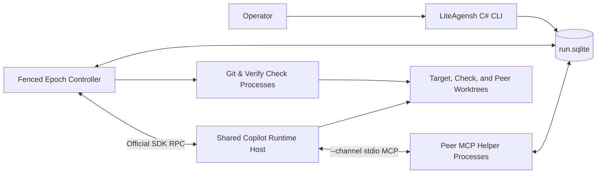

# LiteAgensh Architecture

LiteAgensh is designed top-down from the `TLC`-verified abstract machines in
[`specs/`](../specs/), refining pure mathematical coordination invariants onto
single-machine SQLite, Git worktrees, stdio MCP, and the official Copilot `.NET`
SDK to satisfy [requirements](requirements.md).

## Layered TLA+ refinement and horizontal composition

[`specs/`](../specs/) follows Lamport's two-dimensional TLA+ discipline—**vertical
layered refinement** (`Tier 0 <- Tier 1 <- Tier 2` via nontrivial state-function
refinement mappings) combined with **horizontal orthogonal composition** across
three Tier-1 coordination planes:

- **Tier 0 (`What` — [`AtomicOrganization.tla`](../specs/AtomicOrganization.tla)):**
  Specifies external behavior as single-step atomic transitions without cursors,
  channel tokens, intermediate `committing`/`eval` states, OS scopes, or ghost
  variables: `AtomicObserveTurn` updates `acked[p]` index sets (where `NoKey`
  items are delivered verbatim and keyed updates satisfy `UpToDateOn`),
  `AtomicIntegrate` advances `targetRef` and `status := "integrated"`
  atomically, and lifecycle transitions govern `runEpoch`, `phase`, `peerExec`,
  sum-type `meter`, and `finalVerdict`.
- **Tier 1 (`How` — [`AgenshOrganization.tla`](../specs/AgenshOrganization.tla)):**
  Composes the three protocol sub-planes horizontally (`THEOREM Spec =>
SubPlane!SafetySpec`) while refining Tier 0 vertically (`THEOREM Spec =>
HighOrg!Spec`, covering safety, fairness, and `BoundedTermination` liveness):

1. **Single Causal Log & Co-Axial Cursors ([`CausalStream.tla`](../specs/CausalStream.tla)):**
    - Refines Tier-0 `(acked, bootstrapped)` via `MappedAcked(p) == {i \in
1..immCursor[p] : VisibleTo(p, log[i]) /\ (i <= baseCursor[p] \/
log[i].imm)}` and `~needsBootstrap[p]` (`THEOREM Spec =>
HighStream!StreamSafetySpec`).
    - All inter-peer and operator coordination appends to one global immutable
      causal `log` carrying `imm \in BOOLEAN` and an optional coalescing `key`
      (`NoKey` for discussion messages, comments, and shared-context posts;
      `'task:<id>'` or `'proposal:<id>'` for state transitions; unfenced
      external `owner` appends are verified in `CausalStream.tla` via
      `AllActors \ Peers`, while `AgenshOrganization.tla` composes the peer
      cohort `AllActors <- Peers`).
    - Durable progress uses `0 <= baseCursor <= immCursor <= |log|` paired with
      ephemeral `(turnSnap, inflightImm)` (`turnSnap = -1` when idle; turn
      aborts discard ephemeral cursors with zero persistent cursor writes) and
      fencing `(needsBootstrap, signed chan \in -MaxChan..MaxChan, InTurn ==
turnSnap >= 0)`.
2. **Two-Phase Cross-Store CAS ([`WorkspaceCas.tla`](../specs/WorkspaceCas.tla)):**
    - Refines Tier-0 single-step `AtomicIntegrate` via `MappedProposals`
      (mapping `status = "committing"` to `"integrated"` iff `head \in
ancestors[targetRef]` else `"open"`, linearizing three-step cross-store
      CAS + crash recovery at `ExecuteArtifactCas` with zero ghost variables,
      `THEOREM Spec => HighWorkspace!WorkspaceSafetySpec`).
    - Trusts Git for merge-base and three-way tree merging through an abstract
      partial-order `ancestors` DAG (including `PeerSyncMerge`) plus a
      nondeterministic merge + `ProtectedDiff` oracle.
3. **Fenced Epoch, Hierarchical Scopes & Sum-Type Meter ([`EpochLifecycle.tla`](../specs/EpochLifecycle.tla)):**
    - Refines Tier-0 `Spec` (safety + liveness, `THEOREM Spec =>
HighLifecycle!Spec`) by hiding `scopeState`, `chan`, and `crashesLeft`
      over `Idle -> Open -> Draining -> Settling -> Quiescent`, three-state
      `peerExec \in {Idle, Running, Unmeasured}`, and unclamped sum-type `meter
\in Exact(cost) | Indeterminate`.

- **Tier 2 (OS/SQLite Scope Protocol — [`OsScopeRefinement.tla`](../specs/OsScopeRefinement.tla)):**
  Refines Tier-1 `EpochLifecycle` (`THEOREM Spec => Tier1Lifecycle!SafetySpec`)
  via `AbstractScope(s)` onto asymmetric SQLite `effect_scopes` and OS
  containment across Windows `KILL_ON_JOB_CLOSE` (breakaway disabled) and
  cooperative POSIX `setsid` process groups (assuming child tools do not call
  `setsid`/`setpgid` to escape `pgid == rootPid`): separates root write-ahead
  `PrePidAmbiguous`, OS `SpawnOsRootProcess`, and SQLite `PersistRootPid`
  (failing closed on pre-PID crashes without speculative disk witnesses),
  models surviving POSIX `mcp Main` self-registration (`OrphanChildMaterializes`,
  `NoPrePidAmbiguousOnPeerChannel`), and proves `ZeroOrphanWhenAbstractStopped`
  via `kill(-pid, 0) == ESRCH` even when group leaders exit before children.

## Downward refinement onto local primitives

| Abstract plane / invariant                      | Concrete local refinement                                                                                                                        | C# module boundary    |
| ----------------------------------------------- | ------------------------------------------------------------------------------------------------------------------------------------------------ | --------------------- |
| `log`, co-axial `(baseCursor, immCursor)`       | Single append-only `causal_log` + `peers(..., base_cursor, imm_cursor, turn_snap, inflight_imm)` (eliminating duplicate stream/entity tables)    | `CausalLogStore`      |
| `(needsBootstrap, signed chan, InTurn)`         | `needs_bootstrap` (`0\|1`), signed `chan_token` (`+k` bound / `-k` unbound), `turn_snap >= 0`, and launch-bound `mcp --channel <K>`              | `McpHost` / `SdkHost` |
| `ancestors`, `PeerSyncMerge`, 3-step CAS        | Git worktree branches + `git merge --no-ff`, `proposals`, `proposal_reviews`, `verification_runs`, `git update-ref` CAS on `refs/lite-agensh/..` | `WorkspaceIntegrator` |
| `head \in ancestors[targetRef]` crash reconcile | Startup/settlement recovery checks `git merge-base --is-ancestor <head> refs/lite-agensh/<run>/main` for any `committing` row                    | `WorkspaceIntegrator` |
| `runEpoch`, `scopeState`, `peerExec`, `meter`   | `coordinator.lock` + `epochs`, `effect_scopes` + `KILL_ON_JOB_CLOSE`/process groups, `session_meters.exec_state`, and sum-type `meta['meter']`   | `EpochController`     |

### Causal log and MCP transaction discipline

Keep one WAL-enabled `run.sqlite` per run, opening short-lived logical
connections and ending every transaction before invoking SDK RPC, Git, or check
processes:

- **Single causal log without double storage:** Messages, task/proposal
  comments, shared-context entries (`FACT`, `OBSERVED`, `FAIL`, `CLAIM`,
  `PATCH_SUMMARY` with `immediate = 1` and optional `replaces_seq`), and keyed
  `task:<id>` / `proposal:<id>` status updates append directly to `causal_log`
  in the same SQLite `IMMEDIATE` transaction as any `tasks`/`proposals` row or
  post-CAS status update. (`AgenshOrganization.tla` intentionally omits coupling
  proposal row mutations and post-CAS settlement to `log` appends so finite
  `MaxLogItems` never starves workspace liveness, while `FencedWsCall` still
  enforces `McpLive` fencing and atomic immediate-slice piggybacking; atomic
  row-plus-`causal_log` SQLite commits are verified by controlled refinement
  scenarios in [validation](validation.md).)
- **Co-axial cursors and signed `chan_token` fencing:** `BindOrRecoverChannel`
  sets `chan_token = ABS(chan_token) + 1` (`> 0`) and launches
  `mcp --channel <K>`, preserving `saved_session_id` and `needs_bootstrap`
  (`needs_bootstrap` becomes `1` only at `init`, on `Paused` continuation, or on
  safe fresh-session fallback when `exec_state != 'Unmeasured'`). `BeginTurn`
  snapshots `T = COALESCE(MAX(seq), 0)` into `(turn_snap = T, inflight_imm = T)`
  under `chan_token > 0`, delivering `UnreadTurnIdx(peer, T)` (preserving
  `dedup_key IS NULL` rows verbatim while folding each key across `(base_cursor..T]`,
  including already-piggybacked `immediate = 1` rows `<= imm_cursor`) plus
  bootstrap context iff `needs_bootstrap = 1`. Every peer MCP call checks
  `turn_snap >= 0 AND chan_token = $launchChannel`, piggybacking visible
  `immediate = 1` rows in `(inflight_imm..MAX(seq)]` and advancing
  `inflight_imm` iff that visible slice is non-empty. `CommitTurn` sets `base_cursor = turn_snap`, `imm_cursor = inflight_imm`,
  `turn_snap = -1`, and `needs_bootstrap = 0`; every transition into `Settling`
  (turn abort, timeout, helper launch failure, `Paused`/`GoalConverged`, drain
  expiry, or soft cost limit) **atomically** negates `chan_token =
-ABS(chan_token)` and resets `turn_snap = -1` across **all** peers (committing
  the completing peer's cursors/`needs_bootstrap = 0` on `SoftCostLimit`
  completion while resetting `inflight_imm = imm_cursor` with zero writes to
  `base_cursor`, `imm_cursor`, or `needs_bootstrap` for every non-completing
  peer), tearing down the `runtime` container (`RuntimeGroupEmpty`) before
  re-attaching under `+(K + 1)` in the next epoch (`CausalStream.tla`,
  `OsScopeRefinement.tla`).

### Two-phase Git integration and `ProtectedDiff`

1. Evaluate queued `proposals` (`status = 'open' AND requested = 1`) serially in
   the dedicated check worktree under `verify` scope (`Open` phase): verify a
   unique Git merge base (`git merge-base --all <snapMain> <head>` returning
   exactly one commit; criss-cross multiple bases fail closed) and materialize
   the merge into `snapMain = refs/lite-agensh/<run>/main` via `git merge --no-ff`
   when diverged so `<proposal.head>` remains a true Git ancestor.
2. Compute per-path net `ProtectedDiff` over
   `git diff --no-renames --name-only <snapMain> <mergedTree>` against
   `protectedPaths` (emitting both source and destination paths on renames). If
   merge conflicts, multiple merge bases exist, required non-author approval on
   `proposal.head` is absent, or configured checks fail, clear `requested = 0`
   in SQLite only if `proposals.head_oid = $snapHead` (preserving any newer
   head's request) without touching `refs/lite-agensh/<run>/main` or peer
   worktrees (peers may run `git merge` of `refs/lite-agensh/<run>/main` locally
   in their worktree to resolve conflicts).
3. Pre-commit `status = 'committing'` in SQLite after rechecking `(snapMain,
snapHead)` and live approvals, then complete `git update-ref refs/lite-agensh/<run>/main <mergedOid> <snapMain>`
   and post-CAS SQLite settlement (`integrated` vs `open` via
   `git merge-base --is-ancestor <head> refs/lite-agensh/<run>/main`) across
   `Open`, `Draining`, or `Settling` before closing the epoch. Startup and crash
   settlement apply the identical `merge-base --is-ancestor` reconciliation.

### OS process topology, unified `run`, and guardrails

- **True OS process hierarchy, root-only write-ahead `Ambiguous`, and Job Object lifetime (`#1756`):**
    - The Coordinator directly spawns only the two root processes: `runtime`
      (shared Copilot CLI host) and `verify` (check runner). On Windows, each
      root attaches to a Coordinator-owned `JOB_OBJECT_LIMIT_KILL_ON_JOB_CLOSE`
      Job Object (breakaway disabled) before initial thread execution
      (`PROC_THREAD_ATTRIBUTE_JOB_LIST` or `CREATE_SUSPENDED` +
      `AssignProcessToJobObject`), so a Coordinator crash closes the Job handle
      and kernel-terminates the entire tree; on POSIX, each root starts a
      `setsid` process group (`pgid == pid`) torn down via `kill(-pid, SIGKILL)`.
      Under `runtime`, Copilot CLI spawns `lite-agensh mcp` helpers
      (`channel:<peer>`) and—under `"trusted"` policy—native shell tools as
      sibling OS children (`mcp` never spawns shell tools, and `runtime` stays
      non-`'Stopped'`—blocking `Quiescent`, new epochs, `finalize`, and
      `cleanup`—until both `channel:<peer>` helpers and all sibling shell tools
      exit).
    - Pre-PID write-ahead `'Ambiguous'` applies **only** to Coordinator-spawned
      roots (`runtime`, `verify`), promoted to `'Active'` with
      `(pid, start_ticks)` before resuming execution (or `'Stopped'` if creation
      fails). Because `channel:<peer>` (`mcp`) is spawned internally by
      `runtime` during `CreateSessionAsync`/`ResumeSessionAsync` after the
      Coordinator reserves strictly monotonic `chan_token = ABS(chan_token) + 1`
      (`--channel <K>`, used for at most one SDK helper launch) and has no side
      effects before `Main`, the Coordinator never pre-writes a PID-less
      `'Ambiguous'` row for it (preventing permanent self-lock on pre-`Main`
      crashes); `mcp` atomically checks `epochs.phase = 'Open' AND
effect_scopes['runtime'].state = 'Active' AND
COALESCE(effect_scopes['channel:<peer>'].state, 'Stopped') = 'Stopped' AND
peers.chan_token = K` in `Main` before registering `(pid, start_ticks,
'Active')` under `parent_id = 'runtime'`, and never self-writes `'Stopped'`
      before OS process exit—instead, whenever the epoch enters `Settling` (on
      any turn abort, helper launch failure, or stop signal), the Coordinator
      **atomically** negates `peers.chan_token = -ABS(chan_token)` and resets
      `turn_snap = -1` across **all** peers in SQLite (fencing every peer helper
      out of MCP calls at once while keeping `effect_scopes['channel:<peer>'].state =
'Active'`), tears down the root `runtime` Job Object / process group
      (`RuntimeGroupEmpty`, terminating `runtime`, all `mcp` helpers, and all
      `"trusted"` sibling shell subprocesses without blocking on RPC
      `DisposeAsync()`), and clears `(pid = NULL, start_ticks = NULL, state =
'Stopped')` only after OS termination before a subsequent epoch reserves
      `+(K + 1)`.
    - Because a restarted CLI process cannot open a dead predecessor's anonymous
      Job handle, cross-restart `run`, `finalize`, and `cleanup` rely on Windows
      `KILL_ON_JOB_CLOSE` plus bottom-up `(pid, start_ticks)` liveness checks in
      `effect_scopes` (`channel:<peer>` before `runtime`, plus `verify`, and
      `kill(-pid, 0) -> ESRCH` cooperative group emptiness for POSIX roots),
      while PID-less pre-PID root `'Ambiguous'` rows fail closed. Logical turns
      use `peers.turn_snap >= 0` + `session_meters.exec_state`.
- **Unified `run`, honest `Quiescent` metering, & idempotent `finalize`:**
  From `Idle`, `run` starts epoch 1; from `Quiescent(Paused)`, sets
  `needs_bootstrap = 1` across peers and seeds a fresh state summary; from an
  interrupted epoch with `Exact` metering (`meter >= 0`), reconnects saved SDK
  sessions (`ContinuePendingWork = false`, `AllowTranscriptRecovery = false`)
  with fresh `ABS(chan_token) + 1` helpers, allowing fresh-session fallback
  (`needs_bootstrap = 1`) only when `exec_state != 'Unmeasured'`. Whenever an
  epoch settles into `Quiescent` (gracefully or after crash) with any non-`Idle`
  `exec_state`—or on missing/incomplete/regressing `Complete` nano-AIU
  readback—`meta['meter']` transitions to `-1` (`Indeterminate`,
  `FaultedClosed`). `finalize` runs `finalChecks` under `verify` scope without
  overwriting `stopReason`.

## Trust boundary

Agent tools and check commands execute under the local user's OS account;
worktrees isolate Git working trees, not host permissions, network, or secrets.
Under default `nativePermissionPolicy: "deny"`, arbitrary shell execution is
denied; under `"trusted"`, same-account peers are cooperative (`LA-REQ-016`), so
`--actor` and `--channel` act as concurrency/ABA staleness fences against
delayed or orphaned MCP helpers rather than an adversarial privilege boundary.
Existing Copilot authentication is used in place without credential copying or
traffic proxying.
