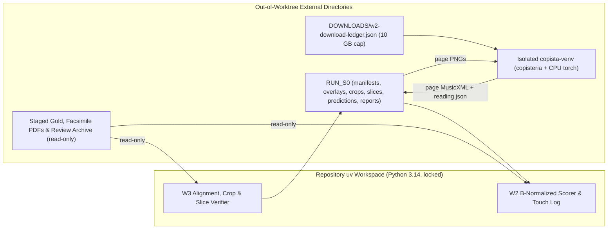

# Evaluation and Real-Data Alignment Protocol

This record is the protocol that
[OMR-REQ-016 through OMR-REQ-020](requirements.md#real-data-splits-and-recognizer-evaluation)
require for W2 ([Issue #1489](https://github.com/hcoona/three/issues/1489)) and
W3 ([Issue #1490](https://github.com/hcoona/three/issues/1490)) under the
accepted [Delivery Wave](../../../../../docs/delivery-wave.md) entry. Its
consumers are W2 and W3 implementers, their independent reviewers, and
downstream W4 through W8 workstreams.

This record governs external reader installation, `copista-28m` weight
downloads, private-input overlay/crop generation, `TEST`/private-gold access
and formal Stage S0 baseline evidence once accepted on `main` under applicable
[record-system review](../../../../../.github/skills/record-system-review/SKILL.md),
[research-evidence review](../../../../../.github/skills/research-evidence-review/SKILL.md)
and [shared engineering guidance](../../../../../.github/skills/engineering-guidance/SKILL.md);
later changes to splits, masks, normalization rules, candidate tool revisions
or statistical estimators require applicable review before formal baseline runs
or private/external operations rely on them, while in-scope local unit tests
and synthetic-fixture debugging without external installs, network downloads or
private-gold access on working branches run without pre-merge protocol gates
([project namespaces](../../../../../docs/governance/record-system.md#project-namespaces)).
Results belong in `#1489` and `#1490`, not in this protocol.

Statements about external tools and repositories are source findings and cite
their primary sources under [Evidence limits and source basis](#evidence-limits-and-source-basis).
Statements about the staged local archive are local read-only observations.
Statistical models and projections are inferences whose assumptions are stated
explicitly.

## Subject, scope and authority

The protocol covers two coupled subjects that share the `23` accepted private
gold pieces, their `92` restored US-Letter facsimile pages, and their
anonymized batch namespace (`gold-01` through `gold-23`):

1. **W3 real-data alignment, piece-level split and system slicing
   ([OMR-REQ-016](requirements.md#omr-req-016-unified-real-data-alignment-and-piece-level-split-manifest),
   [OMR-REQ-017](requirements.md#omr-req-017-overlay-qa-normalized-system-crops-and-printed-system-slices)):**
   building the unified `23`-piece manifest (`omr-real-manifest-v1`), freezing
   the `7`-piece `TEST` set and `16`-piece `TRAIN/DEV` pool, approving
   bounding-box overlays across all `92` restored facsimile pages, cutting
   `14.0 px` staff-space-normalized system crops, and verifying that canonical
   per-system `Text Score 2` slices along physical printed-system boundaries
   re-assemble and convert forward with zero counted content differences.
2. **W2 recognizer evaluation, Stage S0 baselines and discrepancy schema
   ([OMR-REQ-018](requirements.md#omr-req-018-b-normalized-per-category-recognition-and-second-reader-scorer)
   through
   [OMR-REQ-020](requirements.md#omr-req-020-discrepancy-sidecar-and-round-logging-schema)):**
   scoring candidate MusicXML readings against accepted gold in drafter and
   blind second-reader modes, recording test-set touches in
   `DOWNLOADS/w2-touch-log.jsonl` (`w2-touch-log.jsonl`), evaluating Stage S0
   baselines for initial agent drafts (`build-01` or `draft.musicxml`) and stock
   `copista-28m`, re-fitting the review-pass model against the labeled `T01`
   whole-round dataset joined to the historical review archive, and emitting the
   versioned `omr-discrepancy-log-v1` schema.

W1's [comparison protocol](comparison-protocol.md) remains the authority for
converter round-trip fidelity (`T(Y)` versus `Y`) and element/category
definitions. Recognizer evaluation reuses its annotated element model and `19`
supplementary checks through a fail-closed recognizer adapter rather than
treating noisy recognizer errors as converter `ProtocolDefectError` stops.

## Tools, environment and isolated reader setup

- **Host and workspace:** local Windows or WSL2 host running the repository's
  locked Python `3.14` `uv` workspace (`musicdiff 6.0`, `music21 10.5.2`,
  `converter21 4.0.2`). When MuseScore `4.x` is invoked for optional import or
  rendering checks, its exact version, executable `SHA-256` and `MuseScore4.ini`
  preference state are recorded per run as in the
  [comparison protocol](comparison-protocol.md#tools-and-environment).
- **External directory confinement:** all W2 and W3 mutable state (`RUN`,
  `DOWNLOADS`, overlays, crops, slices, predictions and isolated environments)
  lives outside every local Git worktree, enforced by
  `check_outside_repository` and serialized per run directory by
  `RUN/.run.lock`.
- **Lossless page extraction without host OS mutation:** each page of the `23`
  staged restored US-Letter facsimile PDFs stores one embedded `2300 x 3185`
  raster at `~303.33 dpi` (local read-only observation from capture
  `manifest.json`). Page extraction reads that embedded raster directly into
  lossless grayscale/RGB `.png` (`RUN/pages/<gold_id>-p<NN>.png`, verifying
  exact `2300 x 3185` dimensions) using pure-wheel Python PDF image extraction
  in the isolated environment (`pypdfium2` / `pillow`), so `copisteria` receives
  `.png` page inputs via `copisteria.vision.page.scan.from_png` without
  requiring host `apt` installation of `poppler-utils`.
- **Isolated `copista-28m` environment and pinned revisions:**
    - Installed into `DOWNLOADS/w2-copista-venv` (`uv venv --python 3.14` or
      `>=3.12`), leaving root `pyproject.toml`, `uv.lock`, `mise.toml` and CI
      unchanged.
    - **Reader code:** `https://github.com/kobimusic/copisteria` (`Apache-2.0`)
      pinned at commit `2be4a9d88c15fd6b36fe7c97e0fa816f08804570` (`v1.3.4` +
      post-`1.3.4` error-message/CI commits; `requires-python >= 3.12`),
      installed with CPU PyTorch wheels
      (`--extra-index-url https://download.pytorch.org/whl/cpu` on non-GPU
      hosts: `torch`, `torchvision`, `numpy`, `pillow`, `scipy`,
      `opencv-python-headless` or `opencv-python`, `pypdfium2`).
    - **Model weights:** `https://huggingface.co/kobimusic/copista-28m`
      (`Apache-2.0`) pinned at revision
      `44464d11234a22ba23634ec8eb1e31e3b012021a`:
      `evidence-2m.pt` (`8,145,299` bytes, LFS `SHA-256`
      `7a3eb0362b44016e941680c5df1e133239576592ab134057c3dbac8e9f3b8838`) and
      `small/v7_obj-recall-30m_best.pt` (`115,352,175` bytes, LFS `SHA-256`
      `9f1db282271fb1064461387da4a2e15de14b099c49b619c21429cdc45be85cfe`),
      summing to `123,497,474` weight bytes (`124,314,338` bytes repository
      `usedStorage`).
    - **Resolved environment provenance:** `RUN/run.json` and the sanitized S0
      report record the resolved Python interpreter version and installed
      package versions of both the repository `uv` workspace and
      `DOWNLOADS/w2-copista-venv`, together with the verified `copisteria`
      commit/archive `SHA-256` and both weight `SHA-256` digests.
    - **W2/W3 download ledger (`DOWNLOADS/w2-download-ledger.json`):** separate
      from W1's closed `2,350,276,855`-byte ledger. Before any network fetch of
      the `copisteria` archive or `copista-28m` weight files (and recording new
      wheel bytes fetched when creating `w2-copista-venv`), the installer
      reserves and records exact byte counts and `SHA-256` digests against the
      `10,000,000,000`-byte (`10 GB`) cumulative W2/W3 fuse, including failed
      or aborted transfers, and reuses verified cached files on rerun at `0`
      new network bytes.

## Real-data alignment, overlay QA and system crops

### Piece-level split and `TEST` exclusion manifest

All `23` accepted private gold pieces (`2,033` measures, `92` source pages;
`model_draft_free = true` across all `23`) are partitioned at the piece level:

- **Frozen `TEST` (`7` pieces, `432` measures, `23` source pages; `113`
  accepted-MusicXML `<print>` segments, ~`111` printed grand-staff systems
  pending overlay QA):**
    - Book 1 (`19` pages, `368` measures): `gold-01` (`G3`, `19`m, `2`pp),
      `gold-02` (`G1`, `105`m, `6`pp), `gold-03` (`G1`, `124`m, `4`pp),
      `gold-04` (`G1`, `37`m, `2`pp), `gold-05` (`G1`, `40`m, `4`pp), and
      `gold-06` (`G2`, `43`m, `1`p).
    - Book 2 (`4` pages, `64` measures): `gold-18` (`G6`, `64`m, `4`pp).
- **Non-test `TRAIN/DEV` (`16` pieces, `1,601` measures, `69` source pages;
  `380` accepted-MusicXML `<print>` segments, ~`323` printed grand-staff
  systems pending overlay QA):**
    - Book 1 (`40` pages, `1,116` measures): `gold-07` through `gold-15`
      (`G1`, `G2`, `G4`, `G5`).
    - Book 2 (`21` pages, `294` measures): `gold-16`, `gold-17`, `gold-19`,
      `gold-20` and `gold-21` (`G6`).
    - Group `G7` (`8` pages, `191` measures): `gold-22` and `gold-23`.

`RUN/splits/test-exclusion.json` records each `TEST` piece's `gold_id`, `group`,
`book_cohort`, accepted MusicXML `sha256`, facsimile PDF `sha256`, and per-page
`source_sha256` digests (with zero private paths or titles) so downstream W4,
W6 and W8 pipelines verify non-overlap mechanically.

### Unified alignment schema (`omr-real-manifest-v1`)

`RUN/alignment/manifest.json` (`schema: "omr-real-manifest-v1"`, kept local
because it links local workspace digests, with sanitized aggregate summaries in
`RUN/report/`) records for each piece `gold-01` through `gold-23`:

- **Piece record:** `gold_id`, `split` (`"TEST"` or `"TRAIN_DEV"`), `group`
  (`"G1"`..`"G7"`), `book_cohort` (`"book1"`, `"book2"` or `"g7"`),
  `measure_count`, `page_count`, `xml_print_system_count`,
  `printed_system_count`, `model_draft_free` (`true`), `accepted_xml_sha256`,
  `initial_draft_kind` (`"build-01"` or `"draft.musicxml"`),
  `initial_draft_sha256`, `label_tier` (`"L0"` when all five review aspects in
  batch-root `aspect-convergence.json` satisfy the deterministic convergence
  predicate `not bool(entry.get("pending_complete_clean_scopes"))` and contain
  none of `("partial", "holdsremain", "remainingfull", "fresh-round-pending",
"otherrowsandaspectsremain", "userholdremains", "userquestion")` in
  `entry["status"].lower()`, yielding `17` `"L0"` pieces including all `7`
  `TEST` pieces, and `"L1"` on the remaining `6` `TRAIN/DEV` pieces `gold-07,
08, 10, 11, 13, 22`), `converged_aspects` (subset of
  `["pitch", "duration", "accidental-display", "articulations-lines",
"annotations"]` passing that predicate), `open_reading_masks` (list of
  `{measure_ordinal, categories, basis}` compiled from `T01#6`, batch-root
  `aspect-convergence.json` and `final-summary.md` and frozen by `SHA-256` in
  `manifest.json` before any `copista-28m` execution), and
  `open_reading_masks_sha256`.
- **Page record (`1..page_count`):** `page_index` (`1`-based within piece),
  `global_page_index` (`1..92`), `facsimile_size_px` (`[2300, 3185]`),
  `effective_dpi` (`303.33`), `has_pencil_annotations` (`bool`), `quad_norm`
  (stored `4`-corner normalized quad for raw `.heic` capture),
  `raw_crop_status` (`"absent"` unless raw `.heic` captures are staged locally),
  `ordinal_range` (`[first_ordinal, last_ordinal]`), and `overlay_qa_status`
  (`"approved"` required for all `92` pages).
- **System record (`1..printed_system_count`):** `system_index` (`1`-based
  within piece), `page_system_index` (`1`-based on page), `ordinal_range`
  (`[first_ordinal, last_ordinal]`, partitioning `1..measure_count` across
  consecutive systems of the piece, with an explicit split-measure flag if any
  printed measure wraps across a system break), `facsimile_box_px`
  (`[x0, y0, x1, y1]` in `2300 x 3185` page pixels), `staff_lines_y_px` (top
  and bottom staff `5`-line y-coordinates), `staff_space_px`, `box_trust`
  (`"verified"` after overlay QA), `barline_x_px` (list of interior/bounding
  barline x-coordinates in facsimile page pixels when present), and
  `barline_trust` (`"verified" | "detected" | "approximate" | "absent"`).

### Overlay QA, normalized crops and printed-system slice round-trip

1. **System box reconciliation and `92`-page overlay QA:** for each page, horizontal
   ink-run staff detection on the `2300 x 3185` raster locates the `5`-line
   treble and bass staves of each grand-staff system and reconciles the system
   count and `[first_ordinal, last_ordinal]` ranges against the workspace's
   `notes.md` and `source-map*.json` records. Vertical crop bounds cover all
   connected ink components belonging to that system (with a minimum margin of
   `4.0 * staff_space_px` above the top treble line and below the bottom bass
   line, clamped at midpoints to adjacent systems or page borders so pedals,
   hairpins, dynamics, headings, ottavas and slurs are not clipped); horizontal
   bounds span `[max(0, ink_x0 - 2.0 * staff_space_px), min(2300, ink_x1 +
2.0 * staff_space_px)]`. Annotated overlay images
   (`RUN/overlays/<gold_id>-p<NN>.png`) are inspected across all `92` pages and
   recorded in `RUN/alignment/overlay-qa.json`; any clipped system or count
   mismatch is corrected in box parameters and re-inspected until `92 / 92`
   pages are `approved`.
2. **Normalized system crops:** each approved system box is resampled with
   bicubic/Lanczos interpolation by scale factor `14.0 / staff_space_px` to
   `RUN/crops/facsimile/<gold_id>-s<NN>.png`, recording exact crop dimensions
   and scale in `manifest.json`.
3. **Printed-system `Text Score 2` slices and zero-difference gate:** each
   accepted gold MusicXML is converted via `from_musicxml_text`, sliced along
   the verified physical `printed_system_count` `ordinal_range` boundaries into
   system documents (`RUN/slices/<gold_id>/s<NN>.txt`) carrying exact
   `carry-in` and `carry-out` state, re-assembled via `assemble_documents`, and
   converted back via `to_musicxml`. `compare_file(T_reassembled, Y_gold)` must
   report `0` counted content differences on `23 / 23` pieces; any nonzero
   difference stops execution with `StopConditionError` (exit status `2`).
   Because all Stage S0 comparisons operate on whole pieces (`23` pieces), gold
   and draft MusicXML scores are never page-sliced or tie-clipped at page turns.

## Recognizer comparison and B-normalization

### Fail-closed candidate comparison (`score_prediction`)

Candidate whole-piece MusicXML readings (`build-01`/`draft.musicxml` or
page-concatenated `copista-28m` `P_piece`) can contain noisy recognition
artifacts or measure-count shifts that a deterministic converter never emits.
`score_prediction(candidate_xml, reference_xml)` adapts the W1 comparator as
follows:

1. **Reference pre-validation vs. candidate fail-closed boundary:**
   `install_coupling_fix()`, `annotate(reference_xml)` and reference
   supplementary-item extraction run **outside** the candidate fail-closed
   handler. Any parse or `ProtocolDefectError` on `Y_gold` (or an unassignable
   instrument defect not caused by invalid candidate structure) raises
   `ProtocolDefectError` and stops the run; when `D_piece` serves as the
   comparison target in blind second-reader mode (`P_piece` vs. `D_piece`),
   `D_piece` is validated separately first (and any unparsable `D_piece`
   measure marks that draft measure uncertain with `u = 1.0` rather than
   attributing a false failure to `P_piece`).
2. **Content-preserving two-part single-staff grand-staff merge:** when a
   candidate MusicXML represents a piano grand staff as `2` `<part>` elements of
   `1` staff each with equal `<measure>` counts (as `copisteria` emits when a
   page's left brace is missed), the adapter merges them into one
   `<part id="P1">` with `<staves>2</staves>`: per measure it scales
   `<divisions>`, `<duration>` and `<offset>` to `lcm(div_1, div_2)`, tags
   `<clef number="1|2">` and `<staff>1|2</staff>`, shifts part-2 `<voice>` IDs
   into a disjoint range, renumbers part-2 spanner `number` attributes across
   all spanner families (`slur`, `wedge`, `dashes`, `pedal`, `octave-shift`,
   `wavy-line`, `bracket`) into disjoint positive integers so spanners cannot
   collide, inserts `<backup>` between the two staves, and emits
   `<key number="1|2">` if staff keys differ (marking the unit
   `parse_valid = false` if measure counts, `<time>` or barline structures
   conflict).
3. **Fail-closed handling of unparsable or wrong-staff-count candidates:** if a
   candidate XML is missing, fails XML or `music21` parsing, has `0`, `1` or
   `>= 3` total staves across its parts, or triggers a candidate-side structural
   error (such as >4 voices on one staff or corrupt candidate spanners), the
   candidate unit is recorded with `parse_valid = false` and its error reason:
   every unmasked reference measure of `reference_xml` is marked erred across
   all categories present in that measure, and `musicdiff` normalized edit
   distance for that failed unit is `1.0` (`omr_ed = symbols_gt`,
   `symbols_pred = 0`).
4. **Grand-staff DP measure alignment and measure-ordinal attribution:**
   `compare_annotated(t_score, y_score)` passes candidate `t_score` first and
   reference `y_score` second. Rather than pairing measures by raw positional
   index (where one missed or extra bar line cascades across the rest of the
   piece), `score_prediction` aligns the `1..M_cand` candidate measures and
   `1..M_ref` reference measures once across both staves jointly via
   Needleman-Wunsch / Hirschberg dynamic programming summing staff-1 and staff-2
   bar edit costs (`Comparison._bars_diff` substitution vs. bar insertion and
   deletion costs):
    - **Matched measure pairs `(m_cand, m_ref)`:** notes, rests, chords and
      extras are compared within each aligned `(m_cand, m_ref)` pair, and
      per-measure supplementary checks run with candidate event measure indices
      remapped through `m_cand -> m_ref` (anchoring multi-measure spans at
      `start.measure + 1` and score-level `heading` at `m_ref = 1`), mapping
      every difference to `1`-based `m_ref` and its W1 content category across
      all `27` W1 content categories (`CONTENT_CATEGORIES`, mapped onto the `26`
      non-layout `T01` category IDs in
      [Requirements](requirements.md#relation-to-the-existing-category-vocabulary)
      and onto the `5` review aspects via `P* -> "pitch"`,
      `D* -> "duration"`, `X1 -> "accidental-display"`,
      `L* -> "articulations-lines"`, `N* -> "annotations"`).
    - **`insbar` (`obj2 = y_bar`, missing reference bar with no `m_cand`
      partner):** marks every category present in `m_ref` plus `repeat_ending`
      (`N8`) as erred on `m_ref` (and drops unmatched candidate-endpoint
      multi-measure supplementary items accordingly).
    - **`delbar` (`obj1 = t_bar`, extra candidate bar with no `m_ref`
      partner):** attributes its decomposed symbol categories plus
      `repeat_ending` (`N8`) and `rhythm_rest` (`D1`) to the immediately
      preceding matched `m_ref` (or `m_ref = 1` when before the first matched
      bar).

### Normalization and mask layers

Every scored drafter run reports three explicit layers side by side so
normalization never conceals raw differences:

- **Layer 0 (`raw_content`):** all `27` W1 content categories (`26` non-layout
  `T01` IDs) unnormalized and unmasked; `layout` (`C`-class / `Y1`) differences
  are tallied separately and never enter recognition error rates.
- **Layer 1 (`b_normalized`, primary reader-agnostic `A`-error metric, `26`
  active non-`beam` W1 content categories):** applied identically to
  `e_build01` and `e_candidate`, normalizing representation/toolchain
  (`B`-class) artifacts that do not alter musical reading and applying
  pre-registered `open_reading_masks` when scoring against `Y_gold`:
    1. `beam` (`L6`: primary/secondary beaming, `beam_hooks`, `rest_beams` and
       `cross_barline_beams`);
    2. `time_signature` symbol-only differences (`common`/`cut` glyph vs.
       numeric `4/4`/`2/2` when `beats` and `beat-type` match);
    3. single-note adjacent vs. substitution fingering encoding
       (`((*note_key, 1, d1), (*note_key, 2, d2))` vs.
       `((*note_key, "sub", d1, d2))`) keyed by exact
       `(measure, staff, onset, grace_position, written_pitch)` so cross-pitch
       chord finger swaps remain counted as errors;
    4. `voice_order` `excluded_voices` and stemless candidate voices
       (`NO_STEMMED_EVENT` when candidate note stems are omitted); separately,
       for `build-01`/`draft.musicxml`, filtering the `326` confirmed-`B` loci
       (`324` unique `(gold_id, target_measure_ordinals, w1_category)` triples)
       of `req012-private-manifest.json` (excluding the `1` `gold-03`
       duplicate-slur `A` entry) is reported as an **auxiliary diagnostic
       breakdown** without altering primary `Layer 1` `e_build01` or masking
       other categories in those measures;
    5. pre-registered `open_reading_masks` from `manifest.json` mask only the
       listed `(gold_id, measure_ordinal, category)` triples when scoring
       against `Y_gold` (never during blind second-reader flag generation); on
       `TRAIN/DEV`, `L1`-converged-aspect-only rates are also reported alongside
       full `TRAIN/DEV` rates.
- **Layer 2 (`in_vocabulary`, stacked onto Layer 1 `b_normalized`, `22` active
  W1 content categories):** for `copista-28m`, which architecturally emits
  neither fingering (`N6`) nor un-OCRed text (`N3`, `N4`, `N7`, `N9`), excludes
  `{fingering, text, tempo_rehearsal, heading}` (`4` W1 categories) on top of
  Layer 1's `beam` exclusion (`27 - 1 - 4 = 22`). Drafter readiness is judged on
  Layer 1 per category; Layer 2 isolates symbol/line recognition within
  `copista-28m`'s native vocabulary.

## Stage S0 baselines and isolated copista-28m execution

### Arm S0-A: Initial agent drafts (`build-01` / `draft.musicxml`)

- **Inputs:** for `22` pieces, `<workspace>/build-01/score.musicxml`; for
  `gold-07` (whose directory sequence starts at `build-02-repairs72`),
  `<workspace>/draft.musicxml` (`139` draft measures vs. `140` gold measures;
  `gold-11` has `54` draft measures vs. `52` gold measures; all `7` `TEST`
  pieces match gold measure counts `1:1`). Exact `SHA-256` digests are recorded
  in `manifest.json`.
- **Execution:** evaluated whole-piece (`D_piece` vs. `Y_gold` across all `23`
  pieces), reporting Layer 0 (`raw_content`, reconciling directly with `T09#4`'s
  `64 / 99` changed measures on `gold-01, 04, 06`), primary Layer 1
  (`b_normalized`), Layer 2 (`in_vocabulary`), and the auxiliary `OMR-REQ-012`
  `326`-locus (`324`-triple) breakdown on `TEST` and `TRAIN/DEV` separately.

### Arm S0-B: Stock `copista-28m` (drafter and blind second-reader modes)

- **Page inference and posterior extraction:** a deterministic worker invokes
  `DOWNLOADS/w2-copista-venv` on the `92` extracted facsimile page `.png` files
  (`texts=None`, `device="cpu"` by default, `OMP_NUM_THREADS=1`, bounded worker
  pool), running `copisteria.pipeline`'s cached `detections` + `read_revised` +
  `write.write` and writing per page:
    - `RUN/preds/copista-28m/<gold_id>-p<NN>.musicxml`;
    - `RUN/preds/copista-28m/<gold_id>-p<NN>.posteriors.json`: because
      `texts=None` keeps multi-measure rest expansion disabled (`mr = None` in
      `copisteria/write.py`), emitted `<measure>` elements `1..M_pred_page` map
      strictly `1:1` to `copisteria` system bar columns `(system_idx, col_idx)`.
      For each emitted measure column, the worker aggregates over real
      (`real.p >= 0.5`) non-`measure` symbols across that column's staves:
      `n_symbols`, `min_real_p`, `mean_real_p`, `min_cls_p` and `mean_cls_p`,
      defining per-measure raw confidence
      `raw_conf(m_pred) = min_cls_p(m_pred)` (`0.0` when `n_symbols == 0`).
- **Deterministic page-to-piece assembly (`P_piece`):** for each piece
  `gold-01` through `gold-23`, valid page outputs `p = 1..page_count` are
  normalized (`1+1` staves -> `<staves>2</staves>`), unified to whole-piece
  `<divisions> = lcm_p(div_p)`, spanner-renumbered into disjoint per-page ranges,
  and concatenated with sequential `measure number="1..M_pred_piece"` and
  `<print new-page="yes"/>` on the first measure of each valid page `p >= 2` (so
  `comparison.py:_remove_reprints` strips repeated page-opening clefs, keys and
  unprinted meters while retaining misread changes). If page `p` fails
  (`parse_valid = false`), `0` measures are emitted for page `p` and `p` is
  recorded in `failed_pages` (if every page of a piece fails, the whole piece is
  marked `parse_valid = false`).
- **Drafter scoring (`P_piece` vs. `Y_gold`):** `score_prediction(P_piece,
Y_gold)` evaluates the whole piece while forbidding DP bar matches
  `(m_cand, m_ref)` for any `m_ref` inside `p`'s `manifest.json` `ordinal_range`
  when `p in failed_pages`, so each failed-page reference measure is left as an
  unmatched `insbar` (charged once in `omr_ed` via `y_bar.notation_size()` and
  marked erred across all categories present in `m_ref` without double-counting
  gold symbols).
- **Blind second-reader scoring (`P_piece` vs. `D_piece`, zero gold
  consultation during flag formation):**
    - `score_prediction(P_piece, D_piece)` runs whole-piece using **unmasked**
      Layer 2 (`in_vocabulary` stacked on `b_normalized`, **without** consulting
      `Y_gold`, gold `ordinal_range`, or `open_reading_masks`). If
      `len(failed_pages) > 0` on a piece, blind second-reader mode fails closed
      on that piece without consulting page breaks or `Y_gold`, marking all
      `1..M_draft` measures of that piece uncertain (`delta(m_draft) = 1`,
      `u(m_draft) = 1.0`). On a piece with `0` failed pages, each draft measure
      `m_draft in 1..M_draft` receives discrepancy count `delta(m_draft)` (`> 0`
      automatically on `insbar`) and uncertainty
      `u(m_draft) = 1.0 - raw_conf(m_pred)` from its aligned `m_pred`
      (`u(m_draft) = 1.0` when `m_draft` is unaligned `insbar` or `D_piece`
      failed validation on `m_draft`).
    - Across a split (`TEST` or `TRAIN/DEV`), draft measures are ranked in
      strict deterministic order: descending by
      `(delta(m_draft) > 0, delta(m_draft) * (0.5 + 0.5 * u(m_draft)),
u(m_draft))`, breaking ties ascending by `(gold_id, m_draft)`. At budget
      fraction `alpha in {0.10, 0.20}`, the top `K = floor(alpha * M_draft_split)`
      draft measures are flagged (alongside the unthresholded disagreement set
      `delta(m_draft) > 0`).
    - **Post-flag recall evaluation against `Y_gold`:** only after flags on
      `1..M_draft` are fixed, `D_piece` is aligned to `Y_gold` via grand-staff
      DP measure alignment and gold `open_reading_masks` are applied: a gold
      `A`-error measure `m_gold` is caught iff either (i) its matched `m_draft`
      (or preceding anchor `m_draft`, or `m_draft = 1`, when `m_gold` is an
      unmatched `insbar` missed by `D_piece`) is flagged, or (ii) an unaligned
      `delbar` extra draft measure attributed to `m_gold` is flagged (matching
      the `delbar` error-attribution rule symmetrically). Primary late-round
      survivor recall is the share of `T01` `r >= 3` `A`-survivor anchor gold
      measures in the evaluated split (`23` anchor gold measures in `TEST`
      `gold-01..04`; `0` in `TRAIN/DEV`, reported as `null` / `"unavailable"`
      when the survivor denominator is `0`) caught under the same mapping, with
      the `25`-measure expanded gold span (`measure_end` and
      `start.measure..after.measure`) reported alongside. Conditional
      error-correlation `c'` is the share of unmasked `(m_gold, category)`
      errors of `D_piece` where `P_piece` also errs on the same `(m_gold,
category)` (`null` / `"unavailable"` when `D_piece` has `0` errors in
      that scope).

## Statistical estimators, review-pass model and gates

- **Primary drafter estimator (overall, per aspect and per category):** paired
  measure-level `A`-error rate:
    - Overall on a split of `M` reference measures:
      `e = (1 / M_unmasked) * sum_m I[measure m has >= 1 unmasked Layer-1 error]`
      (where `M_unmasked` excludes only measures whose `26` Layer-1 categories
      are all masked).
    - Per category `c`:
      `e_c = (1 / M_c) * sum_{m not masked on c} I[measure m has >= 1 Layer-1 error in c]`,
      where `M_c` is all reference measures in the split not masked on `c` in
      `open_reading_masks` (reporting the count of gold measures where `c` is
      present alongside `M_c`).
    - Per review aspect `a` (pooling its member Layer-1 categories):
      `e_a = (1 / M_a) * sum_{m in S_a} I[measure m has >= 1 Layer-1 error in an unmasked c in a]`,
      where `S_a` (of size `M_a`) is the set of reference measures in the split
      with at least one unmasked member category `c in a` (`null` /
      `"unavailable"` if `M_a == 0` or `M_c == 0`).
    - Paired ratio (`overall`, per aspect `a`, and per category `c`):
      `r = e_candidate / e_build01` (`null` / `"unavailable"` whenever the
      baseline denominator `e_build01 == 0`), reported on `TEST` (`432`
      measures, `7` pieces; plus Book 1 `6` pieces vs. Book 2 `gold-18`) and
      separately on `TRAIN/DEV` (`1,601` measures, `16` pieces).
- **Piece-cluster bootstrap (`95%` CI, overall, per aspect and per category):**
  `B = 10,000` bootstrap replicates with fixed PRNG seed `20261123`, resampling
  pieces with replacement within the evaluated split (`7` pieces on `TEST`, `16`
  on `TRAIN/DEV`) and recomputing `e` and paired ratio `r` overall, per aspect
  and per category on each replicate (`2.5%` and `97.5%` percentiles; for ratios
  `r`, CIs are reported over replicates with positive baseline denominator when
  at least `50%` of replicates have `e_build01 > 0` and `e_build01 > 0` on the
  observed split, otherwise `null` / `"unavailable"`, with exact
  leave-one-piece-out jackknife range reported alongside; `null` /
  `"unavailable"` on the `1`-piece Book 2 `TEST` slice). One-way ANOVA `ICC`
  over binary measure `A`-error indicators is reported whenever piece count
  `>= 2` and total variance `> 0` (`null` / `"unavailable"` otherwise).
- **Secondary `musicdiff` `6.0` normalized edit distance:** computed from
  `musicdiff` symbol-level edit costs and `AnnScore.notation_size()` as
  `d_norm = omr_ed / (symbols_pred + symbols_gt)` (`0.0` when
  `symbols_pred + symbols_gt == 0`, `1.0` when `parse_valid == false` with
  `omr_ed = symbols_gt, symbols_pred = 0`), reported both over the DP-aligned
  score comparison (with per-category `op.edit_distance` attribution) and as raw
  whole-score `musicdiff` `PassDiagnostic` distance.
- **Confidence calibration (`copista-28m`, fitted strictly without `TEST`):**
  for each reference measure `m_gold`, raw confidence is
  `raw_conf(m_gold) = raw_conf(m_pred) = min_cls_p(m_pred)` on matched
  `(m_pred, m_gold)` pairs (`0.0` on unmatched `insbar` or failed pages). To
  produce calibrated probabilities without touching `TEST`, a `2`-parameter
  L2-regularized monotone Platt/temperature map
  `cal_conf(m) = sigmoid(a * logit(clip(raw_conf(m), 1e-4, 1 - 1e-4)) + b)`
  (`a >= 0`, minimizing negative log-likelihood plus
  `0.5 * 1e-3 * (a^2 + b^2)`, falling back per training fold to that fold's
  constant empirical base rate whenever the training fold is single-class) is
  fitted predicting absence of unmasked Layer 2 measure error on `TRAIN/DEV`
  (`16` pieces): out-of-fold leave-one-piece-out predictions score `TRAIN/DEV`,
  and the full-`TRAIN/DEV` fit scores `TEST` (`0` `TEST` labels used in
  fitting). Reports `AUROC` (`null` / `"unavailable"` if all measures in the
  split are in one class) plus `10`-bin equal-width `ECE` on `[0, 1]` and `AURC`
  for both `raw_conf` and `cal_conf`.
- **Historical review-archive extraction and review-pass model:**
    - Whole-round `A/B/C/R` counts (`225` live `r<N>` rows: `224` in
      `T01-findings-classified.json` `SHA-256` `5bea8318...` plus `1` live
      `r<N>` row in `T01-findings-addendum.json` `SHA-256` `456d206a...`; see
      [Validation basis](requirements.md#frozen-toolchain-class-set-and-replay-protocol))
      are joined deterministically by `(piece, folder, entry_index)` to their
      archive `findings.json` containers (`findings`, `confirmed_findings`,
      `confirmed_differences`, `changes` followed by `rejected_visual_finding`,
      `rejected_provisional_finding` followed by `finding`,
      `withdrawn_intermediate_findings`, `withdrawn_findings`, and
      `general_findings`, plus the `2` `gold-01` `r1` narrative `R` retractions
      outside `findings.json` in `T01-findings-classified.json` rows `222–223`)
      and gold measure keys (`measure`, `ordinal`, `ordinal_measure`,
      `start.measure`, `start[0]` on `[measure, staff, onset]` arrays,
      `ordinals`, `measure_reference`, `anchor.measure`, `anchors[*].measure`,
      excluding `candidate_measure`). All `225` live `r<N>` rows feed
      whole-round `A_t`/`phi_hat` totals; `211` rows resolve to gold measures
      and the `14` unlocated score-level/withdrawn/retracted `N9`/`Y1`/`R` rows
      attach to `measure_ordinal = 1` with `unlocated_piece_level = true` in
      `archive_round_counts`. This resolves all `29` `r >= 3` `A`-class rows
      onto `23` unique anchor gold measures (`25` measures under expanded gold
      spans `measure_end` and `start.measure..after.measure`) in `TEST`
      `gold-01..04`. The `1,495` post-`T01` review files (`1,512` archive-wide
      files lacking `r<N>` or `review-<N>` folder names across the `1,591` total
      `findings.json` files) carry no whole-round `t` or `A/B/C/R` field;
      confirmed post-`T01` `B` loci join separately from
      `req012-private-manifest.json`.
    - Expected passes for an `n`-measure piece (`n = 88` reference) at measure
      `A`-error rate `e`, reviewer per-round recall `d`, fix-regression rate
      `r_reg = 0.10` (`q = 1 - d * (1 - r_reg)`), and non-recognition finding
      rate `phi` per pass follow the `T09#3`/`T09#5` Poisson thinning model:
      `lambda_0 = n * e`, `mu_t = lambda_0 * d * q^(t - 1)`,
      `P_clean(t) = exp(-mu_t - phi)`, and
      `E[passes] = 1 + sum_{t=1}^{500} prod_{s=1}^t (1 - P_clean(s))` (reporting
      the Poisson-occupancy variant `lambda_0 = -n * ln(1 - min(e, 0.999999))`
      alongside). From `T01` round-`t` `A`-finding totals `A_t`, net retention
      is `q_hat = sum_{t >= 2} A_t / sum_{t >= 1} A_t` (excluding the documented
      `gold-01` `67`-item single-pass fingering burst, with with-burst reported
      alongside) and reviewer recall is
      `d_hat = min(1.0, max(0.0, (1.0 - q_hat) / (1.0 - r_reg)))`, paired with
      mean `t >= 3` non-`A` findings per piece-round (`phi_hat`), reporting
      `E[passes]` under both pre-registered `(d = 0.6, phi = 0.5)` and
      `(d_hat, phi_hat)`.
- **Downstream gates recorded for W6/W7 reference (not S0 pass/fail stops):**
  Per-category element recall `recall_c = identical_c / elements_c` (`null` /
  `"unavailable"` when `elements_c == 0`) is computed over unmasked `Y_gold`
  Layer 1 (`b_normalized`) `ElementTally` elements across the DP-aligned
  measures (`identical_c = 0` on unmatched `insbar` or `parse_valid == false`;
  `P1` pools `pitch` + `chord_membership`, `N4`/`N7` share `tempo_rehearsal`).
  Drafter `G1` (`r <= 0.33`, bootstrap `95%` upper bound `<= 0.60`), `G2`
  (per-category recall drop `recall_c(baseline) - recall_c(candidate) <= 0.05`
  on `P1, D3, L2, X1, L3, L1, N2, N6`, using `agent-build-01` as the S0
  comparison baseline and `max(recall_c(agent-build-01),
recall_c(copista-28m))` for W6 drafter promotion, or `null` / `"unavailable"`
  if `elements_c == 0`), `G3` (`>= 99%` parse rate and non-increasing `B`
  rate), `G4` (`AUROC >= 0.75`); Second-reader `GO` (catches `>= 50%` of
  baseline `A`-error measures while flagging `<= 20%` of measures). Stage S0
  measures where `build-01` and stock `copista-28m` stand against these gates.

## Discrepancy and round-logging schema

`RUN/logs/discrepancy-log.jsonl` and its JSON Schema descriptor
`RUN/logs/omr-discrepancy-log-v1.schema.json` emit one validated JSON object per
aligned `(reader_id, gold_id, measure_ordinal, draft_measure_ordinal)` row
(covering `1..M_gold` with `draft_measure_ordinal: int | null` from `D_piece <->
Y_gold` alignment plus `insbar_anchor_draft_ordinal: int | null` on missing-draft
`insbar` rows, and emitting extra unaligned `delbar` draft rows with
`measure_ordinal: null`, `delbar_attributed_gold_ordinal: int`,
`page_index: null`, `system_index: null` so all `1..M_draft` flags and all
`1..M_gold` labels are preserved losslessly):

- `schema`: `"omr-discrepancy-log-v1"`
- `run_id`, `reader_id` (`"agent-build-01"` or `"copista-28m@44464d1"`), `split`
  (`"TEST"` or `"TRAIN_DEV"`), `gold_id`, `group`,
  `page_index` (`int | null`), `system_index` (`int | null`),
  `measure_ordinal` (`int | null`), `draft_measure_ordinal` (`int | null`),
  `insbar_anchor_draft_ordinal` (`int | null`),
  `delbar_attributed_gold_ordinal` (`int | null`)
- `parse_valid` (`bool`), `capability_excluded_categories` (`list[str]`),
  `open_reading_masked_categories` (`list[str]`), `converged_aspects`
  (`list[str]`)
- `layer0_categories` (`dict[str, int]`), `layer1_a_categories`
  (`dict[str, int]`), `layer2_invocab_categories` (`dict[str, int]`),
  `layout_c_count` (`int`)
- `raw_confidence` (`float | null`), `calibrated_confidence` (`float | null`),
  `second_reader_disagreement_count` (`int | null`), `second_reader_score`
  (`float | null`), `flagged_at_20pct` (`bool | null`)
- `archive_round_counts` (`list[{round: int | null, source: "t01_round" |
"req012_post_t01", unlocated_piece_level: bool, by_class_category:
dict[str, dict[str, int]]}]` keying `A/B/C/R` counts by category for offline
  W7/W8 calibration)

## Test-set touch governance, bounds, stops and cleanup

- **Touch ledger (`DOWNLOADS/w2-touch-log.jsonl`, `w2-touch-log.jsonl`):**
  append-only JSONL record written before scoring any `TEST` piece (including
  runs that later fail or abort), recording `utc`, `run_id`, `git_commit`,
  `code_tree_sha256`, `reader_id`, `reader_sha256` (`null` for static
  `agent-build-01`, `copisteria` archive `SHA-256` for `copista-28m`),
  `weights_sha256` (`null` for `agent-build-01`, combined `SHA-256` over
  `evidence-2m.pt` and `small/v7_obj-recall-30m_best.pt` for `copista-28m`),
  `split`, `piece_count`, `command` (`list[str]`) and `purpose`
  (`"S0-baseline"`). Stage S0 performs zero parameter or threshold tuning on
  `TEST` and has an accident-fuse ceiling of `6` cumulative S0 `TEST` touch
  records (covering `agent-build-01` and `copista-28m@44464d1` plus bounded
  bug-fix reruns, all reported); future W6 training pilots remain capped at `3`
  `TEST` touches per pilot.
- **Finite execution bounds:**
    - `10,000,000,000` bytes (`10 GB`) cumulative W2/W3 download cap in
      `DOWNLOADS/w2-download-ledger.json`;
    - `6` cumulative S0 `TEST` touch records in
      `DOWNLOADS/w2-touch-log.jsonl`;
    - `92` pages (`23` pieces) for overlay extraction, slice verification,
      `build-01` scoring and `copista-28m` inference (`300`-second per-page /
      per-piece worker timeout).
- **Stop conditions (exit status `2`, recorded in `RUN/run.json`):**
    1. `RUN` or `DOWNLOADS` lies inside any local Git worktree, or project
       `CODE_PATHS` are dirty during a formal S0 run;
    2. any download would push `w2-download-ledger.json` past `10,000,000,000`
       bytes, or `copisteria` commit / `copista-28m` per-file byte size or
       `SHA-256` fails verification;
    3. appending a `TEST` evaluation would exceed the `6`-touch S0 ceiling in
       `DOWNLOADS/w2-touch-log.jsonl`;
    4. `overlay-qa.json` does not mark all `92 / 92` pages `"approved"` before
       final crop export or S0 `copista-28m` scoring;
    5. printed-system `Text Score 2` slice re-assembly produces `> 0` content
       differences on any of the `23` accepted gold pieces, or `Y_gold` / the
       comparison instrument raises `ProtocolDefectError`;
    6. any public report or schema summary fails the `OMR-REQ-015` privacy scan
       (private paths, usernames, workspace names, book/piece titles or score
       excerpts).
- **Cleanup:** temporary worker scratch files are deleted after each page or
  piece; staged private archives and `gold-cache` remain untouched (`SHA-256`
  verified before and after the run); `RUN` artifacts stay outside the
  repository until the owner deletes them after results review.

## Evidence limits and source basis

### Evidence limits

- Stage S0 measures `build-01`/`draft.musicxml` and stock `copista-28m` on the
  `92` restored US-Letter facsimile pages (`~303.33 dpi`) of the owner's `23`
  accepted arrangements (`2` confirmed books plus group `G7`, `7` groups total).
  Because full raw `.heic` camera captures are not staged in the current local
  bundle, `G5` (`raw photo vs. flat scan`) is not evaluated in S0 unless raw
  `.heic` files or flat scans are later staged.
- Concatenating per-page `copista-28m` outputs into `P_piece` cannot join ties,
  slurs, hairpins or pedals across the `92 - 23 = 69` page turns because
  `copisteria` reads one page at a time; cross-page spanner breaks in `P_piece`
  therefore reflect that genuine single-page reader limitation without clipping
  `Y_gold` or `D_piece`.
- `copista-28m` runs without an external text-OCR sidecar (`*.texts.json`
  absent), so `heading`, `text` and `tempo_rehearsal` words are absent by
  design; reporting Layer 0 (`27` W1 categories), Layer 1 (`26` non-`beam` W1
  categories) and Layer 2 (`in_vocabulary`, `22` W1 categories) separates
  vocabulary scope from symbol detection accuracy.
- `build-01` vs. accepted gold measures net differences between initial entry
  and final accepted transcription: residual undetected errors in accepted gold
  (mitigated by `L0` multi-aspect review and `open_reading_masks`) are bounded
  but not provably zero.

### Source basis and mutable-source recheck

- `musicdiff` `v6.0.0` (`MIT`, commit
  `0368856e8561ba655d990c00c7ae46a2408f071c`) and normalized edit distance
  definition:
  [gregchapman-dev/musicdiff](https://github.com/gregchapman-dev/musicdiff/tree/0368856e8561ba655d990c00c7ae46a2408f071c)
  and Martinez-Sevilla et al. (2025),
  [arXiv:2506.10488v3](https://arxiv.org/abs/2506.10488v3).
- `kobimusic/copisteria` (`Apache-2.0`, commit
  `2be4a9d88c15fd6b36fe7c97e0fa816f08804570`):
  [`pyproject.toml`](https://github.com/kobimusic/copisteria/blob/2be4a9d88c15fd6b36fe7c97e0fa816f08804570/pyproject.toml),
  [`src/copisteria/pipeline.py`](https://github.com/kobimusic/copisteria/blob/2be4a9d88c15fd6b36fe7c97e0fa816f08804570/src/copisteria/pipeline.py),
  [`src/copisteria/vision/page/scan.py`](https://github.com/kobimusic/copisteria/blob/2be4a9d88c15fd6b36fe7c97e0fa816f08804570/src/copisteria/vision/page/scan.py),
  [`src/copisteria/front.py`](https://github.com/kobimusic/copisteria/blob/2be4a9d88c15fd6b36fe7c97e0fa816f08804570/src/copisteria/front.py),
  [`src/copisteria/read.py`](https://github.com/kobimusic/copisteria/blob/2be4a9d88c15fd6b36fe7c97e0fa816f08804570/src/copisteria/read.py),
  and
  [`src/copisteria/write.py`](https://github.com/kobimusic/copisteria/blob/2be4a9d88c15fd6b36fe7c97e0fa816f08804570/src/copisteria/write.py).
- `kobimusic/copista-28m` (`Apache-2.0`, revision
  `44464d11234a22ba23634ec8eb1e31e3b012021a`; `evidence-2m.pt` `8,145,299`
  bytes, `SHA-256`
  `7a3eb0362b44016e941680c5df1e133239576592ab134057c3dbac8e9f3b8838`;
  `small/v7_obj-recall-30m_best.pt` `115,352,175` bytes, `SHA-256`
  `9f1db282271fb1064461387da4a2e15de14b099c49b619c21429cdc45be85cfe`;
  `123,497,474` weight bytes, `124,314,338` bytes repository `usedStorage`):
  [Hugging Face model repository](https://huggingface.co/kobimusic/copista-28m/tree/44464d11234a22ba23634ec8eb1e31e3b012021a).
- Mutable-source recheck:
    - **Trigger:** a run configures a `kobimusic/copisteria` commit other than
      `2be4a9d88c15fd6b36fe7c97e0fa816f08804570` or a `kobimusic/copista-28m`
      revision other than `44464d11234a22ba23634ec8eb1e31e3b012021a`.
    - **Evaluator:** the run operator before executing on `TEST`, and the
      independent `research-evidence-review` reviewer on the protocol or results
      carrier.
    - **Action:** inspect `LICENSE`, `pyproject.toml`, `pipeline.py`, `read.py`,
      `write.py` and the Hugging Face revision metadata/digests, and update this
      protocol's pinned revisions and vocabulary/isolation statements before
      relying on the run.
    - **Fallback and required outcome:** until that recheck passes independent
      `research-evidence-review`, the installer refuses unpinned revisions and
      no public W2 baseline claim may rely on them.
