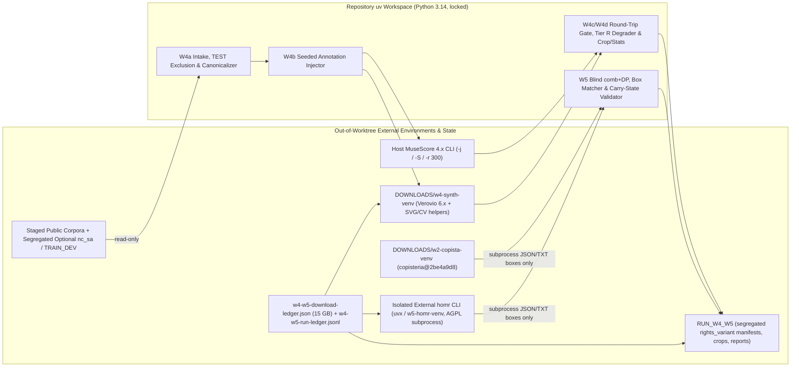

# Synthetic Data and System-Detection Protocol

## Authority, scope and evidence boundaries

This record is the protocol that
[OMR-REQ-021 through OMR-REQ-025](requirements.md#synthetic-training-data-engine-and-system-detection-benchmark)
require for W4 ([Issue #1491](https://github.com/hcoona/three/issues/1491),
with sub-issues [Issue #1493](https://github.com/hcoona/three/issues/1493)
W4a, [Issue #1494](https://github.com/hcoona/three/issues/1494) W4b,
[Issue #1495](https://github.com/hcoona/three/issues/1495) W4c, and
[Issue #1496](https://github.com/hcoona/three/issues/1496) W4d) and W5
([Issue #1497](https://github.com/hcoona/three/issues/1497)). Its consumers
are W4 and W5 implementers, their independent reviewers, and downstream W6
([Issue #1498](https://github.com/hcoona/three/issues/1498)) through W8
([Issue #1500](https://github.com/hcoona/three/issues/1500)) training and
workflow workstreams. With the W4 Stage S3 proof (`w4-w5-formal-2`,
[#1491 comment 7130836402](https://github.com/hcoona/three/issues/1491#issuecomment-7130836402),
owner acceptance in
[#1491 comment 7138762309](https://github.com/hcoona/three/issues/1491#issuecomment-7138762309))
and W5 system-detection and assembly benchmarks (`w4-w5-formal-w5-traindev` and
`w4-w5-formal-w5-locked92`,
[#1497 comment 7130837035](https://github.com/hcoona/three/issues/1497#issuecomment-7130837035),
owner acceptance in
[#1497 comment 7138763006](https://github.com/hcoona/three/issues/1497#issuecomment-7138763006))
accepted at `main` commit `abef22536dbd82ca654fa7cd599204c4e59efd62` and their
[PR #1752](https://github.com/hcoona/three/pull/1752)
[Delivery Wave](../../../../../docs/delivery-wave.md) entry retired, this
protocol does not itself grant work: any new external installation, network
download, batch synthetic rendering (including the deferred `20k`–`50k`-page
bulk pilot), detector training, or private-page execution requires a new
accepted Delivery Wave entry.

When authorized by an accepted [Delivery Wave](../../../../../docs/delivery-wave.md)
entry, this record governs:

- external rendering, rasterization and experimental system-detection package
  or CLI installation and optional `nc_sa` symbolic corpus acquisition;
- symbolic corpus intake, `rights_variant` partitioning, piano filtering,
  `TEST` exclusion and canonical normalization (W4a);
- seeded performance-annotation injection and unlabeled clutter policy (W4b);
- dual-engine (`MuseScore 4.x` and `Verovio 6.x`) layout-matched batch
  rendering, coordinate extraction and `>= 50`-piece round-trip label gates
  (W4c);
- `Tier R` restored-facsimile residue degradation, co-warped `14.0 px` system
  crops, YOLO page box labels, `>= 100`-page throughput benchmarking and
  sim-to-real crop statistics (W4d);
- blind off-the-shelf system-detection benchmarking (`comb + DP`,
  `kobimusic/copisteria`, and isolated external `homr` CLI) and candidate
  carry-state system-assembly validation (W5).

It does not re-specify the [Text Score 2 format](text-format.md), the W1
[comparison protocol](comparison-protocol.md), or the W2/W3
[evaluation and real-data alignment protocol](evaluation-protocol.md). Every
statement below distinguishes **source findings** (verified against immutable
public repositories or repository commits), **runtime observations** (measured
in earlier accepted runs), **inferences**, and **hypotheses**:

- Per [OMR-REQ-014](requirements.md#omr-req-014-evidence-separation), Stage S3
  renderer round-trip fidelity, crop-statistic alignment and rendering
  throughput are properties of the synthetic data engine on the tested inputs
  and tool versions; they do not establish trained recognizer accuracy,
  sim-to-real transfer or review-effort savings (deferred to W6).
- W5 system-detection missed/merged/split counts measure geometric page-box
  segmentation on the staged `92` restored US-Letter facsimile pages; they make
  no claim about raw `.heic` camera photos or downstream symbol-recognition
  accuracy.
- Per [OMR-REQ-015](requirements.md#omr-req-015-privacy-and-fixture-provenance),
  private paths, piece or book titles and copyrighted score content remain
  strictly local and read-only; public summaries report only aggregate metrics,
  `rights_variant` counts, book-group identifiers (`G1` through `G7`) and
  anonymized batch numbers (`gold-01` through `gold-23`).

## Environment, tool isolation and mutable-source rechecks

- **Host and repository workspace:** Windows or Windows + WSL2 host running the
  repository's locked Python `3.14` `uv` workspace (`musicdiff 6.0`,
  `music21 10.5.2`, `pillow`, `numpy`; local host profile observed in
  `w2-s0-formal-3` environment attestation summarized in
  [#1489 comment 7108805391](https://github.com/hcoona/three/issues/1489#issuecomment-7108805391)
  and
  [#1490 comment 7108804779](https://github.com/hcoona/three/issues/1490#issuecomment-7108804779),
  and re-recorded per run in `RUN/environment.json`). All `RUN` and `DOWNLOADS`
  paths lie outside every git worktree
  (`harness/records.py:check_outside_repository`).
- **Two-phase separation between metered provisioning (`setup-w4-w5`) and
  offline execution:**
    - **Phase 1 (`setup-w4-w5`, zero private inputs):** resolves exact wheel,
      checkpoint and optional corpus URLs, meters all HTTP `HEAD`/`GET` metadata
      and payload transfers in `DOWNLOADS/w4-w5-download-ledger.json` by
      reserving byte budgets atomically under a file lock before transfer,
      pre-warms any model checkpoints (including `homr`'s bundled/downloaded
      weights, `liebharc/homr@0dd86956` `homr/main.py#L489-L507`) on a synthetic
      repository fixture with **zero** access to private paths, and fails closed
      if any tool attempts an unmetered network fetch.
    - **Phase 2 (Stage S3 and W5 execution, strictly offline):** before exposing
      any private page or `private_traindev` score to an external subprocess,
      the supervisor verifies process-tree loopback-only network isolation
      (`unshare -rn` on Linux/WSL2 verified by probing that only `lo` exists
      with zero external interfaces and spawning with `close_fds=True`,
      aborting immediately before touching private inputs if process-tree
      network isolation cannot be established; host Windows `MuseScore4.exe`
      runs on public `permissive` / `nc_sa` synthetic scores under its existing
      local CLI lock, while optional `private_traindev` re-rendering runs
      through the offline Linux `Verovio` engine inside `unshare -rn` unless
      host Windows `MuseScore4.exe` offline execution is separately verified)
      alongside `HF_HUB_OFFLINE=1`,
      `TRANSFORMERS_OFFLINE=1`, `PIP_NO_INDEX=1`, and `UV_OFFLINE=1`. Each
      private-page subprocess runs inside an isolated network and PID namespace
      with an inner deadline wrapper
      (`unshare -rn --pid --fork --kill-child=SIGKILL -- timeout -s KILL 300s
<cmd>`), receiving a stripped environment plus only a single temporary
      page PNG inside an ephemeral scratch directory; `timeout -s KILL` runs as
      namespace PID `1` while the outer `unshare` wrapper remains alive (never
      signaled directly by the parent) so `proc.wait()` returns with
      `proc.returncode >= 0` only after `unshare` itself has reaped PID `1` and
      the kernel has completed PID-namespace teardown (`pid_namespaces(7)`). On
      exit, error or deadline, the **parent supervisor's `finally` block** waits
      (`<= 5.0 s` past the inner `timeout`) for `unshare` to exit with
      `proc.returncode >= 0` before deleting that scratch directory — if
      `unshare` has not exited, exited via signal (`proc.returncode < 0`), or
      directory removal fails within `5.0 s`, the supervisor retains the scratch
      directory untouched and aborts fail-closed. Captured `stdout`/`stderr` is
      passed through `harness/privacy.py:scrub_paths` and stripped of score
      titles before any diagnostic is written (`homr/main.py#L236-L250`).
- **Host MuseScore Studio 4 CLI (primary W4c renderer):**
    - Source findings in upstream `musescore/MuseScore` tags
      [`v4.7.6`](https://github.com/musescore/MuseScore/releases/tag/v4.7.6)
      (`96480d58445e3b24b230a3fe7d4725d639aa2eb3`) and
      [`v4.7.7`](https://github.com/musescore/MuseScore/releases/tag/v4.7.7)
      (`b750c43e316cf6a00e70451870b231b12f400bda`), `GPL-3.0` with font
      exception (`LICENSE.txt#L1-L20`):
        - `-j` (`--job`) accepts a JSON array of `{"in": "...", "out": [...]}`
          objects (`src/converter/internal/convertercontroller.cpp#L297-L407`);
          omitting a page selector on `"score.png"` emits `1`-based page files
          `score-1.png`, `score-2.png`, ... (`convertercontroller.cpp#L436-L459`).
        - `-S` (`--style`) loads an `.mss` style sheet before layout
          (`src/project/internal/notationproject.cpp#L198-L216`), and `-r`
          (`--image-resolution`, integer DPI; `--dpi` does not exist,
          `src/app/internal/commandlineparser.cpp#L88-L115`) sets raster DPI.
        - `.mpos` (measure boxes) and `.spos` (segment boxes) write
          `<score><elements><element id="..." x="..." y="..." sx="..." sy="..." page="..."/></elements><events>...</events></score>`
          (`src/notation/internal/positionswriter.cpp#L45-L135`), where `page`
          is **`0`-based** (`page="0"` corresponds to `score-1.png`) and
          coordinates use internal geometry multiplied by `12 * R / 1200` while
          untrimmed PNG rasters use `R / 1200`
          (`positionswriter.cpp#L148-L150`,
          `src/importexport/imagesexport/internal/pngwriter.cpp#L42-L64`). Thus
          **nominal untrimmed PNG pixels equal sidecar units divided by `12.0`**
          (`x_px = x / 12.0`, `y_px = y / 12.0`, `w_px = sx / 12.0`,
          `h_px = sy / 12.0`), provided `-T` (`--trim-image`) is **never**
          passed (`src/engraving/rendering/score/paint.cpp#L125-L130`).
    - Isolation and recheck: host upgrades are permitted without version
      allowlists; every run records exact MuseScore version and executable
      `SHA-256`, enforces the eight MusicXML preferences and `.musescore.lock`
      of the [comparison protocol](comparison-protocol.md#tools-and-environment),
      and runs an automated single-page calibration check before each batch
      verifying that `element.{x,y,sx,sy} / 12.0` encloses rendered staff ink
      within `<= 2.0 px` if MuseScore's version series is outside `4.7.6`/`4.7.7`.
- **Isolated `w4-synth-venv` (`Verovio 6.x` secondary W4c renderer + CV/SVG
  stack):**
    - Source findings in upstream `rism-digital/verovio` tag
      [`version-6.4.1`](https://github.com/rism-digital/verovio/releases/tag/version-6.4.1)
      (`fbe8f4695ab0a123cb096e0cf92354b44f7a2fb8`, PyPI `verovio 6.4.1`,
      `LGPL-3.0-only` in `pyproject.toml#L5-L12` and `COPYING.LESSER#L1-L11`):
        - `verovio.toolkit()` provides `setOptions(dict)`, `loadData(str)`,
          `getPageCount()` and `1`-based `renderToSVG(pageNo)`
          (`bindings/python/verovio.pyi#L10-L46`). Verified layout options
          include `font` (`Leipzig`, `Bravura`, `Gootville`, `Leland`,
          `Petaluma`), `pageWidth`, `pageHeight`, `scale`, `breaks` (`auto`,
          `encoded`, `smart`), `svgBoundingBoxes`, `svgViewBox`, `pedalStyle`
          (`auto`, `line`, `pedstar`, `altpedstar`), `spacingLinear`,
          `spacingNonLinear`, `spacingStaff`, `spacingSystem`, `barLineWidth`,
          `staffLineWidth` and `stemWidth` (`src/options.cpp#L25-L57`,
          `#L1103-L1538`).
        - **Critical format and SVG geometry boundaries (source findings):**
          Verovio imports MusicXML (`src/toolkit.cpp#L664-L678`) but **does not
          export MusicXML** — `getMEI()` and `saveFile()` emit MEI only, and
          `setOutputTo("musicxml")` is unsupported
          (`src/toolkit.cpp#L932-L1068`, `src/options.cpp#L1991-L2030`). Its SVG
          writer emits `<g class="system">` and `<g class="measure">` containers
          inside a nested `definition-scale` `<svg viewBox="...">` and
          `<g class="page-margin" transform="translate(...)">` hierarchy
          (`src/svgdevicecontext.cpp#L550-L577`,
          `src/view_page.cpp`); mapping SVG bounding boxes to raster pixels must
          apply the full cumulative root-to-element SVG affine transform rather
          than raw local coordinates.
    - Installed into out-of-worktree `DOWNLOADS/w4-synth-venv` during
      `setup-w4-w5` alongside pinned wheels for SVG-to-PNG rasterization
      (`resvg_py` / `pyvips` / `pypdfium2`) and `opencv-python-headless` /
      `scipy`, recording exact package versions and wheel `SHA-256` digests in
      `RUN/environment.json` and accounting every fetched byte in
      `DOWNLOADS/w4-w5-download-ledger.json`.
- **Isolated W5 system-detection external tools:**
    - **`kobimusic/copisteria` (`Apache-2.0`):** reuses the staged
      `DOWNLOADS/w2-copista-venv` and `DOWNLOADS/w2-copista-cache` at pinned
      commit `2be4a9d88c15fd6b36fe7c97e0fa816f08804570` (`copista-28m` revision
      `44464d11234a22ba23634ec8eb1e31e3b012021a`), reading `Layout.systems` and
      `Layout.staves` (`src/copisteria/front.py#L64-L93`) via an offline
      out-of-process JSON worker receiving only a single page PNG path.
    - **`liebharc/homr` (`AGPL-3.0`, external CLI subprocess only):** source
      findings at [`v0.7.1`](https://github.com/liebharc/homr/tree/v0.7.1)
      (`0dd86956b15982c4e388029054920ce655a13886`, PyPI `homr 0.7.1`,
      `LICENSE#L1-L10`): CLI entrypoint `homr` (`pyproject.toml#L180-L181`)
      accepts `page.png --write-staff-positions` (`homr/main.py#L428-L482`),
      writing `<stem>.txt` rows `class cx cy width height` (`1` = grand staff,
      `0` = single staff) flattened across `MultiStaff` groups without group IDs
      and normalized to HOMR's internally border-cropped and resized image
      (`homr/main.py#L116-L146`, `homr/staff_position_save_load.py#L16-L42`),
      alongside `<stem>.musicxml` and `<stem>_teaser.png`
      (`homr/main.py#L236-L252`). Provisioned during `setup-w4-w5` into
      `DOWNLOADS/w5-homr-venv` (with checkpoints pre-cached and metered in
      `w4-w5-download-ledger.json`), and executed during W5 **strictly offline**
      as an external subprocess on one ephemeral scratch PNG copy cleaned up
      under the Phase-2 parent supervisor's `finally` rule above; repository
      code never imports or vendors any `homr` module.
- **Mutable-source recheck rule:** whenever **any** resolved executable, wheel,
  package, checkpoint or corpus identity (version, git commit or `SHA-256`
  digest — including upgrades, downgrades or same-version rebuilds) differs from
  the source-verified pins recorded above, `setup-w4-w5` / preflight runs an
  automated contract and license recheck before admitting the asset:
    1. verifies the upstream repository/package license file and scope at the
       resolved commit/version (`GPL-3.0` CLI for MuseScore, `LGPL-3.0-only` for
       Verovio, `Apache-2.0` for `copisteria`, `AGPL-3.0` CLI-only for `homr`,
       `CC0-1.0` / `CC-BY-4.0` / `CC BY-NC-SA 4.0` per `rights_variant`);
    2. runs a two-system synthetic repository fixture (including mixed `line`
       and `pedstar` pedal forms) checking CLI flags, MuseScore `.mpos` `/ 12.0`
       pixel alignment (`<= 2.0 px`), Verovio MEI
       export + nested SVG `viewBox`/margin coordinate alignment (`<= 2.0 px`)
       and `musicdiff` round-trip behavior, and `homr` CLI offline invocation;
    3. stops fail-closed (or requires reverting to a verified digest) if any
       automated contract or license check fails; when automated checks pass on
       a changed identity, attaches the recorded preflight check output and
       exact version/digest provenance to the governing W4/W5 protocol or
       results PR/Issue carrier for **independent `research-evidence-review`
       disposition** (`docs/governance/controls.yaml`), keeping the changed
       asset out of formal Stage S3 and W5 runs until accepted (host upgrades
       are never blocked during ordinary development).

## W4a: Symbolic source intake, rights partitioning and TEST exclusion

1. **`rights_variant` physical partitioning:** every retained source entry and
   every downstream injected/rendered/degraded artifact is written under
   `RUN/synthetic/<rights_variant>/...` and carries `rights_variant` in its
   JSONL manifest row (`omr-synth-manifest-v1`):
    - **`permissive` (default Stage S3 backbone, `0` new corpus bytes):**
        - **OpenScore Lieder `v3.0.0`** (source finding: commit
          `f44e962a1ff85ddcc2f6f42bed3b0c529555ee15`, `CC0-1.0` in
          `LICENSE.txt#L1-L5` and `README.md#L158-L160`, Zenodo
          `10.5281/zenodo.15450144`), staged at `DOWNLOADS/Lieder-v3.0.0.zip`
          (`1,356` `.mscx` files). Exported to MusicXML via host `MuseScore
4.x`, retaining the single two-staff `keyboard.piano` accompaniment
          via `harness/corpora.py:extract_piano`.
        - **PDMX filtered piano subset** (source finding: Zenodo record
          `15571083`, DOI `10.5281/zenodo.15571083`, deposit metadata
          `CC-BY-4.0`, `pnlong/PDMX@7abbd6d9` `wrangling/pdmx.py#L175-L287` and
          `wrangling/full.py#L52-L58`), staged at `DOWNLOADS/PDMX.csv` and
          `DOWNLOADS/mxl.tar.gz`. Retained only when
          `subset:no_license_conflict == True`, `subset:all_valid == True`,
          `license_url` is in `PDMX_LICENSES` (`CC0-1.0` or Public Domain Mark
          `1.0`), `n_tracks == 1`, de-duplicated (`subset:deduplicated == True`
          when column present, plus exact canonical `Text Score 2` `SHA-256`
          deduplication), non-empty (`>= 8` measures, `0` all-rest pieces), and
          passing the two-staff piano screen. Because `subset:no_license_conflict`
          is an uploader-assertion + metadata-copyright screen rather than a
          judicial rights determination, per-score `license_url` and source IDs
          are preserved in `omr-synth-manifest-v1`.
    - **`nc_sa` (optional segregated bucket):** permitted only for upstream
      repositories whose pinned commit carries an explicit `CC BY-NC-SA 4.0`
      license file verified before fetch (source findings:
      `DCMLab/mozart_piano_sonatas@5337257a5318711e6302cfe85c3f1a6ade3c6271`
      `LICENSE#L1-L3`,
      `DCMLab/beethoven_piano_sonatas@ea7181bff88abc8713257234f7ec4033178c57a9`
      `LICENSE#L1-L3`,
      `fosfrancesco/asap-dataset@afc815c75c42e83a79c03feb6da8a35e77d4c6b8`
      `LICENSE.md#L1-L3`,
      `craigsapp/mozart-piano-sonatas@0f1f49d914494f8461709b2a2642153bb240c6da`
      `LICENSE.txt#L1-L9`,
      `craigsapp/haydn-piano-sonatas@299abc8f11eed4982f9fcddf2fc519b7b50b6214`
      `LICENSE.txt#L1-L9`, and
      `craigsapp/scarlatti-keyboard-sonatas@567731b13020802a422bd5aa49347ee3dac3ea25`
      `LICENSE.txt#L1-L10`). Repositories lacking a repository-level reuse
      license in their git tree (source findings: inspected trees
      `craigsapp/beethoven-piano-sonatas@2d6627b8a2b085145b2be48e640fbb993771542b`
      and `craigsapp/chopin-mazurkas@fc3a8fb6cba7fdad2183fee67853789bbfadb3a0`
      contain no `LICENSE*` file) are classified `rights_unverified` and
      rejected fail-closed.
    - **`private_traindev` (optional local-only bucket):** restricted to the
      `16` accepted non-test `TRAIN_DEV` pieces from `gold-cache` (`gold-07`
      through `gold-17` and `gold-19` through `gold-23`), never mixed into
      `permissive` or `nc_sa` manifests.
2. **Forbidden label sources:** public image-plus-partial-label datasets
   (`GrandStaff`, `Camera-GrandStaff`, `FP-GrandStaff`, `OLiMPiC`,
   `Polish-scores`, `SMB`) are never ingested into any W4 manifest.
3. **Fail-closed `TEST` exclusion (`OMR-REQ-021`):** during local intake setup
   (strictly within the Delivery Wave's digest-and-work-identity scope and
   without parsing `TEST` gold notation), the intake gate verifies
   `test-exclusion.json` (`SHA-256`
   `65a798c51095c8cd6f37374428e6e9a39cba7954d33fe047b49959f87538a80b`), the raw
   byte `SHA-256` digests of the `7` staged `TEST` files in `gold-cache`
   (`gold-01` through `gold-06` and `gold-18`), and the normalized
   `(composer_surname, work_title_tokens, catalogue_or_opus)` work identities
   from authorized non-notation batch/archive metadata (`--gold-status` and
   private-archive metadata). During intake filtering, an individual candidate
   is **rejected from admission and counted** if:
    - its work-identity metadata (composer and work title in `PDMX.csv` /
      Lieder header / MusicXML `<work>` or `<movement-title>` / `<creator>`) is
      missing, blank or generic placeholder text (`Untitled`, `Piano Solo`,
      numeric-only) (`excluded_missing_metadata`);
    - its raw file `SHA-256`, extracted MusicXML `SHA-256`, or batch ID matches
      any `TEST` digest or batch entry (`excluded_test_match`); or
    - its normalized composer + work/catalogue tokens match any of the `7`
      `TEST` works (`excluded_test_match`).
      Separately, the run **aborts immediately** if `test-exclusion.json`, raw
      `TEST` file digests or the `7` non-notation `TEST` work-identity records
      cannot be loaded and verified before intake begins, or if the post-intake
      manifest audit detects **any** `TEST`-matching entry inside an admitted
      manifest (`> 0` post-admission leak). Public reports emit only aggregate
      `excluded_missing_metadata` and `excluded_test_match` counts (`OMR-REQ-015`).
4. **Canonical normalization and coverage accounting:** every retained score
   must pass `harness/screen.py` structural screening, `from_musicxml(X) ->
v2_canon -> to_musicxml(v2_canon) -> X_canon`, and `music21.converter.parse`
   without error, recording per-measure category densities (`N1`–`N8`, `L1`–`L5`,
   `D2`–`D4`, `D7`, `P2`–`P3`, `X1`, voice multiplicity) and shortfalls against
   W3 `TRAIN_DEV` reference rates.

## W4b: Seeded annotation injection and unlabeled clutter policy

1. **Gap-driven seeded injection (`OMR-REQ-022`):** given canonical `v2_canon`
   (or `X_canon`) and deterministic sample seed `SHA-256(run_seed || source_id
|| variant_idx)`, the injector samples target per-piece densities spanning
   the real books' multi-modal distributions (`0x` sparse through classical
   dense) and injects only the positive shortfall above the piece's native rate:
    - **`N6` fingering:** digits `1`–`5` (`1` digit per chord notehead, stacked,
      never duplicating an existing fingering on the same pitch, skipping rests
      and tied-continuation notes), piece-level density mixture (`25%`
      fingering-free `0.0/m`, `50%` moderate `1.5–3.5/m`, `25%` dense
      `5.0–8.5/m`), default treble-above / bass-below with sampled flips;
    - **`N1` dynamics and `N2` hairpins:** `Text Score 2`-supported dynamic
      marks and non-overlapping same-staff wedges anchored to valid beat/note
      onsets, including coupled dynamic-plus-hairpin pairs;
    - **`N3` expression text and `N4` tempo text:** sampled from the supported
      `Text Score 2` Italian/English performance vocabulary at measure/phrase
      boundaries;
    - **`N5` pedal:** both `line` (bracket) and `pedstar` (`Ped.` + `*`) styles
      on bass-staff harmonic spans (`1` beat to `2` measures, clean re-pedaling
      at barlines/chords);
    - **`L2` slurs, `L3` articulations/fermatas, `L4` arpeggios and `P3`
      ottavas:** valid note-to-note slurs (including overlapping, explicit-side
      and cross-staff slurs), staccato/accent/tenuto/fermata tokens, multi-note
      chord arpeggios, and high/low ledger-passage `8va`/`8vb` spans;
    - **Source oversampling weights:** weight candidate sampling toward pieces
      containing `D2` tuplets, `D4` cross-staff events, `P2` mid-piece clef
      changes and `N8` repeat/volta barlines so batch rates meet or exceed
      `TRAIN_DEV` reference rates.
2. **Validation and injection log:** every injected score `v2_inj` must pass
   `validate_document` (`0` diagnostics, `0` review markers) and `to_musicxml`
   to `X_inj`, writing a structured `injection-log.json` listing exact counts
   injected per category and measure.
3. **Unlabeled clutter invariant:** non-notation distractors (faint graphite
   pencil strokes, handwritten `1`–`5` digits near or away from printed notes,
   mirrored backside show-through and inner-margin gutter shading) are applied
   exclusively in W4d on rasterized page PNGs **after** W4c label derivation.
   Automated scenario tests verify that `v2` labels with clutter enabled vs.
   disabled under the same layout seed are byte-identical.

## W4c: Dual-engine rendering, layout matching and round-trip gates

1. **Layout-density and style sampling (`G1`–`G7` coverage):** before rendering
   each score, sample target `measures_per_system` (spanning `2` to `7+`,
   centered around `4.3–4.7`) and `systems_per_page` (`3` to `6`, spanning `9.5`
   to `48` measures/page across plate groups `G1`–`G7`), encoding explicit
   `<print new-system="yes"/>` / `<print new-page="yes"/>` breaks when using
   encoded-break mode (or sampling spacing/scale parameters in auto-break mode)
   and sampling music fonts (`Leland`, `Bravura`, `Gootville`, `Petaluma`, plus
   MuseScore's `Finale Maestro` / `Finale Broadway` and Verovio's `Leipzig`) and
   line widths (`staffLineWidth`, `stemWidth`, `barLineWidth`), while keeping
   Verovio `pedalStyle="auto"` so per-mark `line` versus `pedstar` pedal forms
   encoded in `X_inj` are never overridden at render time
   (`src/pedal.cpp#L93-L106`).
2. **Engine A — Host `MuseScore 4.x` driver, ordinal reconciliation and gate:**
    - Invokes `MuseScore4.exe -j job.json -S style.mss -r 300` (never `-T`),
      requesting `["score.png", "score.musicxml", "score.mpos", "score.spos"]`.
    - Rejects any score with collapsed multimeasure rests and enforces **two
      separate fail-closed structural checks**: (a) an exact `1:1` bijection
      between `.mpos` `<element>` IDs (`0..M-1`) and canonical `MeasureBlock`
      ordinals (`1..M`), and (b) exact equality of `(page, system ->
[first_ordinal, last_ordinal])` spans between `.mpos` `(page, y)` measure
      groups and `harness/systems.py:system_starts(R_ms.musicxml)`.
    - Maps `.mpos` `0`-based `page` to `score-{page + 1}.png`, converts
      `x, y, sx, sy` to untrimmed `300 dpi` PNG pixels by dividing by `12.0`,
      and expands each system box (and each measure box's `[y0, y1]` over its
      horizontal `[x0, x1]` barline span) vertically up to the mid-gap boundary
      with adjacent systems so all rendered ledger lines, pedals, dynamics,
      fingerings and ottavas assigned to that system/measure are enclosed (`0`
      ink-clipping check).
    - **Round-trip label gate:** runs `compare_file(R_ms.musicxml, X_inj)` (all
      19 W1 content categories + supplementary checks) and `musicdiff 6.0`
      detail comparison. Any piece with a counted content difference in a
      target category is **dropped** and logged by category; passing re-exports
      are converted via `from_musicxml(R_ms.musicxml)` and sliced per verified
      system via `split_score`, confirming `0` differences on `assemble`
      round-trip.
3. **Engine B — Isolated `Verovio 6.x` driver, ordinal reconciliation and gate:**
    - Runs offline in `DOWNLOADS/w4-synth-venv`: loads `X_inj` into
      `verovio.toolkit()` with `svgBoundingBoxes=True` and `svgViewBox=True`,
      renders pages `1..getPageCount()` via `renderToSVG(p)` and rasterizes
      each SVG to an untrimmed `~300 dpi` PNG.
    - Applies the full cumulative SVG affine transform (including
      `definition-scale` `viewBox` scaling and `page-margin` translation,
      `src/svgdevicecontext.cpp#L550-L577`) to extract `<g class="system">` and
      `<g class="measure">` pixel bounding boxes (checked on synthetic
      calibration fixtures to match rasterized ink within `<= 2.0 px`, with
      both system and measure vertical bounds expanded up to the mid-gap
      boundary to enclose all system-owned notation ink), and verifies an exact
      **`1:1` measure-count and order match** between the ordered SVG `<g
class="measure">` elements across pages and the canonical `MeasureBlock`
      ordinals (`1..M`) of `X_inj` (dropping any mismatch fail-closed).
    - **Fail-closed round-trip label gate:** exports `R_vrv.mei = tk.getMEI()`,
      parses both `X_inj` and `R_vrv.mei` (`format="mei"`) in `music21 10.5.2`,
      and pairs `musicdiff 6.0` with **direct `R_vrv.mei` XML supplementary
      checks** comparing expected values, staff/measure attachments and counts
      against `X_inj` for the target facets that `musicdiff 6.0` does not
      establish (`fingering` MEI fingering elements, `cross_staff` `@staff`,
      `voice` multiplicity/order, effective `pedal` style resolving `<pedal
@form>` with fallback to `scoreDef/@pedal.style` and default sign
      `Ped.`/`*` under `pedalStyle="auto"`, checked in `setup-w4-w5` / preflight
      on a single rendered fixture containing both `line` and `pedstar` styles,
      `ottava` `<octave>`, `arpeggio` `<arpeg>`, `slur` `<slur>`, `hairpin`
      `<hairpin>` and `dynamics` `<dynam>`), while **excluding before `verovio` emission any
      score containing an applicable W1
      [supplementary-check facet](comparison-protocol.md#supplementary-checks)
      (such as extended-trill `wavy-line` spans, text-extension `dashes`,
      voice-leading `bracket` lines, parenthesized
      noteheads/accidentals/metronomes, `other-dynamics` text, tremolo stroke
      counts, `discontinue` pedal-line ends or beam-hook directions) unless an
      equivalent fixture-tested MEI check is enabled** (routing those scores to
      `MuseScore 4.x`, where `compare_file` checks all W1 supplementary facets).
      Any sample with a non-zero difference in either
      `musicdiff` or the MEI supplementary checks is **dropped fail-closed**
      (painted SVG child paths/glyphs may be recorded as diagnostic telemetry
      only, never waiving a failed check). If a category's gate drop rate on
      `verovio` exceeds `5%`, that category is disabled for `verovio` and
      **any score containing native or injected marks of a disabled category is
      excluded from `verovio` emission** so `verovio` labels never carry
      unverified marks. For passing samples, Verovio's verified `1:1` SVG
      system/page break ordinals are written as `<print>` breaks onto `X_inj`
      (`X_inj_vrv_breaks`), converted via `from_musicxml(X_inj_vrv_breaks)`,
      sliced via `split_score`, and verified via `assemble` (`0` differences).
4. **Stage S3 round-trip exit check and symbolic-gate scope (`OMR-REQ-014`):**
   evaluates `>= 50` distinct injected scores on `MuseScore 4.x` and `>= 50` on
   `Verovio 6.x`, reporting exact pass/drop counts and per-category survival
   rates per engine. The re-export and `Text Score 2` round-trip gates verify
   symbolic preservation of the checked facets; the renderer is trusted to paint
   them, and the gates do not verify each mark's presence or legibility in the
   PNG. Where recorded, Verovio checks for non-empty painted SVG paths or glyphs
   establish element presence in the SVG only; they are diagnostic, do not waive
   a failed symbolic gate, and establish neither PNG-pixel fidelity nor
   recognizer accuracy.

## W4d: Tier R degradation, co-warped crops, YOLO boxes and statistics

1. **`Tier R` restored-facsimile residue chain (`OMR-REQ-024`):** seeded
   page-level transform modeling residual artifacts observed on restored
   US-Letter facsimile PDFs:
    - smooth low-frequency 2D displacement field `(dx(x, y), dy(x, y))`
      (horizontal staff-line wave/bow `<= 0.35%` of page height and mild skew
      `<= 0.4 deg`);
    - optical/resampling point-spread blur (`sigma` `0.4–1.0 px`) plus mild
      unsharp/deblur ringing;
    - low-frequency illumination gradient, warm/neutral paper tint, sensor/JPEG
      compression residue (`quality` `78–95`), faint horizontally mirrored
      next-page show-through (`alpha` `0.02–0.06`), and spine/gutter edge
      shading;
    - unlabeled clutter policy from W4b (faint graphite pencil curves and
      handwritten digits on a sampled subset of pages).
      (Optional lightweight `Tier P` perspective/curl hooks may be exercised in
      unit/scenario tests, while bulk `Tier P` corpus generation remains deferred
      per the Wave entry.)
2. **Exact box co-warping and `14.0 px` system cropping:**
    - Dense boundary sample points `(x_i, y_i)` along each clean system and
      measure rectangle (expanded vertically to include ink/annotations halfway
      toward neighboring systems, matching W3's crop-margin rule) are mapped
      through the exact forward displacement field to `(x'_i, y'_i)` and bounded
      to clipped page coordinates, emitting standard normalized YOLO rows
      `class_id cx cy w h` (`0 = grand_staff_system`, `1 = measure`).
    - On `>= 50` degraded pages per engine, an automated geometric + ink-containment
      overlay check verifies `0` missed or merged systems and renders contact
      sheets for audit.
    - Each warped system box is cropped and rescaled by `14.0 / local_staff_space_px`
      to `14.0 px` per staff space (also verifying clean rescaling hooks at
      `10.0 px` and `20.0 px`), stored alongside its canonical per-system
      `Text Score 2` slice, `carry_in` header and `omr-synth-manifest-v1`
      provenance row (`sample_id`, `seed`, `source_id`, `rights_variant`,
      `engine`, `degradation_tier`, `crop_sha256`, `label_sha256`).
3. **Throughput and sim-to-real statistics (`>= 100` pages per engine):**
    - Records wall-clock `seconds/page`, worker count, peak RSS (`MiB`) and
      `bytes/page` (page PNG + crops + labels) over `>= 100` rendered/degraded
      pages on `MuseScore 4.x` and `>= 100` pages on `Verovio 6.x`.
    - Computes six objective image descriptors on both the synthetic `Tier R`
      `14.0 px` crops and W3's `323` `TRAIN_DEV` real `14.0 px` crops (`0`
      `TEST` reads): (1) measured staff-space (`px`), (2) staff-line vertical
      run thickness (`px`), (3) Laplacian variance blur index, (4) paper
      background `sigma` noise, (5) `p95 - p05` foreground/background contrast,
      and (6) residual staff-line vertical slope/bow (`px` peak-to-peak),
      reporting `p05 / median / p95` and checking whether each real `TRAIN_DEV`
      median falls inside the synthetic `5th–95th` percentile interval.

## W5: Blind system-detection benchmark and candidate assembly validator

1. **Candidate blind detectors (`OMR-REQ-025`):** each trusted local detector
   worker is supplied **only** a raw `2300 x 3185` restored facsimile page PNG
   (`K_page`, `box-overrides.json`, source maps and MusicXML are not supplied to
   the detector call; `close_fds=True`, no filesystem chroot claimed) and emits
   predicted system boxes `[(x0, y0, x1, y1, detected_staff_count), ...]`:
    - **`comb_dp_blind` (in-repository automatic baseline):** thin horizontal
      5-line staff comb + dynamic programming without `K_page` or manual
      overrides, pairing consecutive staves into grand-staff systems using
      left-edge system-barline/brace vertical ink connectivity and inter-staff
      gap ratios (`alignment.py`'s `K_page`-guided no-override mode may be
      reported alongside purely as an oracle-count ablation, clearly labeled
      non-blind);
    - **`copisteria_front` (`kobimusic/copisteria@2be4a9d8`, `Apache-2.0`):**
      runs `copisteria` layout extraction in `DOWNLOADS/w2-copista-venv`,
      emitting one box per `Layout.systems` entry spanning its member
      `Layout.staves` (`detected_staff_count = len(sy.staves)`);
    - **`homr_cli` (`liebharc/homr@0.7.1`, `AGPL-3.0`, offline external CLI
      only):** invokes `homr <scratch_page.png> --write-staff-positions`
      offline inside `DOWNLOADS/w5-homr-venv` on an ephemeral scratch PNG whose
      entire directory is removed in `finally`. Because HOMR flattens
      `MultiStaff` groups without group IDs and normalizes `<stem>.txt`
      coordinates (`class cx cy w h`) to its border-autocropped/resized canvas
      (`homr/main.py#L116-L146`, `homr/staff_position_save_load.py#L16-L42`),
      `homr_cli` boxes are scored **if and only if** the adapter establishes a
      fixture-validated exact inverse transform back to the `2300 x 3185` page
      frame (for example, proving zero border autocrop occurred on pages with
      white outer margins or recovering exact crop bounds verified within
      `<= 2.0 px` on synthetic full-page calibration fixtures) and explicit
      grand-staff (`class == 1`) / paired single-staff (`class == 0`) grouping;
      on any page or run where exact page-frame registration cannot be verified,
      `homr_cli` is reported transparently as `unscorable_page_frame` with exact
      affected page counts rather than fabricating FP/FN or recall numbers.
2. **Matching geometry and failure taxonomy against W3 oracle boxes:** given
   `G` W3-approved grand-staff boxes (`g_1..g_G`, total `N_gold` across the
   evaluated split) and `P` predicted boxes (`p_1..p_P`, total `N_pred`) on a
   page:
    - define oracle-width coverage
      `h_cov_gold(p, g) = max(0, min(p.x1, g.x1) - max(p.x0, g.x0)) / max(1, g.w)`,
      min-width containment
      `h_contain(p, g) = max(0, min(p.x1, g.x1) - max(p.x0, g.x0)) / max(1, min(p.w, g.w))`,
      oracle-height coverage
      `v_cov_gold(p, g) = max(0, min(p.y1, g.y1) - max(p.y0, g.y0)) / max(1, g.h)`,
      and min-height containment
      `v_contain(p, g) = max(0, min(p.y1, g.y1) - max(p.y0, g.y0)) / max(1, min(p.h, g.h))`;
    - `p` **fully covers** `g` when `IoU(p, g) >= 0.50`,
      `h_cov_gold(p, g) >= 0.85`, and `v_cov_gold(p, g) >= 0.70` (ensuring an
      isolated half-width, full-height two-staff prediction has
      `h_cov_gold = 0.50 < 0.85` and classifies as `split_or_truncated_gold`,
      never `exact_two_staff_match`, as required by a regression test fixture);
    - `p` **associates** with `g` (capturing both full matches and partial-staff
      or horizontally/vertically truncated boxes) when `p` fully covers `g` or
      (`h_contain(p, g) >= 0.60` and `v_contain(p, g) >= 0.60`);
    - **Mutually exclusive `N_gold` oracle partition (evaluated in strict
      precedence order so counts sum to `N_gold`):**
        1. **`missed_gold` (`FN`):** `g` has `0` associated predictions;
        2. **`merged_gold`:** at least one prediction associated with `g` also
           associates with another distinct oracle box `g' != g` (prediction-side
           `merged_preds / max(1, N_pred)` is reported alongside: predictions
           associating with `>= 2` distinct oracle boxes; note that Stage S0's
           runtime observation in
           [#1489 comment 7108805391](https://github.com/hcoona/three/issues/1489#issuecomment-7108805391)
           of `32 / 92` `copista-28m` pages having `>= 3` staves in a MusicXML
           part was a MusicXML failure count, distinct from this W5 geometric
           merge predicate);
        3. **`split_or_truncated_gold`:** `g` is not `merged_gold`, and either
           `>= 2` predictions associate with `g` (e.g., separate treble and bass
           1-staff boxes) or `g`'s sole associated prediction does **not**
           `fully cover` `g` (catching horizontally or vertically truncated
           partial-only boxes);
        4. **`exact_two_staff_match`:** `g`'s sole associated prediction `p`
           associates with no other oracle box, `fully covers` `g`, and has
           `detected_staff_count == 2`;
        5. **`exact_wrong_staff_count`:** same 1-to-1 full coverage as (4), but
           `detected_staff_count != 2`;
    - **Spurious false positive (`FP`, denominator `max(1, N_pred)`):**
      prediction `p` associates with `0` oracle boxes;
    - **Ink-clipping check (denominator `N_matched` = `exact_two_staff_match +
exact_wrong_staff_count`):** a 1-to-1 matched prediction clips ink if `p`
      excludes dark notation pixels inside the eroded interior (`inset 4 px`) of
      the approved W3 oracle box `g` beyond peripheral page noise (`> 0.1%` of
      `g`'s foreground ink pixels).
3. **`TRAIN_DEV` development vs. single locked `92`-page report (bound to
   accepted W3 snapshot digests):**
    - Before running any formal W5 benchmark, preflight verifies the staged W3
      snapshot against the accepted `w2-s0-formal-3` digests recorded in
      [#1490 comment 7108804779](https://github.com/hcoona/three/issues/1490#issuecomment-7108804779)
      (`pages_sha256`
      `8698d6cc4ad52b28ccb49d55442142a5cb6488a867be69e8c3457985cd3d0b83`,
      `geometry_sha256`
      `8a7dfe0ec37546c8f9347872dec946aa0c840aee36301f41eaa1ae835969e84e`,
      `overlays_sha256`
      `69a671f815ddc07470edefab97e61e247d8967ecd8783cedcc9f124835623c90`, and
      `test_exclusion_sha256`
      `65a798c51095c8cd6f37374428e6e9a39cba7954d33fe047b49959f87538a80b`),
      aborting fail-closed on any mismatch and retaining the sanitized input
      attestation in `RUN/report/`.
    - All detector development, bug fixes and pairing-threshold selection happen
      exclusively on the `69` `TRAIN_DEV` pages (`323` oracle systems; `0`
      `TEST` reads).
    - Once frozen on clean `origin/main`, at most **one** completed zero-tuning
      `92`-page geometry evaluation (`69` `TRAIN_DEV` + `23` `TEST` pages = `434`
      oracle boxes, reporting `TRAIN_DEV`, `TEST` and per-book-group `G1`–`G7`
      tables separately) may run. That pass reads **only** page PNGs and
      `alignment-manifest.json` box coordinates — it never reads `TEST` MusicXML
      or `Text Score 2` notation labels and does not consume W2 recognizer
      `TEST` touches.
    - **Train-vs-no-train decision rule (evaluated strictly on `TRAIN_DEV`,
      `N_gold = 323`):** if at least one Apache/MIT/in-repo blind detector
      achieves `exact_two_staff_match / N_gold >= 98.0%`,
      `merged_preds / max(1, N_pred) <= 1.0%`,
      `merged_gold / N_gold <= 1.0%`,
      `split_or_truncated_gold / N_gold <= 1.0%`,
      `FP / max(1, N_pred) <= 1.0%`, and **`0 / N_matched` ink-clipped matched
      crops**, W5 recommends using that deterministic detector without training
      a neural detector; otherwise W5 recommends training a lightweight YOLO
      system detector in the next GPU Wave using W4's co-warped YOLO page
      labels.
4. **Candidate carry-state system-assembly and integrity validator:**
    - Given predicted per-system `Text Score 2` documents and the expected
      ordered `[(page_1, system_1), ..., (page_K, system_K)]` sequence for a
      piece, the validator performs deterministic fail-closed checks without
      inventing or silently repairing musical events: 1. parses each system document (`parse_document` + `validate_document`),
      verifying that the ordered list of `(doc.page, doc.system)` tuples
      equals the expected sequence exactly before assembly; 2. delegates whole-piece assembly, carry-in/carry-out link verification,
      split-measure joining, spanner closure and assembled-score semantic
      validation directly to `sheet_music_omr.assembly.assemble` (flagging
      `AssemblyStatus.NEEDS_PERSON` on review markers or `<trill)>` and
      `AssemblyStatus.FAILED` on any diagnostic); 3. on `AssemblyStatus.SUCCESS`, runs forward `to_musicxml` conversion
      and `music21.converter.parse`, emitting structured per-piece/system
      diagnostic records (`omr-assembly-validation-v1`) supporting W2 gate
      `G3 >= 99%`.
    - **Required oracle test expectation:** automated tests on repository
      fixtures (and local verification on W3's `TRAIN_DEV` slices) must observe
      `100%` pass and `0` round-trip differences on valid system slices and
      deterministic `FAILED` / `NEEDS_PERSON` rejection on injected
      missing-system, wrong-`(page, system)`-tuple, measure-gap, unclosed-spanner
      and carry-mismatch faults.

## Finite execution bounds, ledgers, stops, privacy and cleanup

- **Accident-fuse safeguards and retired `PR #1752` campaign authorization
  (`ledgers.py` and `cli.py` enforce the download, disk and per-run checks on
  the supplied `DOWNLOADS` / `RUNS` roots and enforce
  `DOWNLOADS/w4-w5-run-ledger.jsonl` on `--formal` runs, including `--mode
locked92` which requires `--formal`; the `PR #1752` Wave execution grant ended
  on closure, so any new external download, batch synthetic generation, detector
  training or private-page execution requires a new accepted Delivery Wave
  entry, any future authorized formal run must reuse or carry forward the
  preserved `w4-w5-download-ledger.json` and `w4-w5-run-ledger.jsonl` rather
  than an empty `DOWNLOADS` root — which never resets spent counts or the
  completed `locked92` pass — and any rerun of the locked `92`-page W5
  box-geometry report also requires an accepted protocol amendment):**
    1. **Download ledger (`DOWNLOADS/w4-w5-download-ledger.json`):** under an
       exclusive lock, meters every HTTP `HEAD`/`GET` metadata probe and
       reserves exact byte budgets before starting any wheel, checkpoint or
       optional `nc_sa` archive transfer (reconciling actual transferred bytes
       on completion or failure, retaining failed/aborted or crashed uncertain
       reservations conservatively, reusing verified cached files at `0` new
       bytes, and failing closed if any tool attempts an unmetered transfer),
       stopping before cumulative W4/W5 downloads exceed **`15,000,000,000`
       bytes (`15 GB`)** (`PR #1752` campaign closed at `341,067,483` recorded
       bytes across `204` settled entries; positive download authorization does
       not carry forward without a new accepted Delivery Wave bound). Historical
       `download-ledger.json` and `w2-download-ledger.json` remain untouched.
    2. **Generated disk cap:** all local W4/W5 proof output directories reside
       under a metered W4/W5 output root (`RUNS/w4-w5-*`), stopping and
       returning to the repository owner before combined generated local W4/W5
       proof outputs exceed **`50,000,000,000` bytes (`50 GB`)** on disk
       (`PR #1752` campaign closed at `889,390,301` bytes across
       `w4-w5-formal-1`, `w4-w5-formal-2`, `w4-w5-formal-w5-traindev` and
       `w4-w5-formal-w5-locked92`).
    3. **Per-run and per-worker bounds:** at most **`5,000` rendered pages** in
       any single proof run and **`300` seconds** per batch worker invocation.
    4. **Persistent formal-run ledger (`DOWNLOADS/w4-w5-run-ledger.jsonl`):**
       under an exclusive lock (`.w4-w5-run-ledger.lock`), atomically reserves
       the run's planned page count and start slot **before** any formal Stage
       S3 or W5 private-page work begins (recording UTC timestamp, `git commit`,
       clean-tree check, command, `reserved_pages` and `status: "started"`), and
       appends a settlement record (`actual_pages`, `status: "completed" |
"failed"`) on exit; an unsettled `"started"` record from a hard crash
       charges its full `reserved_pages` and blocks further formal starts until
       inspected, and output cleanup never deletes, edits or resets the ledger.
       Reaching **any** download, disk, per-run or formal-ledger ceiling below
       **stops execution before exceeding the bound and routes any request to
       raise or amend a ceiling to the repository owner** via `#1491`, `#1497`
       or `#686` under an accepted Delivery Wave:
        - **`25,000` cumulative pages** across all formal Stage S3 and W5 runs
          combined (charging `actual_pages` on settled runs and `reserved_pages`
          on unsettled crashes; `1,215` settled pages recorded at `PR #1752`
          closure);
        - **`20` formal `69`-page `TRAIN_DEV` W5 detector benchmark starts**
          (`1 / 20` starts recorded on `w4-w5-formal-w5-traindev`); or
        - **`3` starts toward the single locked zero-tuning `92`-page W5
          box-geometry count report**, with a hard stop prohibiting any further
          `92`-page start once **one** `92`-page pass settles with
          `status == "completed"` (**spent and locked** at `1 / 3` starts and
          `1 / 1` completed pass on `w4-w5-formal-w5-locked92`).
          Routine local unit/scenario tests (`pytest`) and repository-fixture
          checks without network fetches or private-data access remain
          unconstrained.
- **Stop conditions and cleanup:** inside `unshare -rn --pid --fork
--kill-child=SIGKILL`, `timeout -s KILL` runs as namespace PID `1` while the
  outer `unshare` wrapper is kept alive to reap PID `1`; the parent supervisor's
  `finally` block deletes each private-page scratch directory (including any
  temporary `homr` PNG, `<stem>.musicxml` and `<stem>_teaser.png`) only after
  `unshare` has exited with `proc.returncode >= 0` (confirming `unshare` reaped
  PID `1`), retaining the scratch directory untouched and aborting fail-closed
  if `unshare` does not exit within `5.0 s`, was killed by a signal
  (`proc.returncode < 0`), or directory removal fails. Any clean-tree failure on
  `--formal`, unverified process-tree network isolation before private-input
  exposure, unreconciled ledger state, failed W4a `TEST`-exclusion
  verification, **post-admission** `TEST` overlap inside an admitted manifest,
  MuseScore preference drift, coordinate-scale sanity failure, bound exhaustion
  or [OMR-REQ-015](requirements.md#omr-req-015-privacy-and-fixture-provenance)
  privacy-scan hit aborts immediately with non-zero exit status, preserves
  append-only ledgers and sanitized local diagnostics for inspection, and writes
  no unsanitized report.
