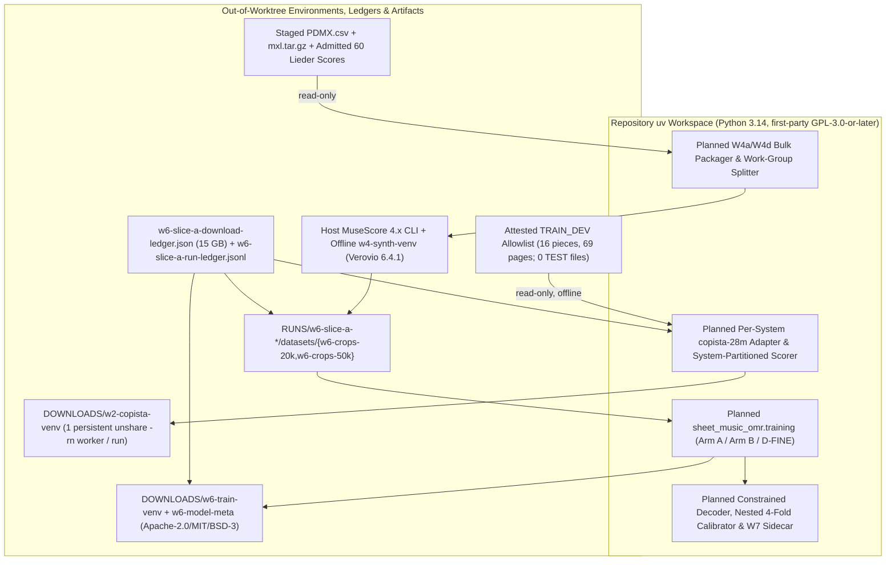

# Training, Bulk-Packaging and Page-Detector Protocol

## Authority, scope and evidence boundaries

This record is the protocol that
[OMR-REQ-026 through OMR-REQ-030](requirements.md#pilot-dataset-packaging-clean-training-stack-and-per-system-baseline)
require for W6 ([Issue #1498](https://github.com/hcoona/three/issues/1498)) and
the W4 bulk system-crop packaging milestones
([Issue #1491](https://github.com/hcoona/three/issues/1491), with sub-issues
[Issue #1494](https://github.com/hcoona/three/issues/1494) W4b,
[Issue #1495](https://github.com/hcoona/three/issues/1495) W4c and
[Issue #1496](https://github.com/hcoona/three/issues/1496) W4d) originally
admitted under the retired W6 CPU Slice A grant
([PR #1766](https://github.com/hcoona/three/pull/1766), amended in
[PR #1769](https://github.com/hcoona/three/pull/1769); owner dispositions in
[#1498 comment 7141304639](https://github.com/hcoona/three/issues/1498#issuecomment-7141304639),
[#1498 comment 7145361970](https://github.com/hcoona/three/issues/1498#issuecomment-7145361970)
and
[#1491 comment 7141314149](https://github.com/hcoona/three/issues/1491#issuecomment-7141314149)).
Its consumers are W6 and W4 implementers, their independent reviewers, and
downstream W6 GPU Slice B, W7 ([Issue #1499](https://github.com/hcoona/three/issues/1499))
and W8 ([Issue #1500](https://github.com/hcoona/three/issues/1500)) workstreams.
This protocol does not itself grant work: execution requires an active
[Delivery Wave](../../../../../docs/delivery-wave.md) entry covering the
specific slice (W6 CPU Slice A is completed and retired; the
[W6 Slice B Delivery Wave entry](../../../../../docs/delivery-wave.md#execute-omr-gpu-training-and-evaluation-on-local-rtx-4090-w6-slice-b)
is active on the local RTX 4090 `24 GB` physical host, gating Slice B campaign
execution on the accepted Slice B protocol amendments and CUDA/checkpoint locks).
The `sheet_music_omr.training` modules, asset-lock manifest and CLI commands
currently defined below implement the completed CPU Slice A controls pending
the Slice B protocol and lock amendments.

When authorized by an accepted [Delivery Wave](../../../../../docs/delivery-wave.md)
entry, this record governs:

- isolated `DOWNLOADS/w6-train-venv` CPU wheel and pinned permissive
  JSON/Jinja/text model-metadata provisioning (`trust_remote_code=False`, zero
  remote Python code fetches);
- expanded `permissive` W4a intake (`PDMX` expansion reusing the `60` admitted
  `OpenScore Lieder` scores), connected canonical-work `synth_train` /
  `synth_val` quota splitting, source-measure repetition accounting, and
  **`20,000`-crop** / **`50,000`-crop** `Tier R` `14.0 px` crop + co-warped
  `system`/`measure` page-box dataset packaging;
- strictly `Apache-2.0`, `MIT` or `BSD-3-Clause` external model contracts,
  spatial-resolution mechanics and CPU tiny-model smoke checks for **Arm
  A** (`Qwen3-VL-2B/4B-Instruct`, `Qwen3.5-2B`, `PaddleOCR-VL-1.6`), **Arm B**
  (`timm/convnext_tiny` `stride 8 + 16` and `zenosai/MonkeyOCRv2-S` +
  autoregressive `Text Score 2` decoder) and the **2-class (`system`,
  `measure`) page detector** (`D-FINE Small` and `RT-DETRv2-R18`);
- per-measure and per-system capped `Text Score 2` decoding validated through
  `parser.py`, `semantics.py` and `assembly.py` prefix/boundary rules,
  pre-registered `4`-fold plate-group-disjoint `TRAIN_DEV` real validation and
  nested out-of-fold calibration, W7 sidecar (`omr-w7-sidecar-v1`) + aligned
  real-data `omr-discrepancy-log-v1` emission, and Slice B's pre-registered
  paired local-only replay and frozen-`TEST` evaluation rules;
- the single-worker offline `TRAIN_DEV`-only zero-training
  `copista-28m@44464d1` per-system crop baseline (`0` `TEST` touches); and
- persistent non-resettable Slice A download, disk and run ledgers, stop
  conditions and cleanup rules.

Every statement below distinguishes **source findings** (verified against
immutable public repositories or repository commits), **runtime observations**
(measured in earlier accepted runs), **inferences**, and **hypotheses**:

- Per [OMR-REQ-014](requirements.md#omr-req-014-evidence-separation), Slice A
  dataset statistics, tokenizer/processor grid lengths and tiny-model
  CPU smoke checks establish pipeline contract compliance and sizing only — not
  trained recognizer accuracy, CUDA VRAM consumption on `24 GB` hardware or
  sim-to-real transfer (measured in GPU Slice B). Similarly, the
  `copista-28m@44464d1` per-system run measures a baseline for that pinned
  reader and `comb_dp_blind` crop pipeline on `TRAIN_DEV` (`69` pages), not an
  off-the-shelf ceiling.
- Public document-OCR leaderboard scores (`OCRBench`, `OmniDocBench`) are
  source-reported observations on text/formula/table benchmarks; whether dense
  document pretraining improves or hinders polyphonic music notation (and
  whether `448x448` tile seams or `48 px` pooling degrade staff/accidental
  reading) are **inferences and hypotheses** tested on identical splits in
  Slice B where candidates are admitted.
- Per [OMR-REQ-015](requirements.md#omr-req-015-privacy-and-fixture-provenance),
  private paths, piece/book titles and copyrighted score material remain strictly
  local and read-only; public reports carry only aggregate metrics,
  `rights_variant` counts, plate-group IDs (`G1`–`G7`), book-cohort labels
  (`book1`, `book2`, `g7`) and anonymized batch IDs (`gold-01`–`gold-23`).

## Planned container and single-worker baseline views



```mermaid
sequenceDiagram
  participant CLI as Planned run-copista-per-system
  participant Ledger as w6-slice-a-run-ledger.jsonl
  participant NetNS as 1 Persistent unshare -rn --pid Worker
  participant Val as Candidate XML Merge + W2 Scorer
  CLI->>CLI: Check clean git tree & worktree confinement (0 data/locator files opened)
  CLI->>Ledger: Lock + reserve 1 invocation slot before opening any locator or private file
  CLI->>CLI: dir_fd O_NOFOLLOW walk under --traindev-root; verify relpath-bound aggregate SHA-256
  CLI->>NetNS: Spawn namespace PID 1 supervisor + PID 2 copista-28m batch worker
  NetNS->>NetNS: 300s/page watchdog in PID 1 kills/reaps PID 2 & exits 124 (returncode >= 0)
  NetNS-->>CLI: Return per-crop XMLs + posteriors; reap PID 1 & clean scratch dir
  CLI->>Val: Map blind crops to oracle systems; align strictly within each system's measures
  Val-->>CLI: TRAIN_DEV parse-survival, Layer-1 A-error & second-reader baseline
  CLI->>Ledger: Settle 1 invocation record & scrub local output paths
  Note over CLI: Separate scan-public-report verifies 23-identity OMR-REQ-015 privacy.scan before publication
```

## Environment, isolated provisioning and mutable-source rechecks

1. **Committed asset lock and two-phase metered provisioning (`setup-w6-slice-a`):**
    - Before any formal Slice A run executes, the Slice A implementation commits
      a reviewed lock module (`src/sheet_music_omr/training/asset_locks.py`,
      analogous to `evaluation/wheel_lock.py` and `synthetic/ledgers.py`)
      pinning: (a) exact wheel URLs (from PyPI and PyTorch's official CPU wheel
      index `https://download.pytorch.org/whl/cpu`), byte sizes, `SHA-256`
      digests and package license provenance satisfying
      [OMR-REQ-027](requirements.md#omr-req-027-clean-permissive-recognizer-and-page-detector-model-stack)
      (enforced via `asset_locks.py:verify_lock_licenses`) for
      `DOWNLOADS/w6-train-venv`, covering the accepted Wave's named packages
      and required transitive Python/native wheels (`torch`, `torchvision`
      code-only without `COCO_V1` checkpoints, `scipy`, `timm`,
      `transformers >= 5.24.1`, `peft`, `accelerate`, `safetensors`,
      `datasets`, `tokenizers`, `sentencepiece`, `numpy`, `pillow`, `regex`,
      `pyarrow`, `hf-xet` and pure-Python helpers), and (b) exact per-file
      byte sizes, Git blob OIDs and `SHA-256` digests for the W6 model
      metadata files listed below under
      [OMR-REQ-027](requirements.md#omr-req-027-clean-permissive-recognizer-and-page-detector-model-stack).
      Missing or drifted lock entries abort fail-closed.
    - **Phase 1 (`setup-w6-slice-a`, zero private inputs, zero remote `.py`
      files):** installs locked CPU wheels into `DOWNLOADS/w6-train-venv` and
      fetches **only** pinned non-code metadata files (`config.json`,
      `preprocessor_config.json`, `video_preprocessor_config.json`,
      `processor_config.json`, `tokenizer.json`, `tokenizer_model` /
      `tokenizer.model`, `tokenizer_config.json`, `merges.txt`, `vocab.json`,
      `special_tokens_map.json`, `added_tokens.json`, `chat_template.json` /
      `chat_template.jinja`, `generation_config.json`, `README.md` and
      `LICENSE` where present) into `DOWNLOADS/w6-model-meta/<slug>@<sha10>/`.
      Every loader enforces `trust_remote_code=False`: `transformers >= 5.24.1`
      provides native first-party implementations for `qwen3_vl`, `qwen3_5`,
      `paddleocr_vl`, `d_fine` and `rt_detr_v2` (source finding in
      `huggingface/transformers@v5.24.1` `src/transformers/models/`), `timm`
      provides `convnext_tiny`, and `MonkeyOCRv2VisionTransformer` is
      implemented as a first-party repository PyTorch module consuming only
      `MonkeyOCRv2-S`'s `config.json` (`773` bytes) and
      `preprocessor_config.json` (`452` bytes). Zero `.safetensors`/`.bin`
      foundation checkpoints are downloaded in Slice A.
    - **Phase 2 (bulk packaging, CPU smoke checks and `TRAIN_DEV` `copista-28m`
      per-system execution):** runs strictly offline (`HF_HUB_OFFLINE=1`,
      `TRANSFORMERS_OFFLINE=1`, `PIP_NO_INDEX=1`, `UV_OFFLINE=1`). Every run
      records `RUN/environment.json` capturing resolved Python/package versions,
      wheel lock `SHA-256`, metadata lock `SHA-256`, and host `MuseScore` +
      `Verovio` version and binary `SHA-256` digests.
2. **Pinned external model and license registry (source findings verified at
   immutable commits on `2026-11-24`):**

    | Slot & role                       | Hugging Face repo & commit SHA                                                     | Code & weight license provenance (source findings)                                                                                                                         | Verified config & offline processor mechanics (source findings)                                                                                                                                                                                |
    | --------------------------------- | ---------------------------------------------------------------------------------- | -------------------------------------------------------------------------------------------------------------------------------------------------------------------------- | ---------------------------------------------------------------------------------------------------------------------------------------------------------------------------------------------------------------------------------------------- |
    | **Arm A control**                 | `Qwen/Qwen3-VL-2B-Instruct` (`89644892e4d85e24eaac8bacfd4f463576704203`)           | `Apache-2.0` (`README.md` `license: apache-2.0`; upstream `QwenLM/Qwen3-VL` `LICENSE`).                                                                                    | Native `Qwen3VLForConditionalGeneration` + `Qwen2VLImageProcessor` (`chat_template.json`, `tokenizer.json` `7,032,403` B); `patch_size=16`, `spatial_merge_size=2` (`32x32 px`/token), `deepstack_visual_indexes=[5,11,17]`.                   |
    | **Arm A capacity option**         | `Qwen/Qwen3-VL-4B-Instruct` (`ebb281ec70b05090aa6165b016eac8ec08e71b17`)           | `Apache-2.0` (`README.md` `license: apache-2.0`; upstream `QwenLM/Qwen3-VL` `LICENSE`).                                                                                    | Identical `qwen3_vl` processor/tokenizer metadata; reserved for Slice B capacity comparison.                                                                                                                                                   |
    | **Arm A generational challenger** | `Qwen/Qwen3.5-2B` (`15852e8c16360a2fea060d615a32b45270f8a8fc`)                     | `Apache-2.0` (in-repo `LICENSE` blob `f938136e3a`, `11,544` B).                                                                                                            | Native `Qwen3_5ForConditionalGeneration` (`chat_template.jinja`, `tokenizer.json` `12,807,982` B); `16 -> 32 px` dynamic grid (`deepstack_visual_indexes=[]`); run with `enable_thinking=False`.                                               |
    | **Arm A OCR-grid challenger**     | `PaddlePaddle/PaddleOCR-VL-1.6` (`132c45f52c0a26ed5a6b2f6bd8e3985794cc27dd`)       | `Apache-2.0` (in-repo `LICENSE` blob `0491a00e80`, `11,376` B).                                                                                                            | Native `transformers >= 5.24.1` `PaddleOCRVLForConditionalGeneration` + `PaddleOCRVLProcessor` (`trust_remote_code=False`, stripping `auto_map` to native classes); `14 -> 28 px`/token, `max_pixels=1,003,520`.                               |
    | **Arm B CNN control**             | `timm/convnext_tiny.fb_in22k_ft_in1k` (`bc48a87f119bae1b06418f5340bfa97ef75d4609`) | `Apache-2.0` (`README.md` `license: apache-2.0`; `huggingface/pytorch-image-models@v1.0.31` `LICENSE`).                                                                    | Native `timm` `convnext_tiny` (`config.json` `666` B); `features_only=True, out_indices=(1, 2)` exposes `stride 8` (`192`-ch) and `stride 16` (`384`-ch) stages (`timm/models/convnext.py#L400-L464`).                                         |
    | **Arm B doc-encoder challenger**  | `zenosai/MonkeyOCRv2-S` (`8efa4f856af5d38030d83565c8a79b36e5454ce7`)               | `Apache-2.0` (`README.md` `license: apache-2.0`; `Yuliang-Liu/MonkeyOCRv2@da96afede9` `LICENSE` explicitly grants `Apache-2.0` over code and encoder/Parsing/Und weights). | `config.json` (`773` B): `embed_dim=384`, `num_hidden_layers=12`, `num_attention_heads=6`, `intermediate_size=1536`, `patch_size=14`, `spatial_merge_size=2`; `2x2` block-ordered trunk states unpermuted to `[H/14, W/14, 384]` raster order. |
    | **Page detector primary**         | `ustc-community/dfine-small-coco` (`f79e65b5fbb33ceb9d3ebba042955d7410c608f8`)     | `Apache-2.0` (`README.md` `license: apache-2.0`; upstream `Peterande/D-FINE` `LICENSE`).                                                                                   | Native `DFineForObjectDetection` + `RTDetrImageProcessor`; stock `640x640` overridden by proposed `do_pad=False` stride-`32`-aligned aspect-preserving `{"height":H_32,"width":W_32}` (`L=1024`, `1280` in Slice B).                           |
    | **Page detector control**         | `PekingU/rtdetr_v2_r18vd` (`5650961749fa93567c0d46fc7f43ea4f9e914107`)             | `Apache-2.0` (`README.md` `license: apache-2.0`; upstream `lyuwenyu/RT-DETR` `LICENSE`).                                                                                   | Native `RtDetrV2ForObjectDetection` + `RTDetrImageProcessor` under the identical `do_pad=False` stride-`32`-aligned `{"height":H_32,"width":W_32}` override.                                                                                   |

3. **Explicitly excluded external models and weights:**
    - License exclusions (source findings): `rokotmidi/rokot-omr-2b@7add305`
      (`CC-BY-NC-4.0`), `facebookresearch/ConvNeXt-V2@main` pretrained weights
      (`CC-BY-NC-4.0` in `README.md#L96-L97`), `btrkeks/transcoda@d4e2e68`
      (`AGPL-3.0` code; `btrkeks/transcoda-v2.1@6a46a8c` `CC-BY-NC-4.0` weights
      and `btrkeks/transcoda-59M-zeroshot-v1@b529f8a` `CC-BY-4.0` weights),
      `ultralytics` (`AGPL-3.0`), `SoMarkAI/OXR-1.0` (`SoMarkAI/OXR@main`
      `LICENSE#L11-L50`: `$2M` funding/revenue cap + attribution termination),
      `facebookresearch/dinov3@main` (`LICENSE.md#L22-L36` custom DINOv3
      license), `apple/aimv2-large-patch14-native` (Apple AMLR) and
      `nvidia/C-RADIOv3-B` (NVIDIA Open Model license).
    - Spatial-geometry exclusions (source findings + domain inferences):
      `OpenGVLab/InternVL3_5-2B` (`448x448` tile splitting in
      `preprocessor_config.json`, inferred to bisect horizontal staff lines,
      beams and slurs at tile seams) and `google/gemma-4-E2B-it@4adf15748d`
      (`Apache-2.0`, `16 px` patches with `3x3` pooling = `48x48 px/token` in
      `config.json`, inferred to under-resolve `2`–`5 px` staccato dots,
      accidentals and fingering digits).
4. **Mutable-source recheck gate:**
    - Host `MuseScore 4.x` (`GPL-3.0` CLI) and `w4-synth-venv` (`Verovio 6.x`,
      `LGPL-3.0-only`) follow the renderer mutable-source recheck rules in
      [synthetic-protocol.md](synthetic-protocol.md#environment-tool-isolation-and-mutable-source-rechecks).
    - Cached `DOWNLOADS/w2-copista-venv` and `w2-copista-cache` follow the
      `copisteria` / `copista-28m` mutable-source recheck in
      [evaluation-protocol.md](evaluation-protocol.md#evidence-limits-and-source-basis),
      and W6 preflight additionally verifies the cached `copisteria@2be4a9d8`
      archive digest, `copista-28m@44464d1` LFS checkpoint digests and locked
      `w2-copista-venv` wheel digests before any `TRAIN_DEV` per-system run,
      blocking formal `TRAIN_DEV` runs fail-closed until any drift passes
      accepted license and interface rechecks.
    - For W6 assets (`w6-train-venv` wheels and `w6-model-meta` files),
      preflight verifies every wheel and metadata file against `asset_locks.py`.
      Any drift runs automated license verification (`Apache-2.0`, `MIT` or
      `BSD-3-Clause` for W6 models/metadata; permissive non-strong-copyleft,
      non-NC, non-revenue-restricted as listed in item 1 for library wheels) and
      synthetic-fixture processor/model interface checks, writes a structured
      recheck artifact, and **blocks formal runs fail-closed** until that
      artifact passes independent `research-evidence-review` and is accepted on
      `main`.

## Expanded W4a intake, canonical-work split and 20k/50k crop packaging

1. **Expanded `permissive` intake (`0` new corpus download bytes):**
    - Reuses the `60` `OpenScore Lieder` `v3.0.0` (`CC0-1.0`) piano scores
      already admitted in `w4-w5-formal-2` (`#1491 comment 7130836402`) without
      adding new Lieder extracts, and streams additional `PDMX` candidates from
      staged `PDMX.csv` and `mxl.tar.gz` (`no_license_conflict == True`,
      `CC0-1.0` or Public Domain Mark, deduplicated, single two-staff piano
      part, passing `screen.py`, `music21` parse, `Text Score 2` round-trip and
      fail-closed `TEST` exclusion against `test-exclusion.json` `SHA-256`
      `65a798c51095c8cd6f37374428e6e9a39cba7954d33fe047b49959f87538a80b` and
      non-notation work identities — applying the same reviewed composer
      transliteration alias map in **both** W4a `TEST`-exclusion matching/audit
      and split grouping, covered by a Slice A regression test with an aliased
      surname, distinct byte digest and matching catalogue ID) targeting
      **`2,500`–`5,000` total admitted `permissive` scores** (or exhausting
      eligible archive candidates if fewer pass, reporting exact funnel and
      rejection counts).
    - **Conditional reuse rationale (inference from `w4-w5-formal-2` runtime
      observations):** `w4-w5-formal-2`'s `440` scores held `14,907` measures;
      under `~4.6` measures/crop, `50,000` crops from `440` scores would imply
      `~15x` mean appearances per source measure before renderer gate drops
      (`37 / 84` MuseScore and `54 / 84` Verovio in `w4-w5-formal-2`). Because
      admitted scores vary in length and gate survival, realized measure reuse
      is not assumed from score count alone and is measured directly via
      per-measure repetition quantiles (`p50`, `p90`, `p99`, `max`).
2. **Composer-scoped alias canonicalization, pre-split rejection and
   deterministic quota split:**
    - Before any W4b annotation injection, W4c layout sampling or split
      assignment, all candidate scores have their composer surnames normalized
      through the shared reviewed transliteration alias map
      (`Tschaikowsky`/`Chaikovsky` -> `tchaikovsky`,
      `Rachmaninoff`/`Rakhmaninov` -> `rachmaninoff`, `Scriabine`/`Skryabin` ->
      `scriabin`, `Moussorgsky` -> `mussorgsky`, `Prokofieff` -> `prokofiev`,
      `Schostakowitsch` -> `shostakovich`, plus Unicode diacritic folding).
      **All** ambiguous or composer-local catalogue prefixes — including `K.`
      (Mozart Köchel vs. Scarlatti Kirkpatrick), `L.` (Scarlatti Longo vs.
      Debussy Lesure), `D.`, `S.`, `H.`, `Op.`, `WoO` and `No.` — are scoped
      strictly as `(canonical_composer, cat_norm)` and never override composer
      metadata; single-composer prefixes (`BWV` = `bach`, `KV` = `mozart`,
      `Hob.` = `haydn`, `Sz.` = `bartok`, `RV` = `vivaldi`, `HWV` = `Händel`)
      require corroborating matching/compatible composer metadata. **Any**
      candidate with generic/uninformative composer identity (`anonymous`,
      `traditional`, `various`, single-initial) **or** contradictory
      composer+prefix metadata (e.g., `"Beethoven, Hob. XVI:52"`) is **rejected
      fail-closed before admission** under
      [OMR-REQ-021](requirements.md#omr-req-021-rights-segregated-symbolic-intake-and-test-exclusion)
      so it enters **neither** `synth_train` **nor** `synth_val` (cannot leak an
      unattributed or misattributed edition across splits; verified by Slice A
      regression tests).
    - Admitted canonical-composer buckets (and connected work groups within each
      composer) are partitioned deterministically by
      `SHA-256("omr-w6-synth-split-v1:" + canonical_composer)` greedy quota
      assignment to `synth_val` (target `10%` of works/scores; stopping
      fail-closed before rendering if `synth_val` cannot reach `>= 150` distinct
      canonical works when total works `>= 1,500`, or `>= 10` works on smaller
      fixture runs) and `synth_train` (target `90%`). Neither composer-spelling
      variants (`Tchaikovsky` vs. `Tschaikowsky`), translated-title aliases
      (`Moonlight Sonata` vs. `Mondscheinsonate`), nor Scarlatti dual-catalogue
      editions (`Scarlatti K. 1` vs. `Scarlatti L. 366`) cross splits, while
      `Mozart K. 1` and distinct composers sharing `Op. 2` remain separate
      (verified by Slice A regression tests in both `TEST`-exclusion matching
      and split grouping). Realized composer, work, score and measure split
      proportions are reported.
3. **Engine routing, logit-masked category supervision and packaged milestones:**
    - In `w4-w5-formal-2`, `Verovio 6.4.1`'s symbolic gate disabled `5`
      categories (`mid-score clef change` per `renderers.py:_has_midscore_clef`
      — mandatory measure-1 `G2`/`F4` header clefs remain enabled — plus
      `cross_staff`, `grace`, `hairpin` and `ottava`). Scores containing or
      injected with any of those `5` categories, or carrying W1 supplementary
      facets unchecked by MEI, route exclusively to `MuseScore 4.x`; scores
      verified free of those `5` categories and unchecked facets may render
      through either `MuseScore 4.x` or `Verovio 6.x` (subject to
      [OMR-REQ-023](requirements.md#omr-req-023-dual-engine-layout-rendering-and-round-trip-label-gates)).
    - **How `category_supervision_mask` eliminates negative supervision in
      full-sequence training:** each row records `category_supervision_mask`
      (`dict[str, bool]`, setting Verovio's `5` disabled categories `false` on
      Verovio rows and `true` on MuseScore rows). During sequence cross-entropy
      loss computation on any row where `category_supervision_mask[cat] ==
False`, the token vocabulary IDs exclusively encoding `cat` (`8va`/`8vb`/
      `15ma` tokens, hairpin wedge tokens, `grace` markers, cross-staff voice
      specifiers, and mid-score clef-change tokens; rows where a shared subword
      cannot be isolated in an Arm A BPE vocabulary instead exclude Verovio rows
      from sequence recognizer loss and use them only for page-detector training
      or unmasked categories) have their logits set to `-inf` in the softmax
      denominator before log-softmax, so **zero negative gradient** is applied
      to disabled-category continuations on Verovio rows while `MuseScore` rows
      supervise the full `27`-category softmax; `category_supervision_mask`
      likewise excludes Verovio rows from those `5` categories' validation
      denominators.
    - Every packaged crop row (`omr-w6-crop-dataset-v1` JSONL under
      `RUN/datasets/<milestone>/<split>/`) records `sample_id`, `variant_id`,
      `system_index` (`0 .. expected_systems - 1`), `expected_systems` (`int >=
1`), `is_final_system` (`bool`), `page_id`, `source_id`, `work_group_id`,
      `rights_variant` (`"permissive"`), `split` (`"synth_train"` |
      `"synth_val"`), `engine`, `seed`, `plate_group` (`G1`–`G7`),
      `crop_relpath`, `crop_width`, `crop_height`, `staff_space_px` (`14.0`),
      `carry_in_text`, `incoming_header_state_text` (`empty` on `system_index == 0`, and prior
      system's end `(key, meter, clefs)` header lines for `system_index > 0`),
      `page_system_tuple` (`(page_number, system_number)` `1`-based caller
      coordinates), `target_text_v2`, `present_categories`,
      `category_supervision_mask`, and `sha256`.
    - Every rendered `Tier R` page also writes a `omr-w6-page-boxes-v1` row
      recording exact page raster `(page_width_px, page_height_px)` alongside
      co-warped `system` (`class 0`) and `measure` (`class 1`) boxes in exact
      pixel `[x0, y0, x1, y1]` and normalized `[cx, cy, w, h]` (relative to
      `(page_width_px, page_height_px)`).
    - **Milestones and complete-sequence boundaries:** `w6-crops-20k` (`>=
18,000` `synth_train` + `>= 2,000` `synth_val` crops) and `w6-crops-50k`
      (`>= 45,000` `synth_train` + `>= 5,000` `synth_val` crops). Every split
      and any deterministic prefix shard (`w6-crops-20k` sliced from
      `w6-crops-50k`) cuts **strictly at complete `variant_id` boundaries**
      (`0 .. expected_systems - 1` contiguous and complete, never mid-piece),
      and blind validation rejects any incomplete `variant_id` sequence
      fail-closed before scoring. Both milestones report realized
      work/score/measure split counts, repetition quantiles (`p50`, `p90`,
      `p99`, `max`), per-category positive counts, and exact visual-grid +
      target-token length quantiles under each pinned tokenizer/processor.
    - **Targeted `MuseScore 4.x` full-category milestone augmentation (`package-w6-musescore-supplement --base-run-dir`):**
      when a configured `--musescore-page-cap` bounds host `MuseScore` volume in
      an initial `package-w6-crops` run (runtime observation in
      [`w6-slice-a-package-formal-4`](https://github.com/hcoona/three/issues/1498#issuecomment-7173082854),
      `w6-packaging.json` `SHA-256`
      `260b461d20c7647415d60f9fb3f025fc33b290cf7a92ef7c4d7db85bcc9f22c3`,
      where `--musescore-page-cap 50` left the `6` `Verovio`-disabled/unchecked
      categories near zero in `synth_train`),
      `package-w6-musescore-supplement` takes an attested completed sibling
      `w6-slice-a-*` `--base-run-dir` (`0` new Phase-1 downloads, reading raw
      bytes and verifying all `7` pinned base manifest `SHA-256` digests before
      parsing any metadata or opening any score/PNG file, and verifying every
      reused crop PNG and page PNG before linking), checks `canonical_root`
      confinement under the canonical synthetic `runs` root, re-audits `0`
      `TEST` overlap against `test-exclusion.json` and `test-status` **before**
      opening any score notation, and reproduces and verifies the base run's
      exact `split_admitted_sources_by_composer` partition against both
      `w6-packaging.json` and the base `w6-crops-50k` manifests so `synth_train`
      and `synth_val` composer/work/score assignments remain identical with zero
      cross-split leakage. Within each split, scores carrying native
      `Verovio`-disabled/unchecked or low-support notation are partitioned into
      `7` disjoint rarity buckets (`0: tremolo`, `1: cross_staff`, `2:
ornament`, `3: grace`, `4: ottava`, `5: hairpin`, `6: mid-score clef change`,
      sorted deterministically by `source_id` within each bucket) and
      interleaved `1:1:1:1:1:1:1` across buckets and rounds under seed domain
      `"omr-w6-ms-supplement-v1:{round_index}:{canonical_v2_sha256}"` (disjoint
      from `"omr-w6-variant-v1:"` so `variant_id`s never collide with the base
      run). Supplement variants disable synthetic `N5` pedal injection while
      preserving native `pedal` (**inference**: avoids avoidable `MuseScore`
      round-trip rejections given the runtime observation in
      [`w6-slice-a-package-formal-4`](https://github.com/hcoona/three/issues/1498#issuecomment-7173082854)
      of a `47.62%` `MuseScore` `pedal` round-trip drop rate versus a `0.00%`
      `Verovio` `pedal` round-trip drop rate and `35,401` `synth_train` +
      `3,593` `synth_val` `pedal`-positive crops already present in
      `w6-crops-50k`), and execute on public `permissive` synthetic scores
      through the `SHA-256`-verified host `MuseScore 4.x` CLI under its local
      batch lock per [synthetic-protocol.md](synthetic-protocol.md) lines
      `125`–`129` (retaining `.w6-scratch-reservation.json` and aborting
      fail-closed via `StopConditionError` on batch worker timeout). After
      rendering `>= 2,700` `synth_train` and `>= 300` `synth_val` complete
      `MuseScore` crops on `--formal` and verifying realized positive coverage
      across all `7` rarity-bucket categories in the supplement, the packager
      prepends those complete `MuseScore` variants before the verified base
      `w6-crops-50k` variants, slices complete-variant prefixes at the exact
      authorized `w6-crops-50k` (`45,000` `synth_train` / `5,000` `synth_val`)
      and `w6-crops-20k` (`18,000` `synth_train` / `2,000` `synth_val`) targets
      (allowing overshoot only to finish the last complete variant, and
      hardlinking selected base PNG assets on the canonical `runs` filesystem
      with unique-inode physical disk accounting under the `100 GB` cap),
      verifies realized positive coverage (`>= 1` crop in both splits) across
      all `27` `CONTENT_CATEGORIES` in both published milestones on `--formal`,
      and writes refreshed `w6-crops-20k` and `w6-crops-50k` manifests and
      `summary.json` files.

## Training, detector and constrained-decoding contracts

1. **Arm A (Small VLM SFT/LoRA — Slice A harness, GPU training in
   Slice B):**
    - Prompt, `carry_in` and `incoming_header_state` contract: because
      `Text Score 2` `CarryState` omits `key`, `meter` and `clefs` while
      `assembly.py` requires subsequent systems' headers to match the preceding
      system's end state (even when printed systems omit an unchanged time
      signature), teacher-forced training (`synth_train` and `REAL_TRAIN`)
      supplies deterministic `page_system_tuple` (`page P`, `system S` from the
      caller's page and crop order), ground-truth `carry_in_text` and
      `incoming_header_state_text` (empty on `system 0`, prior system's end
      `(key, meter, clefs)` thereafter) alongside the aspect-preserving `14.0
px` system crop image (`enable_thinking = False` on `Qwen3.5-2B`). During
      **blind held-out evaluation** (`synth_val` end-to-end, `REAL_VAL`, and
      Slice B `TEST`), every system receives its caller-known `page_system_tuple`
      (`(page_number, system_number)`), system `0` starts with initial empty
      `carry_in` and empty `incoming_header_state_text`, and each system `s > 0`
      receives **both** the predicted `carry_out_text` **and** the predicted end
      `(key, meter, clefs)` `incoming_header_state_text` derived from accepted
      system `s - 1`
      (tested in Slice A across a system break where `meter` is not reprinted on
      the page); if system `s - 1` abstained (`valid = false`), **remaining
      systems `s .. S - 1` of that piece fail closed immediately with `valid =
false, abstention_reason = "upstream_carry_gap"`**. Any diagnostic run
      using oracle `carry_in_text` / `incoming_header_state_text` is labeled
      `"oracle_carry_conditioned"` and never used for gate claims. (Arm B obeys
      this identical prompt state rule.)
    - Proposed Slice B starting recipe (exercised structurally in Slice A on
      tiny random-init `Qwen3VLConfig`, `Qwen3_5Config` and `PaddleOCRVLConfig`
      CPU smoke fixtures): `bf16` LoRA (`r = 32, alpha = 64`), sequence packing
      disabled so image token grids are never truncated, with vision-tower LoRA
      toggled in Slice B if small-symbol recall lags.
2. **Arm B (`~30M–60M` Rectangular Vision Encoder + Autoregressive Decoder):**
    - `convnext_tiny` control: extracts `stride 8` (`H/8 x W/8 x 192`) and
      `stride 16` (`H/16 x W/16 x 384`) feature maps, comparing `stride 16`
      alone against `stride 16` fused with `stride 8` lateral detail plus 2D
      sinusoidal row/column positional encodings in raster `(row-major)` order.
    - `MonkeyOCRv2-S` challenger: first-party `12`-layer, `384`-dim, `6`-head
      `patch-14` ViT trunk matching `zenosai/MonkeyOCRv2-S@8efa4f856a`
      `config.json`; explicitly unpermutes its `spatial_merge_size = 2` (`2x2`
      block-grouped) token sequence back to canonical `[H/14, W/14, 384]`
      row-major raster order before projecting to the decoder.
    - Decoder: `6`-layer (`d_model = 512, nhead = 8, d_ff = 2048`) causal
      Transformer over a compact `< 512`-token `Text Score 2` lexical
      vocabulary (where every category-exclusive construct maps to dedicated
      token IDs supporting exact `category_supervision_mask` logit masking).
3. **2-Class (`system`, `measure`) Page Detector (`D-FINE Small` & `RT-DETRv2`):**
    - Stride-`32`-aligned unpadded coordinate frame (source finding in
      `huggingface/transformers@v5.24.1` `image_processing_rt_detr.py#L295-L325`
      and `modeling_rt_detr_v2.py` `HybridEncoder`): unaligned widths/heights
      such as `739 x 1024` or `600 x 1024` produce mismatched `stride 16` (`47`
      or `38`) vs. `2x`-upsampled `stride 32` (`48` or `38 -> 76 vs 75`) feature
      maps in `HybridEncoder`, while `do_pad=True` shifts box normalization into
      the padded frame without `post_process_object_detection` undoing padding.
      W6 therefore computes per-page stride-`32`-aligned dimensions around long
      edge `L = 1024` (`L = 1280` comparison in Slice B): `scale = L /
max(W_orig, H_orig)`, `W_32 = max(32, round(W_orig * scale / 32) * 32)`,
      `H_32 = max(32, round(H_orig * scale / 32) * 32)` (e.g., `2300 x 3185` ->
      `736 x 1024`, divisible by `32` in both axes), and invokes
      `RTDetrImageProcessor` with **`size={"height": H_32, "width": W_32},
do_pad=False`** (`microbatch = 1` + gradient accumulation or same-`(W_32,
H_32)` buckets). Ground-truth `[cx, cy, w, h]` targets lie in `[0, 1]`
      over `(W_32, H_32)`. Because `DFineForObjectDetection`'s `distance2bbox`
      emits unclamped coordinates and stock `post_process_object_detection`
      invokes `torch.topk` internally before returning candidates, W6's
      evaluation postprocessor decodes directly from raw `outputs.logits`
      (`sigmoid`) and `outputs.pred_boxes` **independently per class** (`class
0` `system` ranked and truncated to `K_system = 32` per page; `class 1`
      `measure` ranked and truncated to `K_measure = 128` per page, so
      high-scoring `measure` boxes never displace `system` boxes — tested in
      Slice A), ranking queries within each class deterministically by `(-prob,
query_idx)` before top-K truncation (tested with tied logits at the
      cutoff), converting `cxcywh -> xyxy` scaled by `(W_orig, H_orig)`, and
      **clamping `[x0, y0, x1, y1]` to `[0, W_orig] x [0, H_orig]`** (discarding
      degenerate `x1 <= x0` or `y1 <= y0` boxes). **Unthresholded** valid top-K
      candidates per class feed `AP75` (`(-prob, page_id, query_idx)`), whereas
      the class operating threshold (`tau_system` / `tau_measure` selected on
      `synth_val` / inner folds) filters candidates strictly for operating-point
      recall/precision/ink-clipping metrics and crop extraction (exercised
      end-to-end through actual `DFineForObjectDetection` and
      `RtDetrV2ForObjectDetection` forward + raw post-processing on `2300 x
3185` and `600 x 1024` synthetic rasters in Slice A).
    - **Stock labeled training forward preserving denoising and auxiliary
      terms:** with `scipy` included in `w6-train-venv`, both
      `DFineForObjectDetection` and `RtDetrV2ForObjectDetection` invoke stock
      `model(pixel_values=..., labels=targets, return_dict=True)` directly so
      upstream label-conditioned denoising queries (`num_denoising = 100`),
      `RTDetrHungarianMatcher`, `D-FINE` fine-grained distribution focal loss
      and decoder distillation, and encoder/decoder auxiliary losses execute
      unmodified; Slice A labeled forward + `.backward()` CPU smoke tests (on a
      fixture with `>= 1` ground-truth box) explicitly assert that layer-indexed
      denoising keys (`loss_vfl_dn_0`, `loss_bbox_dn_0`, `loss_giou_dn_0`, plus
      `loss_fgl_dn_0` on `D-FINE`) are present and finite in `outputs.loss_dict`.
    - **Evaluation alignment across synthetic vs. real splits:** `measure`-box
      `AP75` and `IoU >= 0.85` are evaluated on **`synth_val` only**. On
      held-out `TRAIN_DEV` validation folds, `D-FINE` / `RT-DETRv2` and
      `comb_dp_blind` are compared side-by-side on 2D **`system`** boxes via:
      (i) pure box-geometry metrics (`IoU >= 0.85` recall/precision,
      ink-clipping count, merged-box count, split-box count, plus `AP75` on
      scored detectors; `comb_dp_blind` is unscored single-point), (ii) optional
      W5 two-staff predicate matching (`IoU >= 0.50` full-coverage +
      deterministic blind horizontal-projection staff comb inside each predicted
      box, reported separately from `comb_dp_blind`'s historical `318 / 323`),
      and (iii) downstream system-assembly pass rate.
4. **Constrained `Text Score 2` decoding (`decode_system_constrained`):**
    - Enforces **both** (a) an online **per-measure token cap** (`<= 192`
      cumulative generated tokens for a single logical measure — carrying the
      running token count across accepted split-measure fragments and resetting
      only when the measure closes, aborting that candidate immediately with
      `"length_cap"` if exceeded) **and** (b) a total system token cap
      (`<= 1,536` tokens).
    - Generates up to `K = 3` candidates (`beam = 3` ordered by log-probability)
      and accepts the first candidate that passes (i) `sheet_music_omr.parser`,
      (ii) `sheet_music_omr.semantics` (completed-measure durations), and (iii)
      `validate_system_prefix(prior_systems, candidate, expected_page_system=...,
is_final_system=...)`, which verifies the expected `(page, system)` tuple
      immediately on every system and invokes `sheet_music_omr.assembly` with an
      explicit **in-assembler `allow_open_prefix = not is_final_system` mode**
      (retaining `to = observed_end` on an unclosed trailing split measure
      instead of stripping `to`, running `assembly.py`'s existing step-6
      `_close_bracket` normalization across observed adjacent measure headers
      even when the trailing measure is unfinished, and deferring **only**
      checks whose outcomes depend on unseen future systems — terminal
      `relation_open` on still-open relations at the `to = observed_end`
      prefix boundary, `semantic/fragment` (`measures.py`) **solely on that
      last joined measure** when `observed_end < measure_length`, unresolved
      trailing `arc@rN:start` rewrites in `_Chains.arcs()`, and the unseen tail
      `[observed_end, measure_length)` — so `relations.py` open-tie timeline-endpoint checks (`observed_end`) and
      open-two-note-tremolo checks (no subsequent non-grace rhythmic event in
      the same `(staff, voice)` after the tremolo onset) work natively without
      synthetic rests while `assembly/measure_fill` gaps inside `[0,
observed_end)`, any non-final `semantic/fragment`, closed-measure
      `assembly/measure_fill` gaps, `split_len` mismatches, and post-
      `_close_bracket` `semantic/ending` volta errors are rejected immediately
      on the offending intermediate beam, and running strict unmodified
      `assemble()` when `is_final_system=True`; preserving `NEEDS_PERSON`
      review-marker status separately from validation errors, and tested in
      Slice A by asserting **both** intermediate prefix acceptance **and**
      strict final `assemble()` success on open `arc@rN:start`, an open tie
      ending at `observed_end` + an open two-note tremolo with a later note in
      another voice (and no subsequent non-grace rhythmic event in its own
      `(staff, voice)`) inside an unfinished split measure, and `ending=1:start`
      followed by an unbracketed unfinished measure, plus immediate
      intermediate rejection on open-slur + `split_len` mismatch, `[0,
observed_end)` gaps, `ending=2:single` -> `ending=end` volta beam
      fallback before system `3`, and final `assembly/measure_fill` fallback).
    - If all `K` candidates fail (or a prior system abstained), records `valid =
false` with explicit `abstention_reason` (`"parse_invalid"`,
      `"duration_invalid"`, `"assembly_prefix_invalid"`, `"length_cap"`, or
      `"upstream_carry_gap"`), never fabricating silent notation repairs.

## Pre-registered 4-fold TRAIN_DEV split, calibration, W7 sidecar and Slice B gates

1. **Pre-registered `4`-fold plate-group-disjoint `TRAIN_DEV` partition (source
   counts verified from `w2-s0-formal-3` `alignment/manifest.json` and
   `s0-environment-integrity-attestation.json`; `0` `TEST` pieces touched):**

    | Fold | Held-out `REAL_VAL` groups & cohorts                         | Held-out `TRAIN_DEV` batch IDs                | `REAL_VAL` pieces / pages / systems / measures | Remaining `REAL_TRAIN` pieces / systems / measures |
    | ---: | ------------------------------------------------------------ | --------------------------------------------- | ---------------------------------------------- | -------------------------------------------------- |
    |  `0` | `G5` (`book1`)                                               | `gold-07, gold-08, gold-09, gold-11, gold-12` | `5` / `17` / **`79`** / `339`                  | `11` / **`244`** / `1,262`                         |
    |  `1` | `G6` (all `5` eligible `TRAIN_DEV` pieces from `book2`[^b2]) | `gold-16, gold-17, gold-19, gold-20, gold-21` | `5` / `21` / **`82`** / `294`                  | `11` / **`241`** / `1,307`                         |
    |  `2` | `G1 + G2` (`book1`)                                          | `gold-10, gold-14, gold-15`                   | `3` / `17` / **`87`** / `487`                  | `13` / **`236`** / `1,114`                         |
    |  `3` | `G4` (`book1`) + `G7` (all `2` pieces of `g7`)               | `gold-13, gold-22, gold-23`                   | `3` / `14` / **`75`** / `481`                  | `13` / **`248`** / `1,120`                         |

    [^b2]:
        `gold-18` belongs to `book2` and remains permanently sealed in frozen
        `TEST` (`w2-s0-formal-3`).

    **Invariants:** every plate group (`G1, G2, G4, G5, G6, G7`) stays `100%`
    intact inside a single validation fold, and every `REAL_TRAIN` complement
    holds **`236`–`248` systems** (`3.9x`–`4.1x` above the `60`-system
    real-replay threshold).

2. **Leak-free out-of-fold confidence calibration and W7/W8 schema alignment:**
    - **Synthetic-only vs. replay calibration cross-fitting:**
        - For **synthetic-only** checkpoints (which never train on `TRAIN_DEV`),
          reporting calibration metrics (`AUROC`, `AURC`, `ECE`) or `20%` flag
          decisions on held-out fold `f` (`REAL_VAL_f`) fits temperature or
          Platt scaling strictly on the other `3` folds (`{0, 1, 2, 3} \ {f}`).
        - For **Slice B `TRAIN_DEV` replay** runs (where an outer fold-`f` model
          trains on `{0, 1, 2, 3} \ {f}`), calibrating outer fold `f` fits the
          calibrator on inner validation predictions from **two-fold-held-out**
          replay runs trained strictly on `{0, 1, 2, 3} \ {f, g}` (`g != f`,
          retaining `>= 154` real training systems per inner run, `> 2.5x` the
          `60`-system threshold) so `REAL_VAL_f` never leaks through either
          recognizer weights or calibrator fitting (retaining the explicit
          `conditional on upstream synthetic finalist selection` label).
          Categories with `< 10` positive/error instances in the fitting folds
          report `"insufficient_support"`. Before Slice B's single frozen `TEST`
          pass, one frozen production calibrator is refit across out-of-fold
          `TRAIN_DEV` predictions.
    - **Prediction-side W7 sidecar (`omr-w7-sidecar-v1`) vs. aligned real-data
      `omr-discrepancy-log-v1`:**
        - `omr-w7-sidecar-v1` is emitted for any recognizer prediction run
          (`synth_val`, `TRAIN_DEV`, or Slice B `TEST`), keyed by prediction
          `(run_id, sample_or_piece_id, page_index, system_index,
pred_measure_ordinal, staff)` where `pred_measure_ordinal` (`int |
null`) and `staff` (`int | null`) are `1`-based on parsed system
          measures and **`null` on a single system-level abstention sentinel
          row** emitted whenever a system abstains (carrying
          `text_score_v2_slice = null`, `abstention_reason != null`,
          `page_system_bbox_px`, `raw_logprob`, `calibrated_confidence = 0.0`,
          **`mandatory_abstention_review = true`**, **`flagged_at_20pct =
null`** — tracked and reported as mandatory abstention review overhead
          separately from the `<= 20%` calibrated draft-measure disagreement
          budget — and `aligned_gold_measure_ordinal = null`, tested in Slice A
          when all `K` beams fail). Parsed rows populate `text_score_v2_slice`,
          `page_system_bbox_px`, `page_measure_bbox_px` (`null` when
          unpredicted), `carry_out_text`, `raw_logprob`,
          `calibrated_confidence`, `category_confidences`, `symbol_posteriors`
          (`list[dict] | null`), `coverage_mask` (`dict[str, bool]`),
          `mandatory_abstention_review = false`, `flagged_at_20pct` (`bool |
null`: `null` on `synth_val` or unaligned prediction measures where no
          draft-measure flag budget applies, and populated directly from the
          original budgeted `(gold_id, draft_measure_ordinal)` flag set via
          prediction-to-draft measure alignment rather than OR-aggregated
          gold-aligned discrepancy rows — while unpredicted draft measures are
          still budgeted in `omr-discrepancy-log-v1` which remains unchanged),
          `abstention_reason` (`null`), and `aligned_gold_measure_ordinal`
          (`int | null`).
        - `omr-discrepancy-log-v1` (`evaluation-protocol.md`) remains **strictly
          unchanged** and is emitted **only** on eligible aligned real-data
          evaluations (`TRAIN_DEV` or Slice B `TEST` on `gold-01`–`gold-23`),
          never on `synth_val`.
3. **Pre-registered Slice B selection, conditional replay and `TEST` rules:**
    - Pooled `4`-fold `TRAIN_DEV` scores used to choose the synthetic-only
      finalist across Arm A and Arm B are reported explicitly as **cross-validated
      model-selection evidence** (conditional on selection across `TRAIN_DEV`),
      not unbiased post-selection test estimates.
    - From the selected synthetic-only checkpoint, Slice B runs matched-step
      local branches per `TRAIN_DEV` fold (`synthetic continuation` vs.
      `REAL_TRAIN + synth_train replay` with `open_reading_masks` loss masking)
      evaluated on each fold's held-out `REAL_VAL_f` (`0` `TEST` touches;
      reported as conditional on the upstream synthetic-architecture choice).
    - Only **one** final pre-registered `"W6-pilot-final"` evaluation touches
      frozen `TEST` in Slice B (logged in `DOWNLOADS/w2-touch-log.jsonl` within
      W2's `3`-touch pilot ceiling).

## Offline per-system copista-28m TRAIN_DEV baseline protocol

1. **Pre-staged sealed `TRAIN_DEV`-only starting-state root, ledger-anchored
   attestation, zero-file pre-reservation, and from-`/` `dir_fd` `O_NOFOLLOW`
   pre-read `fstat` guard (`0` `TEST` touches):**
    - **Threat boundary and pre-staged starting state
      (`docs/engineering/engineering-principles.md#security`):** runs execute on
      a single-operator local workstation where `--traindev-root` is an
      **already lawfully staged, verified, sealed (`0o500` directories, `0o400`
      leaves owned by `os.geteuid()`) and ledger-anchored `TRAIN_DEV`-only
      starting-state directory** supplied by the repository owner / local
      operator (failing closed immediately if either `--traindev-root` or its
      external ledger anchor is absent; any new preparation of private
      `TRAIN_DEV` artifacts executes strictly under accepted W6 Slice A
      [Delivery Wave](../../../../../docs/delivery-wave.md) authorization after
      this protocol is merged on `main`, and no Slice A runner command scans or
      copies from mixed `23`-piece directories). `--traindev-root` holds
      strictly the `102` `TRAIN_DEV` leaves across `gold-07`–`gold-17` and
      `gold-19`–`gold-23` (`pages/gold-{07..17,19..23}-p<NN>.png`,
      `gold/gold-{07..17,19..23}/accepted.musicxml`, normalized Stage S0 initial
      drafts at `gold/gold-{07..17,19..23}/draft.musicxml` sourced from
      `build-01/score.musicxml` on `15` pieces and `draft.musicxml` on
      `gold-07`, and `traindev-manifest.json` carrying `TRAIN_DEV`-only approved
      system boxes, measure ranges, `converged_aspects` and
      `open_reading_masks`), plus read-only `staging-attestation.json` (`0o400`)
      binding root `(st_dev, st_ino)` and every leaf's `(deterministic_relpath,
st_dev, st_ino, st_size, st_mtime_ns, expected_sha256)`, whose
      `staging_attestation_sha256` and root `(st_dev, st_ino)` are anchored in
      `DOWNLOADS/w6-slice-a-run-ledger.jsonl` outside `--traindev-root` and
      whose portable `(gold_id, deterministic_relpath, expected_sha256,
oracle_boxes, masks)` payload matches `asset_locks.py`'s single committed
      aggregate `SHA-256` ([OMR-REQ-015](requirements.md#omr-req-015-privacy-and-fixture-provenance):
      zero individual private hashes, paths or boxes committed in git;
      adversarial same-UID forgery of the pre-staged starting state is outside
      the threat model).
    - **Zero-file pre-start reservation and external anchor check:** during
      `run-copista-per-system`, **before opening `--traindev-root` or any
      private file**, the runner checks git clean-tree state (on `--formal`),
      acquires `.w6-slice-a-run-ledger.lock`, reads the `"traindev-root-anchor"`
      record (`staging_attestation_sha256` and root `(st_dev, st_ino)`) from
      `DOWNLOADS/w6-slice-a-run-ledger.jsonl`, and writes `1` pre-start
      invocation reservation (retained on any subsequent failure or abort).
    - **From-`/` `dir_fd` walk, pre-read `fstat` guard and streaming hash check:**
      strictly **after** reservation, the runner walks from `/` (`os.open("/",
os.O_RDONLY | os.O_DIRECTORY)`) with `O_NOFOLLOW | O_DIRECTORY`
      (`dir_fd=parent_fd`) to `--traindev-root`, verifying `fstat(root_fd)`
      matches the ledger-anchored root `(st_dev, st_ino)`, `st_uid == geteuid()`,
      mode `0o500`, and lies outside every git worktree, then verifies
      `staging-attestation.json` against both `staging_attestation_sha256` and
      `asset_locks.py`'s committed portable aggregate `SHA-256` **before**
      opening any PNG, XML or `traindev-manifest.json` leaf. Every leaf is
      checked against the deterministic `16`-piece allowlist, opened via `dir_fd`
      `O_NOFOLLOW`, **checked via `os.fstat(leaf_fd)` BEFORE reading a single
      payload byte** (`S_ISREG`, `st_uid == geteuid()`, mode `0o400`, and exact
      `(st_dev, st_ino, st_size, st_mtime_ns)` match to the ledger-authenticated
      `staging-attestation.json` — covered by Slice A tests proving that
      replacing `--traindev-root` together with its `staging-attestation.json`,
      or substituting a same-size regular file at an allowed path, aborts with
      `0` payload bytes read), and hashed as bytes are read against
      `expected_sha256`.
2. **Single-namespace PID-1 supervisor + PID-2 batch worker (`1` CLI run = `1`
   `unshare` invocation = `1` ledger slot):**
    - Extracts blind `comb_dp_blind` `2`-staff system crop PNGs across the `69`
      attested `TRAIN_DEV` page PNGs (`0` manual `box-overrides.json` boxes),
      freezes those blind crop coordinates before consulting W3 oracle boxes,
      and spawns **one** `unshare -rn --pid --fork --kill-child=SIGKILL`
      namespace (`close_fds=True`, `lo`-only verified) whose **PID `1` is a
      lightweight standard-library Python watchdog supervisor** that spawns the
      single persistent `DOWNLOADS/w2-copista-venv` (`copisteria@2be4a9d8`,
      `copista-28m@44464d1`) inference worker as namespace **PID `2`**.
    - Namespace PID `1` enforces a monotonic `300`-second per-page pipe
      heartbeat outside the PyTorch inference process: if PID `2` stalls in
      native C++/PyTorch past `300` seconds on any page, PID `1` sends `SIGKILL`
      to PID `2`, calls `os.waitpid` to reap PID `2` inside the namespace, and
      exits normally with status `124` so `unshare` returns **`proc.returncode
== 124 >= 0`** to the host parent (allowing safe scratch-directory deletion
      after verified teardown while retaining scratch and aborting fail-closed
      if `unshare` itself dies by signal `< 0` or fails to exit within `5.0 s`),
      marking stalled/remaining pages fail-closed and **settling the `1` charged
      invocation without spawning any replacement worker**.
3. **Oracle-system-partitioned alignment, spurious-crop penalty and fail-closed
   scoring:**
    - Concatenates surviving per-crop MusicXMLs per piece with `(page_index,
system_index)` `<print>` boundaries and isolated spanner numbers without
      fabricating missing bars, and freezes blind second-reader flags from blind
      predictions before oracle matching.
    - Matches the frozen blind `comb_dp_blind` crops `1:1` against W3's
      `TRAIN_DEV` oracle system boxes under W5's matcher (`IoU >= 0.50`
      full-coverage `2`-staff predicate): (a) candidate measures from a `1:1`-
      matched crop align **strictly within that matched oracle system's
      reference measure interval `[m_start, m_end]`** (never crossing into an
      adjacent or post-gap system's measures even on identical repeated bars),
      (b) any parsed blind crop **without** a `1:1` oracle match (spurious crop
      or losing split/merge fragment) receives an empty allowed reference
      interval (`allowed_ref_ordinals = ∅`) so all of its emitted measures
      remain unmatched and incur W2's unchanged extra-measure penalty (covered
      by a Slice A regression test with a spurious crop repeating a neighboring
      bar alongside a missing-middle-system test), and (c) every measure of any
      missed, merged, split or unparsed oracle system scores fail-closed
      (`A`-error = `1.0`).

## Finite execution bounds, ledgers, stops, privacy and cleanup

- **Persistent non-resettable Slice A safeguards (implemented in
  `sheet_music_omr.training.ledgers`; initialize once via
  `setup-w6-slice-a --init-campaign`, rebind only after copying preserved
  ledgers and moving retained `w6-slice-a-*` run directories via
  `migrate-w6-downloads --from-downloads OLD --to-downloads NEW`, and never
  delete or reset either Slice A ledger while preserving earlier W1, W2/W3 and
  W4/W5 ledgers untouched):**
    1. **Download ledger (`DOWNLOADS/w6-slice-a-download-ledger.json`):** under
       an exclusive lock, meters every HTTP `HEAD`/`GET` probe and reserves
       exact byte budgets against `asset_locks.py` before fetching any
       `w6-train-venv` wheel or `w6-model-meta` file (retaining failed or
       crashed reservations conservatively, reusing verified cached files at `0`
       new bytes, and failing closed on any unmetered transfer, remote `.py`
       file or checkpoint weight file), stopping before cumulative Slice A
       downloads exceed **`15,000,000,000` bytes (`15 GB`)**.
    2. **Generated disk cap:** all local Slice A dataset and run directories
       reside under `RUNS/w6-slice-a-*`, stopping before combined Slice A disk
       usage exceeds **`100,000,000,000` bytes (`100 GB`)**.
    3. **Per-run and per-worker bounds:** at most **`15,000` reserved or
       rendered pages** in any single rendering run and **`300` seconds** per
       renderer batch worker or per-page `copista` deadline.
    4. **Persistent run ledger (`DOWNLOADS/w6-slice-a-run-ledger.jsonl`):**
       under an exclusive lock (`.w6-slice-a-run-ledger.lock`), writes an atomic
       pre-start reservation **before** starting (i) **any** non-exempt staged-
       corpus synthetic rendering run (`>= 1` planned page, regardless of page
       count, `--formal` flag or outcome, charging full `reserved_pages` on
       unsettled crashes and `max(actual_pages, 1)` on aborted starts) or (ii)
       **every** private-input `copista-28m` per-system invocation (`1:1`
       single-worker architecture, regardless of purpose — benchmark, debugging
       or smoke — page count, `--formal` flag or outcome). Execution stops
       fail-closed before exceeding:
        - **`35,000` cumulative reserved/settled rendered pages** across all
          non-exempt Slice A rendering runs;
        - **`10` cumulative private-input `copista-28m` per-system
          invocations**; or
        - **`0` `TEST` touches** (enforced via the attested `16`-piece
          `TRAIN_DEV` allowlist and `TEST` digest exclusion check).
          Only repository-fixture and synthetic-fixture CPU unit/scenario/smoke
          tests with zero network fetches, zero staged-corpus batch rendering
          and zero private-input access remain exempt.
- **Stop conditions and cleanup:** identical parent-reaper `unshare` scratch
  cleanup (`proc.returncode >= 0` within `5.0 s`, retaining scratch and aborting
  fail-closed otherwise), clean-tree and per-run renderer/asset digest
  attestation on `--formal` runs, drifted-pin blocking under the mutable-source
  recheck gate, and two-tier [OMR-REQ-015](requirements.md#omr-req-015-privacy-and-fixture-provenance)
  privacy enforcement: `run-copista-per-system` remains confined strictly to
  `--traindev-root` (`16` `TRAIN_DEV` pieces) and runs path-pattern scrubbing on
  its local outputs, while a separate standalone read-only publication gate
  (`scan-public-report`, permitted under the Wave's local private-archive
  inspection grant to read `formal-5/gold/mapping.json`'s `23`-identity token
  list while receiving **only** the candidate aggregate Markdown/JSON report
  text and zero `TEST` score XMLs or rasters) verifies `privacy.scan` across all
  `23` private gold identities before any public summary is written or posted.
