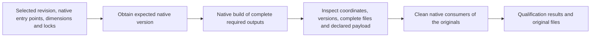

# Build and Qualification

## Scope and Consumers

Ecosystem, CI and Release authors use this shared scope for native versions, complete package outputs and clean local consumption. Release's remote completion conditions remain in the Release scope.

Start with the [component overview](../middle-level-design.md#components-and-native-responsibilities). The [requirements](../requirements.md) govern this design; the [handoff](../agent-handoff.md#authorization-and-closed-campaigns) retains operation limits. The owner maintains this scope with its affected callers.

## Qualification Journey

CI and Release call these shared operations in separate executions. The diagram
shows native work and its checks, not a new pipeline service or a second build.

Missing required facts, version disagreement, incomplete outputs or failed
required consumers fail qualification. The caller retains these results;
[Release](release.md#request-and-preparation) independently prepares its own
complete set and owns remote completion.

## Builds, Packages and Consumers

Build and qualification operations receive the selected revision, native entry
point, dimensions, expected native version projections and relevant locked inputs.
Planning may calculate NBGV; builds may calculate it again under the same relevant
Git/ref/history, configuration, dependency and supported toolchain inputs. CI
package execution owns its process environment and does not inherit the runner's
ambient ref context, which would otherwise change the NBGV projection. Required
package/assembly projections must agree. Missing facts and disagreement fail the
operation; no fallback version or execution suffix is invented. The
[WD-REL-001](../requirements.md#release-delivery) exception uses its committed
static native version in place of the NBGV projection under the same rules.

Use native deterministic build configuration, stable paths/timestamps and locked
dependencies. Routine publication does not require a duplicate build. Same-input
recovery must reproduce original bytes; different commits need not produce equal
bytes merely because their product version is equal. Python source distributions
may need native static version materialization for Git-free downstream builds.

Inspect normal native package output with maintained ecosystem tools/libraries.
Qualification checks coordinate/version, the complete expected output set, declared
payload/dependency requirements and clean native consumption. Product-specific
extra content rules belong to that project's registered quality contract.

Do not promote a smoke package's literal file list, USTAR physical encoding,
padding or UID/GID into universal package validity rules. Retain actual extraction
protections for paths, sizes and ambiguous members where the chosen reader needs
them. A native library's format support is not a claim that every extraction mode
is safe. Preserve appropriate native source metadata without a V3 witness or an
identical mandatory commit field across ecosystems.

Local clean consumers use the complete original package set without source-tree
references or populated consumer caches masking omissions. Release performs its
own build and qualification; it does not promote CI artifacts or results.

## Versions, Original Bytes and Provenance

Preserve native provenance appropriate to the package: assembly source
information, package repository metadata or supported platform attestations.
Do not require an identical commit field across ecosystems or a V3 package
witness. Configure and inspect the chosen carrier; availability is not automatic.
Provenance does not replace required destination byte/state comparison.
Different-commit packages may differ despite equal versions. Native caches
remain the build system's concern.

## Ecosystem Qualification

| Ecosystem | Build and qualification                                                                                                                                    | Destination consequence                                                                                         |
| --------- | ---------------------------------------------------------------------------------------------------------------------------------------------------------- | --------------------------------------------------------------------------------------------------------------- |
| npm       | Native NBGV projection, original archive and clean install                                                                                                 | Exact version state; tags are routing metadata; no lifecycle scripts with publication capability                |
| NuGet     | MSBuild/NBGV, original nupkg and local clean consumer                                                                                                      | Native package identity and archive state; no npm tag assumptions                                               |
| Python    | nbgv-python projection (static version for the [WD-REL-001](../requirements.md#release-delivery) exception), wheel and sdist, local clean consumer of both | Complete two-file set; verified exact subsets may permit missing-file completion under the destination contract |
| Ruby      | Native version/gem build, metadata and local clean consumer                                                                                                | Evaluate gemspecs unprivileged; destination-specific original-gem observation and upload                        |

The destination column explains why local qualification cannot define one
universal package transaction. The [Release scope](release.md#destination-interface)
and each destination contract own normalization, required files, native
non-overwrite behavior, readback, visibility/time bounds, credential scope and
partial-set behavior. Missing necessary guarantees leave the path unsupported;
tests or application locks cannot supply them. Existing ecosystem evidence keeps
its original scope. This table is not new support or publication authorization.

## Validation Scenarios

| Contract | Required cases                                                                                   | Primary validation boundary                 |
| -------- | ------------------------------------------------------------------------------------------------ | ------------------------------------------- |
| Package  | Required native version agreement; complete outputs; clean consumers; same-input reproducibility | Ecosystem integration and package scenarios |

Package-specific mechanisms remain in
[.NET/NuGet](../integration/dotnet.md#concrete-nuget-release-integration),
[Node/npm](../integration/node.md#npm-release-and-destination-completion),
[Python](../integration/python.md#native-python-package-execution),
[Ruby](../integration/ruby.md#concrete-ruby-release-integration),
[GitHub asset preparation](../integration/github-release.md#preparation) and
[browser ZIP preparation](../integration/browser-store.md#preparation).
