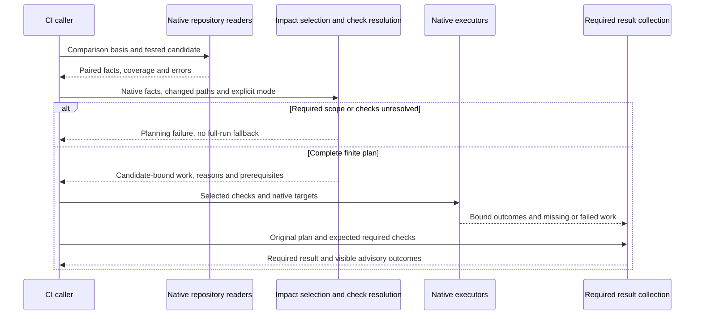
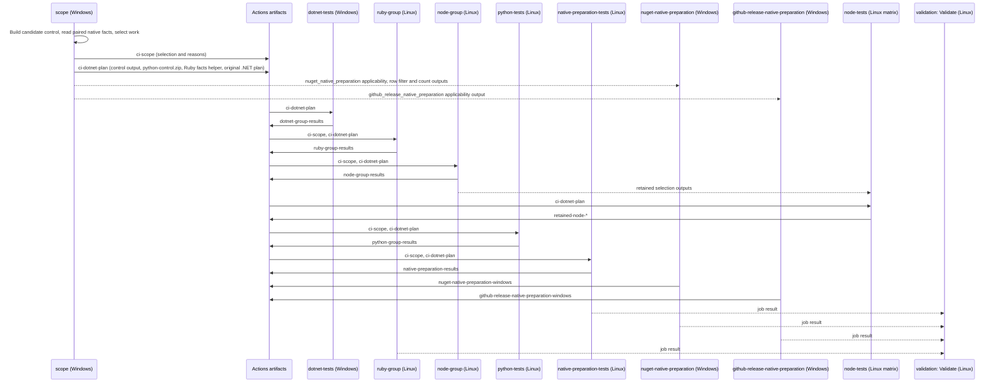

# CI Design

## Scope and Consumers

CI caller and executor authors use this scope for finite work planning, native execution and candidate-bound result collection. Selection and shared package qualification have their own scopes.

Start with the [component overview](../middle-level-design.md#components-and-native-responsibilities). The [requirements](../requirements.md) govern this design; the [handoff](../agent-handoff.md#authorization-and-closed-campaigns) retains operation limits. The owner maintains this scope with its affected callers.

## CI Journey

This UML sequence shows responsibilities inside the CI use case. The later
[job-level view](#workflow-realization) zooms into actual hosted transfers.

The [selection scope](repository-and-selection.md) owns the paired graph and
quality-resolution rules. Native build tools retain compilation ordering;
the caller does not schedule compiler nodes.

## CI Work and Result Contract

CI produces a finite work list before execution. Each selected item identifies:

- the concrete project, native aggregate or artifact target;
- operation and dimensions, suitable runner/toolchain and required inputs;
- required/advisory status and its resolved preset/native-retained origin;
- real prerequisites and the reasons it was selected.

The workflow has static planning, execution and collection phases. Planning can
supply runner matrices and selected lists; it does not create an arbitrary runtime
graph or queue. Native fact collection may use separate runners where ecosystem
evaluation requires them. These are real transfers, not proof-only phases.

### Workflow Realization

The following UML sequence view is at the level of GitHub Actions jobs in the
root [`ci.yml`](../../../../../../.github/workflows/ci.yml) and the artifacts they
transfer by same-run immutable artifact ID. It omits steps inside each job and
the retained jobs that do not exchange Workflow Delivery artifacts. Validate's
declared `needs` also include the omitted `conformance` and `scholarly-tests`
jobs. The repository ruleset's required checks are Validate, `dotnet-tests`,
`python-tests` and the `node-tests` matrix; `ruby-group` and `node-group` are
not required checks and gate merge only through Validate and `node-tests`
respectively.

### Native Execution

Native tool setup and queries consume each endpoint's committed locks without
refreshing tracked inputs. Select a tool version compatible with both basis and
candidate before loading its environment, and use native locked mode for setup
and inherited queries. A changed tracked lock is a planning failure, not a
cleanup condition.

Group compatible work around a native execution target. Build and check its
outputs in the same job when there is no runner, permission or independent-lifetime
reason to split them. A Python build can produce wheel and sdist together; one
native invocation can produce multiple declared outputs or establish several
checks if its contract actually covers them. Output count does not determine job
count. Cache sharing is not a semantic prerequisite.

Keep distinct selected checks visible even when they reuse a build. A successful
command cannot stand in for a check it never ran. Native build tools own their
project prerequisite ordering; the CLI must not schedule individual compilation
nodes to reproduce it.

### Result Collection

The required CI result joins the expected work with candidate-bound results.
Every required result must be present and satisfied. Failure, conflicting results,
cancellation, timeout, skipping or missing required work prevents success.
Advisory results remain visible without changing the required result. Collection
must account for failed dependencies; platform cancellation may still prevent a
final report and must not be interpreted as success.

HK retains source/configuration conformance. The control application's tests have
one ordinary CI owner, selected by actual inputs/dependencies. CI never imports
Release authority or exposes publication capability. General C# execution follows
the repository's Windows default unless a declared variant selects another runner.

### Caller Composition

Finite `CI/Callers` composition in the existing C# application assembles the
existing .NET, Node, Python and Ruby requests and collects their original
results, including retained-job scope and record-catalog responsibility. Actions
owns SDK and locked tool setup, the initial native control build and immutable
artifact transport: native Actions/shell bootstrap builds and transfers the
complete control distribution once and prepares the declared native tools. The
scope caller selects retained jobs and changed-coordinate responsibility in the
same process as the .NET plan; it does not reproduce native planners.

Control-resource prepare/query remain separate around endpoint SDK setup; the
scope caller consumes the separate query response, which retains its default
Debug context. The Linux-only Python and Ruby managed preparation scenarios
run directly through .NET, independently of pytest. Their selected source/build/
version/quality triggers, original reports and packages remain required. The
test runner's filter, per-module `--minimum-expected-tests` (which excludes
skipped rows) and exit code qualify them; missing, skipped or failed rows fail.

## Validation Scenarios

| Contract  | Required cases                                                                                     | Primary validation boundary               |
| --------- | -------------------------------------------------------------------------------------------------- | ----------------------------------------- |
| Execution | Complete selected variants/checks; shared prerequisites; runner mismatch; failed/missing execution | Work planning and real workflow transfers |

Concrete CI groups remain in
[.NET](../integration/dotnet.md#native-net-ci-group),
[Node](../integration/node.md#native-node-ci-group),
[Python](../integration/python.md#native-python-ci-group) and
[Ruby](../integration/ruby.md#native-ruby-ci-group).
[Execution boundaries](execution-boundaries.md#workflow-caller-boundaries)
own the common caller inventory and artifact/permission transfers.
