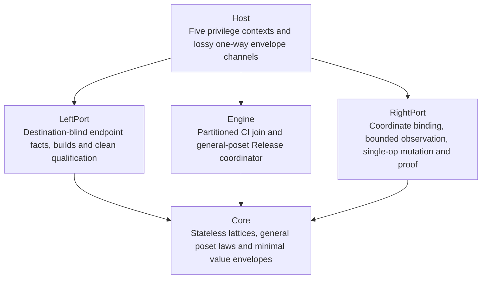

# Workflow Delivery v3: component and port contracts

The [business decision specification](business-semantics.md) treats Workflow
Delivery as a single observer and fixes what a contributor or release operator
may conclude across the five user journeys. Decomposing that black box into
independent components introduces internal seams: what each port may know, what
must cross an execution or privilege boundary, and what may remain private to a
provider without breaking a system-level invariant.

Like the business decision specification, this candidate refines the
[requirements](../requirements.md) (including Official repository anchors under
`WD-RET-004`) and documented native contracts as an independent formal
specification. It describes pure abstract components and their mathematical
contracts, not current classes, package layouts, wire encodings, a broader
product scope or permission to publish.

## Five abstract roles



| Role        | Abstract responsibility                                                                                                                                                              | What it never owns or sees                                                                                                                               |
| ----------- | ------------------------------------------------------------------------------------------------------------------------------------------------------------------------------------ | -------------------------------------------------------------------------------------------------------------------------------------------------------- |
| `Core`      | Stateless value sets, precedence lattices, general operation-poset laws, multi-provider CI planning, bilateral Release binding and pure completion evaluators.                       | Mutable state, external I/O, session handles, fixed topology-cardinality branches, or concrete ecosystem and destination names.                          |
| `LeftPort`  | Emit self-contained endpoint/path/check facts in CI, run partitioned checks, and build/clean-consume destination-agnostic release originals + release-note readiness in `unpriv`.    | Destination IDs, remote coordinates/feeds, remote observations, operator clearance, publication credentials, or cross-endpoint closure filtering.        |
| `RightPort` | Resolve physical coordinates from `(destination, channel, nativeIdentity)`, select its target subset of unit originals, declare its operation poset, and observe/mutate per op.      | Product/build execution, cross-context persistence of internal prerequisite handles, or mutation decisions outside `Engine` admission.                   |
| `Engine`    | Coordinate two-level partitioned CI collection and unified single- or dual-`RightPort` Release windows solely through `Core` rules and abstract `LeftPort` / `RightPort` contracts.  | Ecosystem or destination proper nouns, special-case container/store tracks, or unsealed provider handles across privilege transitions.                   |
| `Host`      | Enforce disjoint capabilities across `unpriv`, `isolated-pub-primary`, `anchor-gate`, `isolated-pub-anchor`, and `verify`, wiping provider session sets at every context transition. | Business completion verdicts, inferred retries, or co-location of product evaluation, primary destination credentials, and repository `contents: write`. |

Only `Core` values cross `Host` context boundaries. Within a single context, a
port interaction is an atomic Assume-Guarantee relation: `Engine` must satisfy
the port's call precondition, and the port may return any value satisfying its
declared postcondition.

## General right-port descriptors and bilateral Release binding

To keep `Core` and `Engine` free of destination-specific or fixed-cardinality
branches, [`DeliveryPortAlgebra`](models/DeliveryPortAlgebra.tla) characterizes
any `RightPort` instance by `IsValidRightProfile(p, unitArtifacts)` over a
general finite operation poset:

| Descriptor component | Mathematical domain                                                                          | Behavioral projection in `Core` and `Engine`                                                                                                                      |
| -------------------- | -------------------------------------------------------------------------------------------- | ----------------------------------------------------------------------------------------------------------------------------------------------------------------- |
| `channelPolicy`      | `(liveChannels, dryChannels)` with $\emptyset \subset \text{live} \subseteq \text{dry}$      | Admits channel/mode pairs uniformly across dual-channel feeds, Official-only feeds, Buddy-only preview feeds, and Official-only stores with Buddy dry runs.       |
| `readTopology`       | `unpriv-always`, `unpriv-live-only`, `publisher-only`, `blind-receipt`                       | Separates pre-gate read permission (`BeforeGateMode`), post-gate write admission (`MayMutatePostGate`), and authoritative completion reader (`CompletionReader`). |
| `proofMode`          | `served-bytes`, `version-available`, `store-accepted`                                        | Fixes what raw evidence establishes `ProofToken` (`WD-REL-009`) and when authoritative byte conflict overrides a lost publisher receipt.                          |
| `(ops, prereq)`      | Finite topological sequence `ops` and strict DAG `prereq[op]` respecting `ops` order         | Drives arbitrary single-op, multi-file, 1-to-$N$-asset container, or multi-hop chained prerequisite topologies without any `"container"` or `"op0"` branch.       |
| `consumes`           | `op -> SUBSET unitArtifacts` with non-empty target union `TargetArtifactsOf(p)`              | Selects the destination's required subset from `LeftPort`'s unit originals (for example one or two storefront ZIPs from a multi-archive unit build).              |
| `completableSubsets` | Non-empty prerequisite-closed family of non-empty subsets of `OpsOf(p)` (`{Ops}` if len = 1) | Distinguishes supported subset completions (`missing`) from blocked partial states (`unsupported-subset`).                                                        |

### Decoupling `LeftPort` preparation from `RightPort` coordinate binding

`LeftPort` receives only `LeftUnitSubject(req)`—`(execution, unit, revision,
inputs, channel, mode)`—with no destination, feed, coordinate or clearance. It
emits `LeftPrepEnvelope` carrying `nativeIdentity` (`pkgName`, `version`,
`notesReady` from `CHANGELOG.md` when present—allowing channel-specific native
package naming such as scoped preview names) and `originals` keyed by unit
artifact roles. `BindTargetEnvelope` on the `RightPort` side then:

1. Resolves the physical destination coordinate from
   `(destination, channel, nativeIdentity)`;
2. Enforces `notesReady` whenever the target or an Official anchor requires
   prepared release notes;
3. Projects `selectedOriginals` onto `TargetArtifactsOf(p) \subseteq DOMAIN originals`,
   keeping sibling build outputs out of unrelated destination envelopes.

### Clearance binding, pre-gate routing, and unconfirmed blind calls

Request-bound operator `clearance` (`first`, `owner-checked`, or `unresolved`)
lives inside `ReleaseRequest` and travels inside every envelope's `.subject`:

- Both `publisher-only` and `blind-receipt` ports have
  `BeforeGateMode(p, "live") = "unobserved"` and
  `CompletionReader(p) = "publisher"`.
- A `publisher-only` port enters `isolated-pub-primary`, observes remote state,
  issues zero writes when already `established`, and mutates only on `missing`.
- A `blind-receipt` port with `clearance = "unresolved"` stops **before** the
  native gate (`SelectRoute = "unresolved"`), never entering
  `isolated-pub-primary` or mounting store secrets, and reports
  `satisfaction = "unknown", attempted = "no"`. Only `first` or `owner-checked`
  enters `isolated-pub-primary`.
- On `blind-receipt`, an HTTP-acknowledged submission whose bounded operation
  poll remains unconfirmed (`unknown`) at the publisher deadline stays in
  `uncertainCalls` (`attempted = "yes"`, `satisfaction = "unknown"`,
  `uncertainCalls # {}`). Where a store's native upload and version submission
  form non-resumable internal sub-steps, `RightPort`'s Assume-Guarantee
  postcondition halts internal sub-calls immediately on failure or ambiguity and
  surfaces any unconfirmed intermediate step as `failed` or `ambiguous`.

### General prerequisite session sets without cross-context handle leakage

Let `PrereqRootsOf(p)` be the set of operations appearing in `p.prereq[op]` for
any downstream `op`. Inside an isolated publisher context, `pluginSession` is
the subset of `PrereqRootsOf(p)` whose handles are bound in provider memory:

- `Host` resets `pluginSession = {}` on every transition between `unpriv`,
  `isolated-pub-primary`, `anchor-gate`, `isolated-pub-anchor`, `verify`, and
  `done`; no envelope contains `pluginSession`.
- Fresh publisher observation binds
  `{pre \in PrereqRootsOf(p) : refreshed[pre] = "established"}`, and each
  acknowledged prerequisite operation adds itself to `pluginSession`.
- Topological selection guarantees `p.prereq[op] \subseteq pluginSession` at
  every `RightPort` mutation call across 1-asset containers, multi-asset
  containers, and multi-depth chains (`op0 -> op1 -> op2`).

### Dual-`RightPort` Official anchor composition (`WD-RET-004`)

Following Assume-Guarantee decomposition, [`ReleaseComponentProtocol`](models/ReleaseComponentProtocol.tla)
temporally verifies step-by-step poset ordering, `pluginSession` wiping, raw
`outcomes` sequences, and sealed-receipt soundness (`PubReceiptGuarantee`:
`IsValidSealedPubReceipt`) across ten representative poset/capability profiles
(including `OneAssetContainer` and `TwoAssetContainer`, which share the 2- and
3-operation container-plus-asset poset shapes of `AnchorProfileFor` up to
Official-only channel admission and artifact-role renaming), while
[`OfficialAnchorComposition`](models/OfficialAnchorComposition.tla) composes
two independent `RightPort` stages across the Host contexts using automatic
congruence quotients (`QuotientObsMaps` and `QuotientPubReceipts` in
[`DeliveryPortAlgebra`](models/DeliveryPortAlgebra.tla), which quotient
non-acknowledged `failed` vs. `ambiguous` command labels in raw `outcomes`
while startup `ASSUME QuotientBisimulationSound` mechanically proves exact
preservation of `PrimaryPermitsAnchor`, `satisfaction`, `attempted`,
`outcomesAvailable`, `uncertainCalls`, and `IsDefinitiveUnsatisfied` for every
full-space `ValidObsMaps` observation and sealed publisher receipt across all
five primary profiles and their `AnchorProfileFor` descriptors):

1. `unpriv` prepares once, requires `notesReady = TRUE` on Official requests
   (failing closed before any gate or write when `CHANGELOG.md` notes are
   missing), and observes primary (where readable) plus the anchor `RightPort`
   (`AnchorProfileFor` creates/adopts `"op0"` and models one upload operation
   per target artifact using local IDs `"op1"` / `"op2"` that intentionally
   overlap primary operation IDs).
2. `isolated-pub-primary` holds only primary destination write capability
   (`AnchorWriteCap = FALSE`); if `primaryRoute = "verify-without-write"`, this
   context is bypassed completely.
3. `PrimaryPermitsAnchor` evaluates the receipt **delivered to `anchor-gate`**
   (`PrimaryReceiptAtAnchor`), rejecting any `failed` primary command
   (`OpsWithOutcome(commands, "failed") = {}`) and admitting
   `anchor-gate -> isolated-pub-anchor` (`AnchorWriteCap = TRUE`,
   `PrimaryWriteCap = FALSE`) **only** when primary was pre-gate
   `verify-without-write`, observed `ProofToken` at post-gate publisher refresh
   with zero writes on `verifier`-read ports, acknowledged all remaining missing
   operations on `verifier`-read ports, or established `ProofToken` in
   `pubFinalObs` on `publisher`-read ports (including owner-specified bounded
   post-`ambiguous` readback under `WD-REL-009` and `WD-RET-004`'s
   _"acknowledged or observed satisfied"_ rule). Primary writes stop on the
   first abnormal outcome per `WD-OPS-002`. The
   [Release completion contract](release.md#post-publication-completion)
   distinguishes this permission to open the anchor from final satisfaction.
4. `verify` receives `PrimaryReceiptAtVerify` and `AnchorReceiptAtVerify`
   independently of `anchor-gate` (so `verify` may lose the primary receipt even
   after `anchor-gate` received it and mutated GitHub, yielding
   `primaryAttempted = "unknown"` while aggregate `attempted = "yes"`).
   `CombinePrimaryAndAnchor` tags composite `hypotheticalOps` and
   `uncertainCalls` by role (`<<"primary", op>>`, `<<"anchor", op>>`) to prevent
   operation-ID collisions across ports, preserves authoritative conflict or
   pre-gate block (`IsDefinitiveUnsatisfied` -> `unsatisfied`) ahead of
   `unknown`, and lets `unknown` dominate non-execution `unsatisfied`
   (`known-nonstart`) whenever either port remains unresolved.
5. **Asymmetric 2-run recovery via bipartite summary hub:** Run 1 injects
   independent verify-stage receipt/observation loss and retention expiry
   (`retained = FALSE` on non-lost verify receipts), and from **every** bound,
   ref-eligible live Official Run 1 execution (`clearance = "first"`) that ends
   non-satisfied, `StageRecovery` collapses Run 1 into its compact observer
   summary (`ctx = "recover"`, reducing $M \times N$ recovery fan-in to
   $M + K \cdot N$ transitions) before `DispatchRecovery` explores Run 2 across
   every reachable observation and publisher/anchor-gate fault (under intact
   Run 2 verify-stage delivery and retention): whenever Run 2 observes the
   primary as `established`, it issues **zero primary writes**
   (`primaryCommands = <<>>`, and `primaryAttempted = "no"` whenever envelopes
   and any required publisher receipt are retained) and executes only
   still-missing anchor operations; when a `blind-receipt` primary lacks
   retained non-start evidence (`~retained \/ primaryAttempted # "no"`) and
   remained unconfirmed in Run 1, Run 2 requires owner inspection
   (`owner-checked` vs. `unresolved`); whereas when `isolated-pub-primary`
   already polled `received` in Run 1 (`BlindPrimaryConfirmedInPub`), Run 2
   forces `clearance = "unresolved"` (even if `verify` lost the Run 1 receipt)
   and blocks before `isolated-pub-primary` rather than double-submitting.

## Self-contained left-port CI composition and two-level join

In [`DeliveryPortAlgebra`](models/DeliveryPortAlgebra.tla), `ComposeCiPlan`
accepts **only** `(mode, changedPaths, expectedSubject, expectedProviders,
leftEnvelopes)`—reading zero external topology, survival, check or partition
constants:

1. **Provider-roster completeness, path accountability, and conflict detection:**
   Each `LeftFactEnvelope` supplies `(provider, subject, complete,
pathConsumers, accountedPaths, basisEdges, candEdges, candidateNodes,
nodeChecks, advisoryChecks, baselineGroups)`. `Core` verifies that the
   delivered domain equals `expectedProviders` with matching `provider`
   identities (omitting or substituting a provider fails closed so cross-plugin
   consumers are never silently lost). A changed path owned by provider B and
   unknown to provider A resolves cleanly; an inert path in `accountedPaths`
   with empty consumers resolves to empty project impact; a path claimed by
   **no** provider—or any cross-provider partition disagreement on the same
   check ID—forces `scope = "unresolved"` in both `selective` and `full` modes.
2. **Paired union before runnable projection:** Surviving nodes with empty
   required `nodeChecks` act as input-only workspace bridges (`bridge`). `Core`
   computes `PairedClosure` over unioned `basisEdges` and `candEdges` before
   filtering to runnable nodes (`ReqSpecsOf(u) # {}`), preserving paths such as
   $\text{library} \xrightarrow{\text{basis}} \text{bridge} \xrightarrow{\text{candidate}} \text{new-consumer}$.
3. **Two-level partition and check join:** `ValidProducerPartitionJoin`
   requires exact-once bound `GroupResultEnvelope` delivery for every planned
   group (including baseline `grp-core` when `work = {}`), no unplanned group,
   and partition-scoped check membership before `ValidRequiredCheckJoin`
   evaluates per-check `passed` receipts.

## Minimal narrow-waist envelopes

| Boundary                              | Envelope              | Required mathematical components                                                                                                                                                                 | Explicitly excluded                                                        |
| ------------------------------------- | --------------------- | ------------------------------------------------------------------------------------------------------------------------------------------------------------------------------------------------ | -------------------------------------------------------------------------- |
| `LeftPort -> Core` (CI)               | `LeftFactEnvelope`    | Provider ID, `(basis, candidate, control)` subject, `complete`, `pathConsumers`, `accountedPaths`, `basisEdges`, `candEdges`, `candidateNodes`, `nodeChecks`, `advisoryChecks`, `baselineGroups` | Native project-graph objects, tool-loader state, pre-filtered closures     |
| `Core -> GroupExecutor / Engine` (CI) | `PlanEnvelope`        | Resolved `scope` or `unresolved`, selected runnable `projects`, `work`, `advisory`, planned `groups`, `partitionMap`                                                                             | Unselected repository nodes, local filesystem paths                        |
| `GroupExecutor -> Engine` (CI)        | `GroupResultEnvelope` | Partition `group`, bound plan `subject`, `occurrence`, partition-scoped check `receipts`                                                                                                         | Ambient runner state, cross-group check results                            |
| `LeftPort -> RightPort` (Release)     | `LeftPrepEnvelope`    | Destination-blind `LeftUnitSubject`, `release` origin, `complete` & `clean`, `nativeIdentity` (`pkgName`, `version`, `notesReady`), unit `originals`                                             | Destination IDs, registry URLs, remote coordinates, clearance, SDK handles |
| `RightPort -> Engine` (Release)       | `TargetEnvelope`      | Full `ReleaseRequest` subject (including `destination` and `clearance`), resolved `coordinate`, `bound` & `notesReady` flags, projected `selectedOriginals`                                      | Unconsumed sibling unit archives, mutable session handles                  |
| `Unpriv -> Gate / Verify` (Release)   | `RouteEnvelope`       | Bound `subject` and `coordinate`, selected `route`, initial `ObsMap` (or `unobserved`), `reviewed` operation ceiling                                                                             | Replayable approval tokens, provider-private handles                       |
| `IsolatedPub -> AnchorGate / Verify`  | `PubReceiptEnvelope`  | Bound `subject`, `coordinate`, and `status` (`present`, `known-nonstart`, `lost`, `not-required`); when `present`, `refreshed`, `commands`, and `pubFinalObs`                                    | Destination or `contents: write` credentials, `pluginSession` handles      |
| `Verify -> Complete` (Release)        | `VerifyObsEnvelope`   | Bound `subject` and `coordinate`, `present` flag, and verifier `ObsMap` (only when `CompletionReader = verifier`)                                                                                | Inferred publisher non-start, retrospective mutation of prior reports      |

## What the finite component models check

The component models connect to the [business decisions](business-semantics.md)
at different levels. [`ReleaseSystemRefinement`](models/ReleaseSystemRefinement.tla)
maps component state to `PublicationWindow` and checks its temporal specification
on two finite configurations. [`CiComponentComposition`](models/CiComponentComposition.tla)
compares the plan and verdict with `CandidateQualification` at the `verify`
boundary; it does not check temporal refinement of every CI step. The Official
anchor model checks composition and capability isolation across two ports.

| Model and configuration                                                                                                    | Finite boundary and checked contracts                                                                                                                                                                                                                                                                                                                                                                                                                                 | Distinct states |
| -------------------------------------------------------------------------------------------------------------------------- | --------------------------------------------------------------------------------------------------------------------------------------------------------------------------------------------------------------------------------------------------------------------------------------------------------------------------------------------------------------------------------------------------------------------------------------------------------------------- | --------------: |
| [`CiComponentComposition`](models/CiComponentComposition.tla) ([configuration](models/CiComponentComposition.cfg))         | Two `LeftPort` providers with roster validation (omitted and substituted provider faults), asymmetric path ownership, inert and unclaimed paths, cross-provider check-partition conflict, surviving input-only `bridge`, two partitions, and `unpriv -> verify` delivery across sixteen boundary/receipt faults. Checks `ComposeCiPlan` self-sufficiency, two-level join and `CandidateQualification` refinement.                                                     |         130,176 |
| [`ReleaseComponentProtocol`](models/ReleaseComponentProtocol.tla) ([single-port](models/ReleaseComponentProtocol.cfg))     | Startup `ASSUME` over `BoundedValidProfiles` (general 1–3-op posets, raw-evidence classification, `PrimaryPermitsAnchor`, `SealedPubReceiptsFromPool`, tampering, and expiry), plus exhaustive `ValidObsMaps` temporal runs across ten poset/capability profiles, `PubReceiptGuarantee` (`IsValidSealedPubReceipt`), receipt & `VerifyObs` loss, `retained` expiry, and 4-family 2-run recovery.                                                                      |         207,929 |
| [`OfficialAnchorComposition`](models/OfficialAnchorComposition.tla) ([official-anchor](models/OfficialAnchorProtocol.cfg)) | Congruence-quotient (`ASSUME QuotientBisimulationSound`) dual-`RightPort` `WD-RET-004` composition across Buddy/Official and five primary profiles + overlapping-ID 2–3-op `AnchorProf`, verifying `notesReady`, disjoint write capabilities, post-gate refresh & post-ambiguous `PrimaryPermitsAnchor`, independent multi-job receipt loss, role-tagged namespaces, and bipartite 2-run recovery.                                                                    |         279,738 |
| [`ReleaseSystemRefinement`](models/ReleaseSystemRefinement.tla) ([ordered-pair](models/ReleaseRefinementPython.cfg))       | Startup `ASSUME` comparing `AdmittedRequest`, `ProofToken`, `CompletionReader`, `BeforeGateMode`, `ValidRecoveryDispatch`, `SelectRoute` (noting the intentional pre-gate `unresolved` stop on Edge `unresolved` clearance, which yields the same terminal `"unknown"` / `"no"` verdict), `HasPublisherAccess`, `MayMutatePostGate`, `EvaluatePositiveProof`, `EvaluateConclusion`, and `EvaluateAttempted` against `ReleaseRules`, plus `PROPERTY PWSpecRefinement`. |           4,992 |
| [`ReleaseSystemRefinement`](models/ReleaseSystemRefinement.tla) ([container-assets](models/ReleaseRefinementAssets.cfg))   | Temporal `PROPERTY PWSpecRefinement` (`PublicationWindow!Spec`), general `pluginSession` prerequisite-set binding and context wiping, and terminal `Report` projection equality on the three-operation container-plus-assets surface.                                                                                                                                                                                                                                 |          25,584 |

Universal safety, isolation, and completion invariants are verified across every
reachable state in the five configurations above (with enabled-progress
additionally verified by `PermittedProgress` in `ReleaseComponentProtocol`).
Eleven additional
configurations deliberately negate a shortcut or a target scenario to produce a
concrete counterexample or non-vacuity witness trace (TLC exit code 12 on the
named invariant):

| Configuration                                                                               | Module                      | Expected violated invariant and what the single trace demonstrates                                                                                                                                                                                                                                                                                                                                               |
| ------------------------------------------------------------------------------------------- | --------------------------- | ---------------------------------------------------------------------------------------------------------------------------------------------------------------------------------------------------------------------------------------------------------------------------------------------------------------------------------------------------------------------------------------------------------------- |
| [`CiBridgeClosureCounterexample`](models/CiBridgeClosureCounterexample.cfg)                 | `CiComponentComposition`    | `EndpointLocalRunnableClosureSuffices`: filtering each endpoint's edges to runnable projects inside `LeftPort` before cross-endpoint union drops `new-consumer` reached across surviving input-only `bridge`.                                                                                                                                                                                                    |
| [`CiFlatJoinCounterexample`](models/CiFlatJoinCounterexample.cfg)                           | `CiComponentComposition`    | `CheckOnlyJoinSuffices`: validating only flat check receipts fails to reject partition-envelope faults such as duplicate group envelopes whose identical check receipts collapse under set union (`TwoLevelJoinDiscipline` checks missing empty-work and misplaced groups as well).                                                                                                                              |
| [`ConflatedReadWriteTraitCounterexample`](models/ConflatedReadWriteTraitCounterexample.cfg) | `ReleaseComponentProtocol`  | `GatedReadAloneImpliesUnobservedWriteSafe`: `publisher-only` enters the gate `unobserved` like `blind-receipt`, but post-gate mutation on `unobserved` is forbidden.                                                                                                                                                                                                                                             |
| [`DroppedSessionRefreshCounterexample`](models/DroppedSessionRefreshCounterexample.cfg)     | `ReleaseComponentProtocol`  | `PreGateObservationSufficesWithoutRefresh`: between `unpriv` and `isolated-pub-primary`, remote state shifts to an established container and conflicting asset; fresh publisher observation binds `"op0" \in pluginSession` and halts writes.                                                                                                                                                                    |
| [`GatedZeroWriteWitness`](models/GatedZeroWriteWitness.cfg)                                 | `ReleaseComponentProtocol`  | `NoGatedStoreZeroWriteSatisfaction`: existential witness that live `publisher-only` enters `isolated-pub-primary` `unobserved`, observes `established`, issues zero writes, wipes `pluginSession`, and satisfies without verifier store reads.                                                                                                                                                                   |
| [`BlindOwnerCheckedRecoveryWitness`](models/BlindOwnerCheckedRecoveryWitness.cfg)           | `ReleaseComponentProtocol`  | `NoBlindOwnerCheckedRecovery`: existential witness that after Run 1 ends `unknown` on an acknowledged `blind-receipt` call with an unconfirmed poll (`uncertainCalls # {}`), `owner-checked` Run 2 submits and satisfies while Run 1 stays `unknown`.                                                                                                                                                            |
| [`ContainerRebuildConflictWitness`](models/ContainerRebuildConflictWitness.cfg)             | `ReleaseComponentProtocol`  | `NoContainerRebuildByteConflictBlocksRecovery`: existential witness that after Run 1 uploads `op0` + `op1` and stops on ambiguous `op2`, a Run 2 recovery observing a conflicting remote asset (`op1 = "conflict"`, such as a remote byte mismatch, while changed-rebuild-digest dispatch is separately forbidden by `ValidRecoveryDispatch`) blocks before the gate with zero writes and reports `unsatisfied`. |
| [`AnchorPostGateSatisfiedWitness`](models/AnchorPostGateSatisfiedWitness.cfg)               | `OfficialAnchorComposition` | `NoPostGateObservedPrimaryPermitsAnchor`: existential witness on `ByteOrderedPair` that when post-gate refresh observes primary already satisfied (`0` primary writes), `PrimaryPermitsAnchor` admits the Official anchor, uploads it, and completes `satisfied`.                                                                                                                                                |
| [`AnchorIndependentLossWitness`](models/AnchorIndependentLossWitness.cfg)                   | `OfficialAnchorComposition` | `NoIndependentVerifyLossPreservesAnchorAttempt`: existential witness that when `anchor-gate` receives primary receipt and mutates GitHub while `verify` loses primary receipt, `primaryAttempted = "unknown"`, `attempted = "yes"`, and `<<"primary","op2">>` / `<<"anchor","op2">>` stay distinct.                                                                                                              |
| [`AnchorReadableRecoveryWitness`](models/AnchorReadableRecoveryWitness.cfg)                 | `OfficialAnchorComposition` | `NoReadablePrimarySkipAnchorRecovery`: existential witness on two-archive `GatedReadBundledStore` that after Run 1 satisfies primary and leaves `"op2"` missing on the anchor, Run 2 performs zero primary writes, uploads only `"op2"` (`attempted = "yes"`), and satisfies.                                                                                                                                    |
| [`AnchorBlindPostReceiptWitness`](models/AnchorBlindPostReceiptWitness.cfg)                 | `OfficialAnchorComposition` | `NoBlindPostReceiptAnchorFailureBlocksRedispatch`: existential witness that after Run 1 satisfies `BlindReceiptStore` primary (`received`) and fails on the Official anchor, Run 2 has `clearance = "unresolved"` and blocks before `isolated-pub-primary` with zero writes.                                                                                                                                     |

The Linux Workflow Delivery verification job runs
[`check_workflow_delivery_models.py`](../../../../../../eng/scripts/check_workflow_delivery_models.py)
on explicit full validation and changes to the models, their runner or locked
toolchain. Changes confined to the control application and its tests rerun the
TLC-to-caller comparisons below without rechecking unchanged temporal models.
The full lane checks
all five positive configurations above and three shortcuts: filtering an
input-only bridge before closure, joining checks without their partitions, and
authorizing a refreshed operation set by count alone. Each shortcut must fail
on its specified invariant;
a different failure is not a witness. HK still checks TLA+ syntax with SANY.
[`PublicationWindowOracle`](models/PublicationWindowOracle.tla) then drives the
unchanged `Grant`, `Invoke`, `LoseResult`, and `Verify` actions on fixed port
responses. The managed test issues the same responses to the real Python
publisher and verifier entry points and compares actual calls, retained
receipts, attempted mutation, and satisfaction with TLC's terminal report.
[`VerifierReadGateOracle`](models/VerifierReadGateOracle.tla) enumerates the
six sealed receipts for one initially missing operation on a verifier-read
port. The Ruby publisher sees matching bytes on its diagnostic readback;
the actual Official gate must still agree with `PrimaryPermitsAnchor`,
including when the native upload times out.
[`CiJoinOracle`](models/CiJoinOracle.tla) supplies the component specification's
verdict for sixteen receipt conditions at the two-partition CI join.
[`CiSelectionOracle`](models/CiSelectionOracle.tla) exports sixteen selective
and full planning results. The Python workspace planner receives corresponding
native dependency and pytest-target facts; the comparison checks its actual
candidate targets, including the consumer across the input-only bridge, and its
refusal of incomplete or unaccounted input. It does not assert that every
ecosystem runs in one process or that GitHub executes every possible schedule.
These comparisons exercise compiled callers with controlled ports, not a live
index, GitHub Environment, or a proof over all C# executions.

Reproduce the lane with `python eng/scripts/check_workflow_delivery_models.py`
with the locked .NET SDK, Java and TLC tools on `PATH`. Use `--conformance-only`
to run just the compiled comparisons. Reproduce any configuration from the
repository root with the
[locked TLA+ toolchain](../../../../../../docs/engineering/workspaces.md#tla)
(`TLC` 2.19 in `tla2tools.jar` 1.7.4):

```powershell
$m = "src/private/app/workflow-delivery/docs/design/models"
mise run tla:tlc -- -workers auto -config "$m/OfficialAnchorProtocol.cfg" "$m/OfficialAnchorComposition.tla"
```

## Boundaries of the component abstraction

- **Port assumptions vs. native behavior:** `ClassifyRawOpObs` in
  [`DeliveryPortAlgebra`](models/DeliveryPortAlgebra.tla) defines the required
  `RightPort` observation postcondition: an operation cell reports `missing` if
  and only if `coordMatch /\ ~present /\ status = "absent"` (never on a foreign
  coordinate); reports `conflict` if and only if `present` holds with either a
  foreign coordinate (`~coordMatch`), `status = "rejected"`, or a `served-bytes`
  target of non-`unknown`/`absent` status whose metadata or bytes fail to match
  (`~metadataMatch \/ ~bytesMatch`); reports `established` if and only if
  `present /\ status \notin {"absent", "unknown", "rejected"} /\ EvaluatePositiveProof(...) = ProofToken`;
  and reports `unknown` otherwise (including unread/failed reads with
  `status = "unknown"`, so on `blind-receipt` an `acknowledged` submission
  command whose polled operation status remains `unknown` stays in
  `uncertainCalls` and never reports `satisfied`). `TLC` verifies that `Engine`
  and `Core` preserve every safety, isolation, envelope-binding, dual-port
  anchor and refinement property _assuming_ each `LeftPort` and `RightPort`
  implementation satisfies that postcondition and its native platform contracts
  (`WD-SYS-004`, `WD-REL-008`, `WD-REL-009`, `WD-OPS-002`, `WD-RET-004`). It
  does not verify MSBuild, PNPM, UV, Bundler, NBGV, GitHub Actions artifact
  integrity, OIDC token exchange or external registry HTTP endpoints.
- **Shared browser-store anchor concurrency:** When multiple storefront runs for
  the same Official unit share one `release/<unit>/v<npmVersion>` anchor, native
  workflow concurrency serializes `publish-github-anchor` per unit while
  `RightPort` treats verified same-version sibling storefront archives as benign
  and rejects any foreign asset name, byte mismatch or commit mismatch as
  `conflict` ([release design](release.md#post-publication-completion)).
- **Opaque session scope:** `pluginSession` models the set of prerequisite
  handles live inside one `isolated-pub-primary` or `isolated-pub-anchor`
  execution. A provider may keep rich typed handles in memory inside that
  context so long as they never enter `Core` envelopes or outlive the context.
