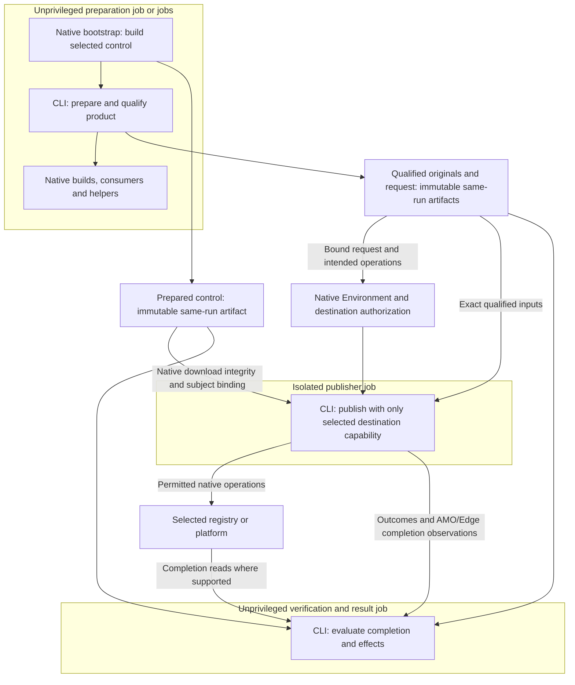

# Execution and Transfer Boundaries

## Scope and Consumers

Workflow and caller authors use this scope for actual runner, permission, process and artifact-transfer boundaries. It owns shared caller inventories and transfer obligations, not CI selection or Release's completion predicate.

Start with the [component overview](../middle-level-design.md#components-and-native-responsibilities). The [requirements](../requirements.md) govern this design; the [handoff](../agent-handoff.md#authorization-and-closed-campaigns) retains operation limits. The owner maintains this scope with its affected callers.

## Execution View

The deployment/permission view below uses flowchart notation. Each CLI box is an
execution of the same selected-revision application, not another service.
It shows Release's isolation needs, not a mandatory job count; CI uses the
prepared control in unprivileged execution and has no publication gate.
The gated live path is shown. Dry runs skip gate and publisher; exact-state
requests bypass them except for live AMO/Edge.

AMO/Edge reads occur only inside their publisher as specified below. The Chrome
read-only token is used outside its publisher, but no browser-store dry run
acquires any store credential. Native gates, runner defaults and transfer
validation remain the concrete caller's responsibilities.

## Workflow, Permission and Transfer Boundaries

Build the CLI from the selected control revision before publication capability
exists. Transfer the prepared control artifact separately from product-mutated
output. Evaluation, package scripts, builds and consumers run in jobs/processes
that cannot obtain publication capability or mutate the publisher's context.
Installing write credentials after product execution in the same job is not
sufficient isolation. Privileged metadata readers must not execute product code.

The native Environment gate belongs on the publisher job. Its effective settings
are the policy; do not mirror reviewers, replay approval/deployment history or
maintain a sentinel certificate. Destination-specific jobs remain appropriate for
different permissions and runners. A common Release use case does not require a
job with the union of every destination's privileges.

Logical phases are prepare/qualify, observe/describe, gated publication when needed,
and verification/result. Combine or split them according to actual runner,
credential, product-execution and transfer boundaries. Verification readback runs
outside the privileged publisher; the Chrome Web Store uses a read-only
`chromewebstore.readonly` token there. AMO and Edge Add-ons are the exception:
AMO version reads require the publish credentials, while Edge has no version
read endpoint and accepts an `Unobserved` first-submission prestate. The AMO
publish job makes the pre-submission and completion reads; the Edge publish
job polls upload and submission operations. Both emit credential-free,
request-bound observations that result collection evaluates
([WD-REL-008](../requirements.md#release-delivery)). A live AMO or Edge request
therefore always enters the write gate. A browser-store dry run acquires no
store credential, including the Chrome read token from the one write-capable
service account, and reports state as unobserved
([WD-CHN-004](../requirements.md#buddy-and-official-channels)). Dry-run paths do not
enter a write gate. Exact-state paths bypass it except for live AMO and Edge
requests under WD-REL-008; dry run reports hypothetical operations and actual
validation limits.

Serialize this repository's publication operation by physical registry and normalized
package, including required read-before-write and verification. If that operation
spans publisher and unprivileged verification jobs, use a containing native workflow
serialization boundary that covers them rather than releasing a job lock early.
Do not partition colliding resources solely by channel or version, automatically
cancel an active publication, or promise FIFO/lossless queue behavior. External
writers remain governed by registry guarantees, not an application-wide lock.

### Data Crossing Boundaries

| Transfer                                 | Minimum information                                                                                                                                 | Consumer validation                                                    |
| ---------------------------------------- | --------------------------------------------------------------------------------------------------------------------------------------------------- | ---------------------------------------------------------------------- |
| Native facts from another runner/process | Revision, relevant entry points, facts, errors and coverage limitations                                                                             | Correct subject and required fact coverage                             |
| CI plan and task results                 | Candidate/comparison, selected work/reasons, required checks, concrete result subjects and outcomes                                                 | Result corresponds to selected work; complete required closure         |
| Release preparation                      | Source/control revision, unit/channel/destination/mode, native versions, complete original files, qualification results and maximum intended writes | Actual files and qualified subject match the reviewed request          |
| Prepared CLI                             | Selected control revision and immutable output with its same-run artifact ID and native integrity                                                   | Publisher executes the intended control artifact without rebuilding it |
| Publication and verification result      | Attempted operations, raw responses/outcomes, required observations/checks and unresolved effects                                                   | Completion is supported; missing data does not prove non-start         |
| Operator                                 | Scope, outcome, diagnostic reasons and supported next action                                                                                        | Preserve terminal outcomes; later requests cannot rewrite them         |

These are consumer-specific typed contracts, not a universal envelope or one file
per row, recursive digest chains, approval certificates, a durable attempt
aggregate or a record engine. Concrete JSON fields and command signatures follow
actual implementation consumers. Internal formats may break; callers change or
retire together without mandatory historical readers in the new core.
Independently consumed helper messages may have static schemas generated from
their actual serializer types; keep producer/consumer shape tests separate from
native semantic tests. Do not mirror upstream native formats or introduce a
runtime schema registry. Keep data in memory when no real boundary requires
transfer. Executors need their work, not a serialized copy of the entire
repository graph.

Use same-run native immutable artifact IDs and native download integrity; reject
missing, substituted or mismatched inputs. Display names and latest-artifact lookup
are not identity. Trust successful native upload; the actual receiving consumer
validates its download. Do not upload/download/re-admit every producer intermediate
just to prove the platform accepted it. Package byte identity remains necessary
for qualification and remote comparison even when native transport owns integrity.

Retain qualified files and required request/results for approval waits and the
supported operation window within platform limits. Concrete durations are workflow
settings, reviewed with their caller. Expired required inputs block that operation.
Fresh same-revision recovery may use current native state under its destination
contract without requiring a permanent application record store. Optional
telemetry failure does not undo an established result; missing required
completion evidence leaves uncertainty. No permanent ledger or mandatory
per-product GitHub Release audit anchor is added.

## Native Helper and Caller Boundaries

Complete .NET, Python and Ruby CI group execution owns its original plan's outcome.
CLI exit and process receivers use that bound outcome, retaining comparison,
candidate, scope, raw results and diagnostics. Receivers reject missing or malformed
outcomes rather than launching the same control to reevaluate its unchanged results.
Pre-execution plan validation and Node's join across independent runtime results
remain distinct.

The application owns ordinary Release job inputs, request subject binding,
original transfer, phase configuration and required write-state output. Existing
Ruby/Python/npm/NuGet workflows invoke `release job-inputs <ecosystem> <operation>` through
their already distributed candidate control. They do not carry a separate
language-specific Release caller implementation. Actions retains job ordering,
Environment, credentials, concurrency and immutable artifact transfer.

Same-run
immutable artifact IDs carry the producer run; each later job checks the received
preparation once against the request subject rather than restating run and
attempt in separate producer records. Live ref eligibility has one definition,
applied where the request is formed and again by the privileged publisher.
Every `complete-*` command (npm, NuGet, Python and Ruby) consumes the retained
initial observation to distinguish legitimate no-write completion from missing
required publication information. NuGet callers forward native process
termination; typed completion owns result interpretation, without a shell enum
mirror.

Ruby helpers retain RubyGems/Bundler evaluation and native source reads; local
installation/API qualification uses the native gem and Ruby commands. Python helpers retain PyPA/NBGV library bindings in the
UV-prepared environment; the CLI runs UV; .NET and Node use their supported native process interfaces.
A helper is justified by a required library interface, not by the language label.
Adding a distinct product can require a concrete recipe; no generic plugin or
automatic adoption capability is implied by the registered release units that
the [integration contracts](../middle-level-design.md#integration-mapping) own.

[Native wire schemas](../../Native/contracts) are generated from the actual
application serializer metadata by `native-message-schemas <directory>`.
They describe retained Ruby fact/source messages with independent
native consumers. Python helper responses are tested by their managed consumers;
no unused schema export is retained. Managed tests require regeneration equivalence; native Ruby
tests consume the static descriptions without building the application. These
are shape descriptions, not a schema registry, runtime admission policy,
upstream PNPM/MSBuild format mirror or compatibility lifecycle. Semantic native
identity, path, version, producer and command checks remain required. Existing
native command-argument interfaces need no invented JSON envelope.

### Runtime and CLI Consumers

The [application README](../../README.md) owns current commands and supported
options. The internal CLI has no historical Python command or record aliases.

| Consumer                     | Native input/output boundary                                                                                                                                                                        |
| ---------------------------- | --------------------------------------------------------------------------------------------------------------------------------------------------------------------------------------------------- |
| Root CI planning             | Exact event candidate/comparison, native paired facts, quality declarations and selected required work                                                                                              |
| Ecosystem CI group wrappers  | Prepared current control, complete selected checks/variants and candidate-bound command/results                                                                                                     |
| Ordinary Release preparation | Selected revision, one release unit/channel/destination/mode, complete original package set and clean qualification                                                                                 |
| Observation and publisher    | Bound preparation/original files, native destination state, upload-once command facts and required verification                                                                                     |
| Separate verification jobs   | No-write registry readback of the [post-publication completion](release.md#post-publication-completion) observation and business completion, retaining command abnormalities and unresolved effects |
| Historical auditors          | Original producer-qualified Git source and retained evidence; no current campaign/replay entry point                                                                                                |

Native PNPM, MSBuild/NuGet, UV/Python and RubyGems/Bundler own ecosystem semantics.
The application does not retain the old public Python control package, exclusive
provider/authority/consumer projects, dependency scanner, runtime admission files
or closed campaign operators as compatibility services.

### Workflow Caller Boundaries

| Caller                                                                                | Required atomic boundary                                                                                                                                                                                                                                 |
| ------------------------------------------------------------------------------------- | -------------------------------------------------------------------------------------------------------------------------------------------------------------------------------------------------------------------------------------------------------- |
| `.github/workflows/ci.yml` and the CI scope caller                                    | Actual native ownership, control preparation, group selection, complete results and retained originals                                                                                                                                                   |
| Native Node, .NET, Python and Ruby group wrappers                                     | Paired endpoint facts, selected work, effective quality, original tool outputs and terminal process facts                                                                                                                                                |
| Windows NuGet preparation job and reproducibility workflow                            | Two smoke rows plus one per registered library in CI, selected by changed unit, and three sensitivity/recovery tests on dispatch or `main` changes, executed and passed, with original packages, separate PDBs, native diagnostics and failure retention |
| Ordinary npm, NuGet, Python, Ruby, GitHub Release and browser-store release workflows | Selected control/product revision, prepared artifact bindings, native authorization, upload-once behavior and separate no-write verification/results                                                                                                     |
| Remaining platform-specific CI and independent projects                               | Preserve their own ownership, runners, preparations and required checks                                                                                                                                                                                  |

The Windows NuGet jobs' success cannot substitute for the complete ordinary CI
gate. General C# checks use Windows; Python and Ruby callers use their supported
Linux runner. The GitHub Release caller prepares on Windows and observes, publishes
and verifies on Linux. Fixture and local successes do not establish live destination,
authentication or publisher configuration. Closed bootstrap/acceptance workflows
and exclusive setup/operation-record actions have no current execution consumer.
Their actual historical producers remain recoverable through pinned readers.

### Root Tooling, Declarations and Record Readers

| Surface                                                                        | Retained responsibility                                                                                                |
| ------------------------------------------------------------------------------ | ---------------------------------------------------------------------------------------------------------------------- |
| Product release/quality declarations, native manifests, versions and locks     | Explicit native ownership, complete output/check scope and genuine shared inputs                                       |
| `mise.toml`, `hk.pkl`, runtime projections and dependency-update configuration | Current tool preparation and conformance; no old control-package generators, scanner tasks or parser-only dependencies |
| Root workspace/build manifests and locks                                       | Actual current projects and native fixture inheritance; native tools update their own locks                            |
| Root selectors, attributes, ignore rules and CODEOWNERS                        | Current source/configuration paths and generated/output ownership                                                      |
| Agent instructions, portals, family bindings and project interfaces            | One current application authority; fixture carrier paths remain distinct from owning namespace                         |

Retire an exclusive dependency or helper only with its last current caller.
Native version/build inputs and the public NBGV component remain when their real
consumers need them. Historical evidence uses original source identities rather
than a transplanted admission, approval-proof or replay implementation.

## Implementation and Retirement Boundaries

The application and its tests use the final private locations. The old Python
framework is retired rather than relocated or ported class for class.

Native fact/impact and build/check code serve the retained CI groups. Common
Release preparation, dry run and destination/result contracts serve the ordinary
callers. Each journey has one active authoritative path; historical comparisons
and evidence readers do not create a second runtime. Changes preserve complete
journeys and their actual dependency, permission and transfer boundaries.

Provider and native-consumer helpers are internal modules with actual process
boundaries. The static-reference scanner and its admission callers are retired.
Real ecosystem manifests and consumer projects remain ordinary fixtures without
special trust. The independently useful `nbgv-python` remains public. Necessary
native fixtures do not contradict the one-application/one-test starting point.

Workflow/CLI callers, tests, schemas and dependencies follow their current
journey owners. There is no old-format/API compatibility requirement. Historical
outcomes and provenance remain with their actual readers and pinned producer
source, without a legacy replay product. Old design/implementation carriers
remain only for concrete evidence consumers.

The same boundary governs CI callers: the existing C# application assembles typed
requests and owns plan binding and result interpretation. Native shell/Actions
build the initial control distribution and prepare tools from maintained native
configuration. A helper's behavior is tested in its own language; managed tests
protect the C# counterpart and concrete cross-language integration. A different
language must supply a real native capability to justify an intervening layer.
Temporary fixture creation remains scenario code; fixed tool/dependency recipes
belong to native configuration rather than another application setup registry.

## Validation Scenarios

| Contract  | Required cases                                                                                      | Primary validation boundary                   |
| --------- | --------------------------------------------------------------------------------------------------- | --------------------------------------------- |
| Isolation | Prepared selected control; no product execution with write capability; exact qualified inputs       | Actual job/process and artifact boundaries    |
| Retention | Missing/expired required transfer; optional telemetry failure; historical outcomes remain unchanged | Transfer/result scenarios and evidence review |

The [common payload table](../integration/common.md#cli-and-boundary-payloads)
owns concrete boundary inputs and outputs. Destination-specific caller and
credential differences remain with the
[concrete Release integrations](release.md#release-integration-review), not a
universal envelope.
