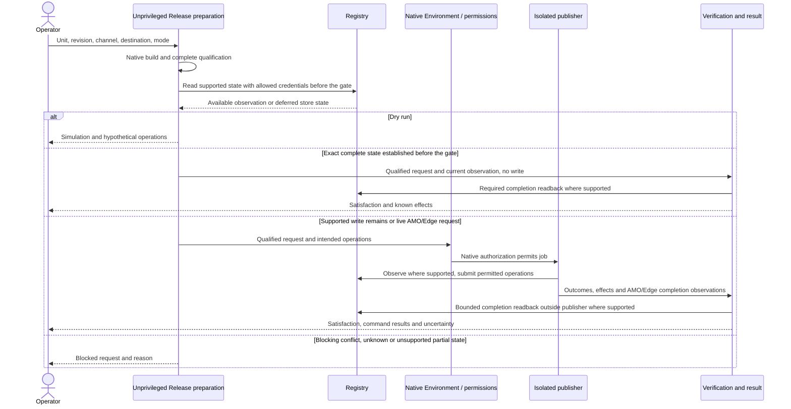
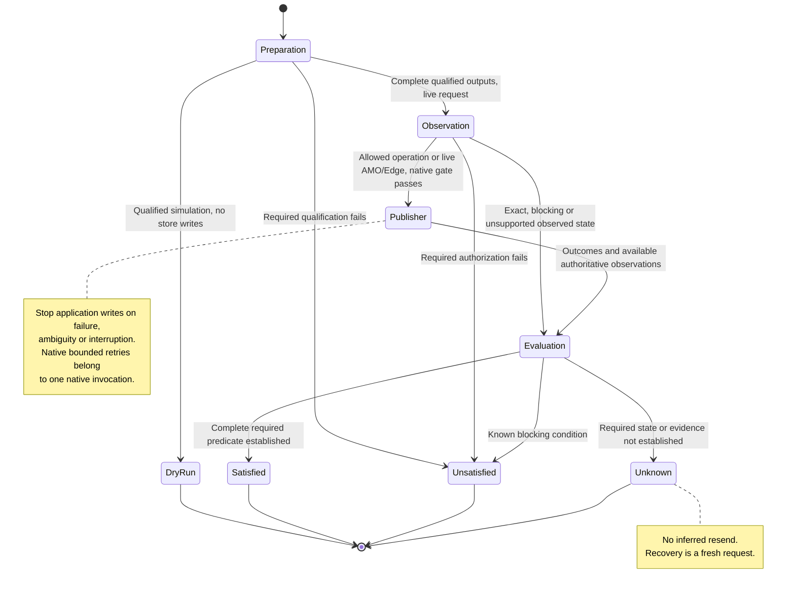

# Release Design

## Scope and Consumers

Release and destination authors use this scope for request preparation, permitted mutation, completion and recovery. Shared local qualification and cross-job permission mechanics have their own scopes.

Start with the [component overview](../middle-level-design.md#components-and-native-responsibilities). The [requirements](../requirements.md) govern this design; the [handoff](../agent-handoff.md#authorization-and-closed-campaigns) retains operation limits. The owner maintains this scope with its affected callers.

## Release Journey

Live AMO and Edge requests take the gated publisher path below. Their completion
observations come from the publisher rather than an independent verification
read; Edge's prestate remains `Unobserved` under WD-REL-008.
Browser-store dry runs acquire no store credentials and report unobserved state.

## Release Operations and State

This UML state view describes one request's execution and terminal outcomes,
not a persistent state-machine service, storage schema or new result enum.
Command success does not imply business satisfaction; all completion paths use
the same predicate. A fresh request never changes an older terminal outcome.

Missing publisher results enter result evaluation without inferring non-start
or retry. The [decision table](#decision-table) governs allowed effects, while
[execution boundaries](execution-boundaries.md#workflow-permission-and-transfer-boundaries)
own actual gate placement and cross-job serialization.

### Request and Preparation

A request contains one immutable source/control revision, Release Unit, channel,
destination and live/dry-run mode. Resolve the native version, complete output set
and applicable quality conditions before execution. Live Official checks
its eligible official ref under the
[Official channel scope](../integration/common.md#official-channel-scope); Buddy
permits configured development refs. Dry run
can use development control code and has no write capability. Unsupported live job
reruns are rejected; ordinary recovery uses a fresh dispatch.

Preparation builds and qualifies the complete set even when recovery may need to
upload only a missing file. It exposes the qualified files, native coordinates,
destination and maximum intended operations before the native gate. The publisher
can remove a now-unnecessary operation after observation but cannot enlarge that
reviewed request.

Inside one invocation these are ordinary values. Persist preparation only for its
actual review, job transfer and operation-window consumers. Separate Execution,
Attempt, Approval Bundle, Authorization and marker aggregates are unnecessary.

### Destination Interface

Destination integrations implement concrete operations with the following contract:

| Operation                  | Input                                                           | Output and responsibility                                                                                              |
| -------------------------- | --------------------------------------------------------------- | ---------------------------------------------------------------------------------------------------------------------- |
| Resolve coordinate         | Selected destination and native package identity                | Physical registry, normalized package/version, expected file identities and supported mode                             |
| Observe                    | Coordinate and qualified expected files                         | Per-file absent/exact/conflicting/unknown state, required native metadata, visibility and bounded diagnostics          |
| Determine supported writes | Current observation and expected set                            | Whether native creation or exact-subset completion is supported, and the ordered missing files                         |
| Invoke native upload once  | One still-needed qualified original and scoped write capability | Native command outcome and available effect facts, including built-in bounded transport retries; no application resend |
| Verify                     | Expected complete state and applicable completion conditions    | Bounded authoritative observations and required checks, with remaining uncertainty                                     |

“Once” counts application invocations, not HTTP attempts inside a supported native
publisher. Delegate its built-in bounded transport retries rather than adding a
custom retry handler or reconstructing the upload protocol. The destination must
still supply the required active-coordinate non-overwrite semantics. A native
retry may resend after an internally ambiguous response; the application must
not claim transport-level exactly-once delivery. When the invocation returns
failure or ambiguity, or is interrupted, stop subsequent application writes and
use bounded reads. This does not remove fresh manual same-revision recovery.
For NuGet, the [native publisher source basis](../research/nuget-native-publisher.md)
records the accepted integration boundary and the selected client's behavior.

Release owns permission to proceed and business completion. The adapter owns native
identity, endpoint, response and partial-set semantics. Do not encode npm tags as
universal identity or Python's two-file behavior as a universal transaction. A
supported interface does not require each method to have its own class or record.

Each concrete integration specifies native non-overwrite reliance, required
files, metadata/readback, credential scope, redirect handling, visibility/read
bounds and partial-set behavior. Rely on the native client's redirect contract;
the application does not reimplement redirect following or storage-host
admission. Use operation deadlines and native capability lifetimes; do not
reinstate a dynamic Governance expiry. Different destinations may need different
read budgets. Necessary guarantees cannot be supplied by application locks or
extra probe records.

### Decision Table

| Observed condition                                                    | Write behavior                                                        | Business result                                                     |
| --------------------------------------------------------------------- | --------------------------------------------------------------------- | ------------------------------------------------------------------- |
| Complete exact state and all required checks                          | No mutation; live AMO/Edge still enter the WD-REL-008 credential gate | Satisfied by observed state                                         |
| Absent required state with supported creation                         | Native gate, fresh observation, then only still-needed writes         | Pending until complete required verification                        |
| Verified exact subset supported by the destination                    | Fresh request qualifies the complete set and plans only missing files | Pending until the full set is verified                              |
| Edge first submission with `Unobserved` prestate under WD-REL-008     | Native gate, qualified upload and submission without a version read   | Pending until the submission operation establishes receipt          |
| Conflicting bytes or unknown required state                           | No mutation                                                           | Unsatisfied or unknown, with the blocking reason                    |
| Acknowledged upload and complete required verification                | No additional write                                                   | Satisfied; preserve the acknowledged command result                 |
| Acknowledged upload with missing required verification                | No additional write                                                   | Unsatisfied or unknown; retain the successful command result        |
| Acknowledged upload not yet visible without read-after-write          | No additional write; a fresh request observes the exact state         | Unknown; retain the successful command result                       |
| Failed/ambiguous native invocation and complete required verification | Stop application mutation; bounded reads only                         | Satisfied by observed state; preserve the command failure/ambiguity |
| Failed/ambiguous native invocation with incomplete/uncertain state    | Stop application mutation; bounded reads only                         | Unsatisfied or unknown; fresh recovery may be possible              |
| Interrupted publisher or missing result                               | No inferred retry                                                     | Effects may remain unknown unless native facts establish non-start  |

For Python, a failed or ambiguous wheel invocation stops the write sequence even if a later
read confirms the wheel. It does not authorize uploading sdist in that same
sequence. If the complete intended set is independently verified, the active
request can be satisfied; otherwise a fresh request can consider supported
missing-file completion. An acknowledged native upload means the index committed
that file, but the public index read is eventually consistent with no
read-after-write guarantee. Successful acknowledged uploads therefore continue in
their declared order without intermediate verification or application polling.
Final verification reports an acknowledged file that the index does not yet show
as unknown; a later fresh request confirms it without a write. Conflicting bytes
still leave the request unsatisfied.

An initially exact request and a newly published request use the same completion
predicate. There is no separate exact-satisfaction certificate. That predicate is
the destination's [post-publication completion](#post-publication-completion)
observation, including its WD-REL-009 exceptions; a version label or successful
upload alone is insufficient.

### Result and Exit Behavior

Keep four facts separate: attempted effects, raw command outcomes, observed remote
state and business satisfaction. Completion established by observation does not
claim that this invocation created remote objects. Missing application records
never prove absence of effects.

The required business check succeeds when the active request establishes all
completion conditions, including after a handled upload error or lost response.
Show the abnormal command outcome explicitly and identify observed satisfaction.
Handled upload outcomes are returned as data for result evaluation. An unexpected
process crash remains a native execution failure; do not blanket-ignore job errors
or overwrite platform conclusions. A business result and the overall workflow
conclusion may differ when an independent infrastructure failure remains.

Final evaluation accounts for missing transfers/checks and interruption. Required
missing evidence blocks a satisfaction claim; optional telemetry failure does not
undo an otherwise established result. Once terminal, an outcome stays terminal.
A later request never changes it retrospectively.

### Recovery

Fresh recovery uses the original source/control revision and relevant inputs,
rebuilds and qualifies its own complete set, and observes current destination state.
It obtains current native authorization only if a write remains. Do not reuse
old approval, old output files or a prior model as authority. A tooling fix is a
new revision; it cannot silently be combined with the old source for recovery.
For Edge, which cannot reobserve its version, a fresh request after an unknown
outcome requires the owner check under
[WD-REL-008](../requirements.md#release-delivery); no automatic resubmission is allowed.

Conflicting bytes, unsupported partial state, missing necessary facts or required
administrative operations need a separate operator decision. Normal release does
not delete, yank, restore, retarget, change access or compensate across registries. No
historical run discovery, permanent ledger or general repair engine is required.

### Registry Observation and Retention

The integrations make no stock-client routing or resolution claim, including
scoped-registry routing. The destination tables in the integration contracts
distinguish the current mechanisms and required properties; they do not assert new platform guarantees or themselves enable any remote operation.

Use the existing bounded native read mechanisms as extraction inputs, not the old
Governance expiry/profile digests. Each integration closes endpoint, redirect and
credential handling, metadata/response-body and archive-expansion bounds, read
deadline/poll bound and cancellation before it is callable; registries own
package size. No missing lower-layer guarantee
may be replaced by an application reservation or probe ledger. A failed upload
still permits bounded read-only evaluation; it never permits application resend or
the next file write after the native invocation reports failure or ambiguity.
Built-in bounded native retries remain within that one invocation, under the
[destination contract](#destination-interface).
The [NuGet source basis](../research/nuget-native-publisher.md) closes the selected
publisher retry boundary without supplying new runtime evidence.

The npm, NuGet and Python registry observations share one standard HTTP client
with no cookies, proxies, default credentials or automatic decompression. It
follows at most five redirects under the platform's
[documented redirect contract](https://learn.microsoft.com/dotnet/api/system.net.http.httpclienthandler.allowautoredirect?view=net-10.0#remarks)
([runtime source](https://github.com/dotnet/runtime/blob/v10.0.12/src/libraries/System.Net.Http/src/System/Net/Http/SocketsHttpHandler/RedirectHandler.cs)),
which clears the `Authorization` header on every automatic redirect, including
a same-host redirect, and does not follow an HTTPS-to-HTTP redirect. The
adapter validates the HTTPS origin of each URL it requests and attaches
credentials only to the registry or API origin it selects. It does not
validate redirect targets or implement its own redirect hop.

A redirect target
that requires the dropped credential, such as an authenticated path on the
same registry host, therefore fails closed as an unknown read. An unfollowed
redirect, including one beyond the limit, is a non-success response and cannot
establish exact or absent state. Exact and conflicting original state rests on
exact coordinate metadata and original size/SHA-256 equality, not on the
serving host. Absence and metadata rely on the selected HTTPS origin and the
redirects it issues. Each body-inclusive read deadline covers its redirects.
Metadata bodies keep fixed limits because they are parsed in memory. Served
originals have no application package-size limit; registries own package size.
An original is compared by a streaming SHA-256, and its read stops one byte past
the qualified original's size, because a longer body cannot match.

Ordinary workflows request 45-day retention for required prepared CLI,
qualified packages and request/results, matching the existing workflow setting.
This is a workflow default, not a new policy expiry or platform-retention proof.
If required inputs expire or the effective platform limit cannot cover the chosen
operation, that operation cannot continue. Optional diagnostics may expire sooner.
A fresh original-revision recovery rebuilds; it does not need a permanent ledger.
Keep registry/package serialization over required verification jobs, with native
concurrency and without automatic live cancellation.

### Post-Publication Completion

Ordinary Release requires local package qualification, including clean local
consumption of the qualified originals, plus authoritative remote verification.
For every destination, post-publication completion is the registry or platform
API observation of each exact intended coordinate, its required metadata and
visibility, and the actual served original downloaded and compared by size and
SHA-256 with the qualified original. Metadata or listing digests alone are not
sufficient. No remote native install, restore or import runs after publication.
GitHub Releases compare each downloaded release asset this way. The
exceptions are the Chrome Web Store, AMO and Edge Add-ons, and nuget.org. Under
[WD-REL-009](../requirements.md#release-delivery), store completion is the store API
reporting the submitted version as received, in review or published. nuget.org
completion is its public API reporting the exact package ID and normalized
version as available after a bounded indexing wait; an already available
version satisfies the request by observation. These exceptions make no
served-byte comparison.

Byte equality carries the pre-publication qualification to the published state.
It does not prove that a stock client's credentials, feed or index routing,
source mapping or dependency resolution select and install the published
package; Release does not claim those properties. The observation remains
bounded, and unknown or conflicting state blocks completion.

Historical campaigns retain all their original consumer requirements, evidence
and terminal outcomes. A later change of completion conditions cannot rewrite an
already terminal request.

### Release Integration Review

The [NuGet Release](../integration/dotnet.md#concrete-nuget-release-integration),
[npm Release](../integration/node.md#concrete-npm-release-integration),
[Python Release](../integration/python.md#concrete-python-release-integration),
[Ruby Release](../integration/ruby.md#concrete-ruby-release-integration),
[GitHub Release](../integration/github-release.md#concrete-github-release-integration)
and [browser store](../integration/browser-store.md) integrations share one review
core: review affected changes with independent engineering/OCR and
record/research review before implementation, run complete affected suites, HK
and record checks, and qualify the final caller subject in ordinary CI before
delivery. These checks do not prove a new publication. Each section states its
own controlled-fixture test cases, runner, additional checks and non-claims.

## Validation Scenarios

| Contract   | Required cases                                                                                                                               | Primary validation boundary                                       |
| ---------- | -------------------------------------------------------------------------------------------------------------------------------------------- | ----------------------------------------------------------------- |
| Completion | Initially exact; absent; supported subset; conflict; delayed visibility; upload error with complete/incomplete readback                      | Destination contract and Release state scenarios                  |
| Recovery   | Interruption; unknown effects; fresh original-revision rebuild; only supported missing-file writes                                           | End-to-end use-case scenarios with bounded dependency substitutes |
| Channel    | Buddy development branch ref; Official ref outside scope rejected at preparation and publisher; dry run from a development ref with no write | Release state and preparation/publisher scenarios                 |

Use the destination sections reached through the
[review core](#release-integration-review), and the
[common Official scope](../integration/common.md#official-channel-scope).
Local qualification follows [build and qualification](build-and-qualification.md);
runtime transfers and credentials follow [execution boundaries](execution-boundaries.md).
