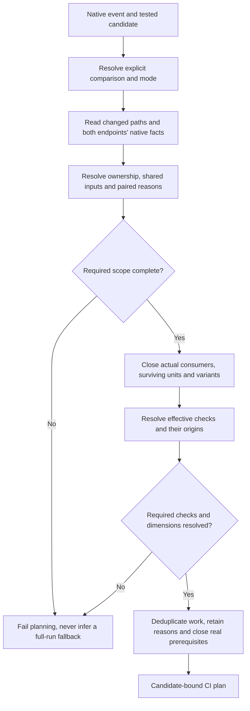

# Repository Facts and Selection

## Scope and Consumers

Repository and CI selection authors use this scope to change native fact consumption, input ownership and complete work selection. It owns those contracts; CI execution and Release's selected closure consume them.

Start with the [component overview](../middle-level-design.md#components-and-native-responsibilities). The [requirements](../requirements.md) govern this design; the [handoff](../agent-handoff.md#authorization-and-closed-campaigns) retains operation limits. The owner maintains this scope with its affected callers.

## Selection View

This CI flow consumes both revision endpoints. Release instead resolves its
selected unit's complete input/build/check closure; it does not need an impact
comparison or unrelated project evaluation.

Complete paired analysis can establish that a path has no applicable owner;
that is not missing scope. The
[selection algorithm](#selection-algorithm) owns the exact rules.
[CI](ci.md#ci-work-and-result-contract) consumes the resulting plan;
[qualification](build-and-qualification.md) owns package execution.

## Repository Facts and Impact Selection

### Minimum Facts

Repository-maintained dependency locks are valid and synchronized with their
native manifests. Analysis consumes that existing repository guarantee; it does
not introduce another lock-validation or admission protocol. Reading facts for
a revision must still address that revision's committed inputs rather than
silently substitute a different installed state.

Repository analysis returns the following facts, with their source revision and
any relevant coverage limitation:

- native project identity, ecosystem, manifest and owned paths;
- native project/workspace dependencies and their relevant dimensions;
- shared configuration, build, version and generated-input consumers;
- supporting test targets and the quality contracts they serve;
- Release Unit identity, native entry points, build variants and expected outputs;
- explicit extra inputs or cross-ecosystem relations unavailable from native tools;
- effective project quality selection and available native check targets.

`ProjectFacts.OwnedPaths` is optional: null retains existing nearest-directory
ownership; a populated array names exact committed endpoint coordinates.

Keep build-input dependencies and quality-consumer relationships distinguishable.
A test project can implement another project's checks without becoming an input
to that product's package or version. Resolve native references and imports using
the ecosystem's supported metadata interface. Converting native identities and
edges into Workflow values is adaptation; interpreting dependency specifiers,
conditional imports or version-file inheritance is native evaluation and follows
the HLD boundary. Combining already resolved edges across revisions and computing
their impact closure remain Workflow responsibilities.

Use existing native project/output metadata for identity association. The
PNPM [directory adaptation candidate](../research/pnpm-native-planning.md#directory-coordinate-adaptation-candidate)
tests joining resolved coordinates to discovered roots and native publish
directories without a second dependency declaration. Its evidence limits remain
separate from acceptance of an implemented reader.

For NBGV, use the pinned public managed API for committed effective options and
native filter matching. Workflow assigns input consumers from those answers and
the native ancestor configuration read boundary; it does not reconstruct
inheritance or historical version-height evaluation. Preserve native case
semantics, missing/added/deleted inputs and both revision identities. The
[source findings and local qualification](../research/nbgv-native-inputs.md)
identify the compile-time official-package integration and its observed Linux
delivery boundary. The implemented `NbgvInputReader` supplies those committed
native inputs for consumer mapping in paired CI fact assembly;
unresolved necessary inputs still fail planning. The component research retains
its original bounded scope; ordinary caller qualification is separate evidence.

Use ordinary typed values inside one invocation. Do not require a Provider Request
Manifest, Fact Bundle, admission token or immutable Repository Model aggregate.
When native evaluation requires another process or runner, transfer the relevant
facts and errors under the [transfer contract](execution-boundaries.md#data-crossing-boundaries).
Project evaluation runs without publication capability.

CI must obtain enough ownership and reverse-consumer facts to justify both
selection and exclusion. An incomplete graph cannot certify that a changed path
has no consumers. Release resolves its selected unit's complete input/build/check
closure; it need not evaluate unrelated projects.

### Implementation Type Names

The integration contracts name these application types for repository selection,
CI work and [shared package execution](build-and-qualification.md).

| Type                                  | Meaning                                                                                                                                                   |
| ------------------------------------- | --------------------------------------------------------------------------------------------------------------------------------------------------------- |
| `RepositoryFacts`                     | One revision's resolved native facts: projects, shared inputs, unaffected paths and errors                                                                |
| `UnaffectedPaths`                     | Paths a complete analysis proved to have no applicable owner; anything else unresolved fails planning                                                     |
| `ProjectFacts`                        | One project's identity, dependencies, quality consumers, Release Unit, checks and optional `OwnedPaths`                                                   |
| `SharedInput`                         | A shared input path and its actual consumers                                                                                                              |
| `SelectionReason`                     | A direct selection's path, initiating revision and resolved project ([paired reasons](#paired-direct-selection-reasons))                                  |
| `CheckSpec`                           | One check: key, dimensions, runner, required flag, prerequisites and optional package subject                                                             |
| `NativeRetained`                      | A check origin for existing native general-CI behavior of an unadopted project, besides `Preset` ([quality autonomy](#declarations-and-quality-autonomy)) |
| `PackageTarget`                       | A check's package subject: unit, declaration, build, entry point, expected version and outputs                                                            |
| `CiPlan`                              | The original candidate-bound plan of selected checks with their reasons and origins, produced by `ImpactPlanner.PlanSelected`                             |
| `ImpactPlanner.PlanSelected` (method) | The shared selection operation that builds a `CiPlan` from paired facts                                                                                   |

### Native Fact Integration

For each new integration, first identify its maintained native library or
supported tool interface, the inputs/configuration it evaluates, the facts and
errors it exposes, and the required facts still unavailable. Review that concrete
boundary before implementation. Follow the HLD's
[native integration boundary](../high-level-design.md#native-integrations), including
native-language helpers and owner disposition when a necessary capability is
missing. Internal implementation and transfer formats have no compatibility
obligation. Rewrite producers and consumers together instead of adding aliases
or porting ecosystem parsing and resolution rules into C#.

| Ecosystem | Native inputs and required initial coverage                                                                                                                    | Unsupported relevant shape                                                                                                    |
| --------- | -------------------------------------------------------------------------------------------------------------------------------------------------------------- | ----------------------------------------------------------------------------------------------------------------------------- |
| Node      | PNPM workspace membership and local dependency edges; package manifests/scripts; shared lock/toolchain consumers; NBGV project inputs; declared package output | Unknown workspace protocol or dynamic dependency/input relation that native metadata and explicit declarations cannot resolve |
| .NET      | Evaluated MSBuild projects/imports and `ProjectReference` per selected configuration/TFM/RID; CPM/lock inputs; declared package outputs and supporting tests   | Missing evaluation runner, unresolved conditional/import inputs or an unmodeled relevant dimension                            |
| Python    | UV workspace/project and local dependency facts; `pyproject.toml`, native lock/build-system inputs; wheel/sdist outputs and Git-free sdist build requirements  | Undeclared dynamic backend/source inputs or native metadata insufficient for affected closure                                 |
| Ruby      | Evaluated gemspec/native dependency facts, locked build/check inputs and explicit repository-local relations unavailable from native metadata                  | Dynamic gemspec behavior whose input/ownership closure is not bounded                                                         |

Analyze base and candidate as specified by the [selection algorithm](#selection-algorithm). Native evaluation is product
execution and runs unprivileged. Initial graph scenarios must include real local
references and transitive consumers, not just the current reference-free smoke
projects. The fixtures do not define the limit of the repository model. Shared
lockfile changes may select all actual consumers; unknown scope never selects a
full-run fallback. New production-product onboarding needs its own accepted Wave entry.

Use Ubuntu runners for the Node/Python/Ruby groups and Windows for general
.NET evaluation/build/consumption, with explicit product variants taking precedence.
Tool versions come from `global.json`, `mise.toml`/`mise.lock` and native locks;
do not introduce a second toolchain authority.

### Native Identity Adaptation

Adapting a native resolved identity is permitted: decode its supported output
format or compare it with the encoding of a known project/output identity. This
does not authorize interpreting unresolved dependency declarations or guessing a
missing producer from a protocol prefix. One bounded exception exists because
native UV metadata stubs build nodes: the
[Python planning contract](../integration/python.md#native-python-planning-facts)
joins PyPA-parsed Hatchling build-requirement names to native workspace members
only under an absent or exact workspace source, and fails on every other shape.
It is not UV lowering and is guarded by the native contract tests its research
record names. Reuse native output-directory metadata when available rather than
requiring a duplicate Workflow declaration.

### GitHub Event Comparison

The finite event adapter reads the native `GITHUB_EVENT_PATH` JSON and the
platform's tested candidate from ordinary process arguments. It consumes only
the relevant native fields; unrelated payload fields and workflow-selected PR
activities do not require an application mirror.

| Native event                       | Comparison basis        | Candidate                                  | Mode      |
| ---------------------------------- | ----------------------- | ------------------------------------------ | --------- |
| `pull_request`                     | `pull_request.base.sha` | Tested `github.sha` merge commit           | Selective |
| `merge_group` / `checks_requested` | `merge_group.base_sha`  | `merge_group.head_sha`, equal tested SHA   | Selective |
| `push`                             | `before`                | `after`, equal tested SHA; `deleted=false` | Selective |
| `workflow_dispatch`                | Tested candidate        | Tested candidate                           | Full      |

Native identities must be full nonzero 40- or 64-character hexadecimal commit
IDs, normalized for comparison. Missing, malformed or conflicting relevant
fields, unsupported events/actions and creation/deletion pushes without a
supported incremental basis fail. They do not select full mode automatically.
The native Git reader subsequently resolves actual objects and compares the
endpoints; the adapter neither requires ancestry nor reconstructs a merge base
or group members. Force-push endpoint comparison remains valid when both
objects are available. PR source head does not replace the tested merge.

The selected semantics follow pinned
[GitHub Actions event documentation](https://github.com/github/docs/blob/2bd66de8cea336061c9ea060c9b37385136e6ab3/content/actions/reference/workflows-and-actions/events-that-trigger-workflows.md)
and the consumed fields in the pinned
[PR](https://github.com/octokit/webhooks/blob/aa80c24a3f55354465b8b1438d33dd5602956d0d/payload-schemas/api.github.com/common/pull-request.schema.json),
[merge-group](https://github.com/octokit/webhooks/blob/aa80c24a3f55354465b8b1438d33dd5602956d0d/payload-schemas/api.github.com/merge_group/checks_requested.schema.json)
and [push](https://github.com/octokit/webhooks/blob/aa80c24a3f55354465b8b1438d33dd5602956d0d/payload-schemas/api.github.com/push/event.schema.json)
schemas. Supplied-payload tests establish the adapter contract, not hosted event
execution or caller cutover. Group ownership, checkout preparation and transfers
remain separate integration responsibilities.

### Selection Algorithm

1. Resolve the candidate tree and event-appropriate comparison through the finite
   mapping above. Explicit full
   validation is a distinct mode with its supported coverage stated.
2. Read changed paths, including both sides of rename/deletion. Resolve ownership
   and relevant relations in the comparison basis and candidate. Changes to
   dependency declarations must not erase the evidence needed to select consumers.
3. Select directly affected projects and shared-input consumers, including valid
   [paired direct-selection reasons](#paired-direct-selection-reasons). Follow required
   transitive reverse dependencies and quality-consumer relations from both sides.
4. Resolve surviving work against the candidate revision. A deleted project is
   not a runnable target; its surviving consumers and changed declarations still
   require analysis. Do not require an old release artifact for CI.
5. Resolve affected Release Units and include all their required variants. Resolve
   effective checks for selected projects and their supporting test targets.
6. Deduplicate identical check/target/dimension combinations, retain all selection
   reasons and close real prerequisites. Reject unresolved scope before execution.

The initial precision is project and actual input-consumer scope. Ordinary source
changes exclude known unrelated projects. A shared lockfile, toolchain or native
workspace operation may select all its actual consumers when that is the supported
semantic input boundary. Explain the broad selection. Use narrower native facts
when available; do not discard them merely to simplify planning.

Package-entry semantic diffing for every lock format and symbol-level impact are
not initial obligations. This accepts wider dependency-maintenance runs while
preserving selective ordinary changes. Unknown paths, failed evaluation, missing
dependencies or unsupported relevant structures block planning; none becomes a
full-run fallback. Explicit full validation also reports unresolved required
facts instead of claiming unsupported repository-wide coverage.

Version and impact input declarations must include genuine shared build and
dependency inputs. A selection optimization cannot make a version-affecting
dependency invisible to the project's native version contract.

### Paired Direct-Selection Reasons

Keep same-endpoint exact input consumers in existing `SharedInput` and explicit
`ProjectFacts.OwnedPaths` values. A paired input association may reach a runnable
owner present only at the other endpoint. Transfer that direct selection through
the existing `SelectionReason(Path, Revision, Project)` value: `Project` identifies
the resolved quality consumer, while `Revision` identifies the committed input's
initiating endpoint. It does not assert that consumer's presence at that endpoint.
A path can enter `UnaffectedPaths` only when the complete paired analysis
establishes no applicable owner. An endpoint-local empty closure, missing facts
or unknown ownership cannot justify exclusion. The core selected-check guard
remains unchanged.

The shared selection operation accepts these paired direct reasons before its
existing union relation and Release Unit closure. Validate each reason against a
normalized changed path, an exact comparison revision and a real owner in the
union of actual endpoint owners. Native Git/ownership binding establishes input
presence and complete scope before this transfer. A valid reason resolves only
its own path; other unresolved changed paths still fail, including in full mode.
Do not clear the changed-path set, transfer an externally completed plan or bypass
ordinary fact validation. Candidate survival, complete checks/variants, selected
origins and prerequisite expansion remain the shared core's responsibilities.

### Shared Inputs and Retained-Job Scope

A changed shared file can reach work through several of these mechanisms at once;
check every one that lists it. For example, root `pyproject.toml` is a native
Python input consumed by every member, a `PythonInputs` entry in `CiScope` and a
root input of the Python caller:

- **Native shared inputs** (`SharedInput`): ecosystem facts name a file's actual
  consumers, such as a lock, toolchain or version input. Product selection and
  exclusion come from these facts and the [paired reasons](#paired-direct-selection-reasons).
- **Control-run inputs**: every CI run executes the candidate control, so the
  .NET and Node groups make its native sources and each group's caller files
  inputs of every member. The application defines this relation; it is not a
  native fact. `ci-scope` reports a consumer reached only through it with the rule
  `control-run-input`, not `native-consumer`, naming the control project when
  that endpoint has one.
- **Retained-job scope** (`Repository/CiScope.cs`): fixed path lists decide which
  retained CI jobs apply and give each changed coordinate a responsibility row.
  `AllInputs` (the CI workflow, control bootstrap script, `mise.toml` and
  `mise.lock`) applies every retained job; `PythonInputs` (root Python
  configuration, lock and Python CI scripts) and `RubyInputs` add their
  caller and special-job responsibilities. These lists select retained jobs and
  report responsibility only; native facts still own product consumption.
- **Root shared inputs of an ecosystem caller**: root files that one ecosystem's
  caller treats as inputs of its root owner, such as root pytest configuration;
  the ecosystem's integration file owns them, for example the
  [Python caller mapping](../integration/python.md#python-quality-and-caller-mapping).

### Declarations and Quality Autonomy

Keep project YAML selection of registered ecosystem presets. Resolve it from the
native manifest directory toward the root: the nearest descriptor containing the
ecosystem entry wins; an unrelated ecosystem entry does not stop the search.
Replacement is explicit, with no implicit ancestor merge. A project-specific
registered preset is valid. Do not introduce an arbitrary YAML command language.
If selected work needs a quality contract and no effective selection resolves,
planning fails rather than inventing a default checklist or omitting its checks.
An explicit `NativeRetained` origin also permits the concrete .NET adapter to
resolve existing general-CI Build/Test behavior for unadopted projects without a
new YAML declaration. This requires nonempty resolved checks and native capability
and variant facts; it is never a fallback from a missing or invalid adopted
preset. Node declaration behavior remains preset-based.

Resolved checks retain `Preset` and/or `NativeRetained` origins. Actual adopted
preset names remain in `QualityPresets`; native-only checks have an empty preset
collection. Identical check keys union origins, actual presets and selection
reasons, with required status combined by OR. Conflicting definitions, runners,
dimensions or prerequisites still fail. This distinction expresses existing
behavior, not a new policy registry or policy-version lifecycle.

Registered checks distinguish required and advisory behavior. A check declared
required must resolve; a supported conditional-on-presence check becomes required
when present. Absence is valid only when the selected contract says so. Stronger
required semantics use an identifiable new preset with explicit project adoption;
equivalent implementation fixes need no new policy lifecycle.

Release Unit declarations supply the product boundary, entry points, variants,
outputs and otherwise unavailable relations. They do not duplicate native project
membership, package names, frameworks or version values. Release channel and
destination selection remain explicit. Removed dynamic Governance content is not
relocated into these declarations.

## Validation Scenarios

| Contract | Required cases                                                                                                | Primary validation boundary                     |
| -------- | ------------------------------------------------------------------------------------------------------------- | ----------------------------------------------- |
| Impact   | Unrelated source; transitive consumers; shared input; deletion/rename; changed dependency edge; unknown scope | Selection scenarios and native fact integration |
| Quality  | Nearest matching ecosystem; explicit stronger-preset adoption; required missing/advisory failed results       | Policy resolution and CI scenarios              |

Follow the concrete native fact contracts for
[.NET](../integration/dotnet.md#native-net-project-facts),
[Node](../integration/node.md#native-pnpm-facts),
[Python](../integration/python.md#native-python-planning-facts) and
[Ruby](../integration/ruby.md#native-ruby-planning-facts). Their native evidence
retains its declared runner, source and tool scope.
