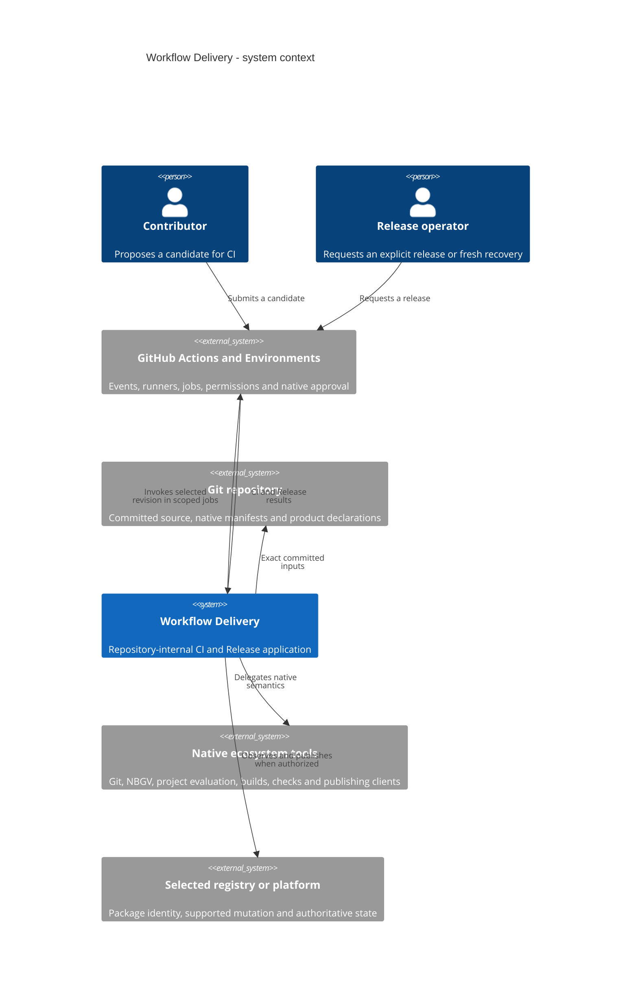
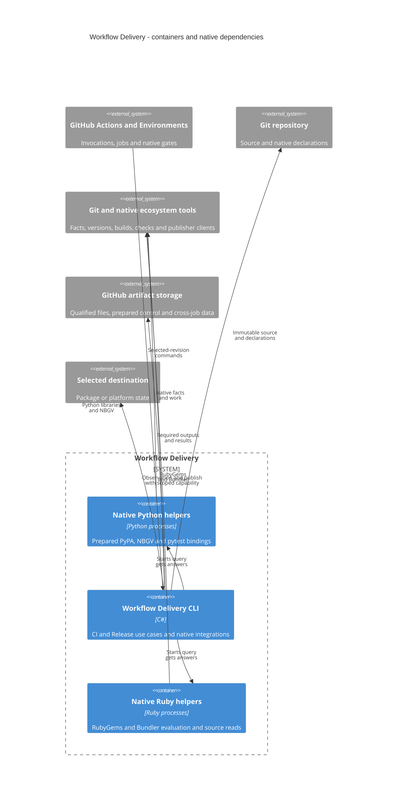

# Workflow Delivery v3 High-Level Design

## Status and Scope

This architecture defines the repository-internal application against the
[requirements](requirements.md) and the owner's architecture decisions.
Implementation qualification follows the actual source, native scenarios and
ordinary hosted checks. Architecture acceptance does not establish live
publication behavior or permission to reopen a completed campaign.

Read the system context, then the container view, then
[middle-level components and scope routes](middle-level-design.md).
The [Wave](../../../../../docs/delivery-wave.md) owns work authorization;
the [handoff](agent-handoff.md) retains operational limits. Historical records
keep their original scope under the
[historical source rule](README.md#historical-source-rule).

## System Context

Workflow Delivery selects and evaluates CI work and carries independently
qualified Release requests to their selected destinations. GitHub and native
ecosystem tools provide the execution, authorization and package semantics it
uses; the application does not replace those systems.

## Container View

One internal C# CLI owns the use cases. Its modules are source organization,
not independently deployed services or a public framework. Invocations are
short-lived processes on Actions runners. The CLI starts Python and Ruby
helpers as separate short-lived processes on the same runner when it needs
their native library bindings.

The CLI also runs native commands, including UV; helpers do not become a
parallel scheduler. The [component view](middle-level-design.md#component-view)
zooms into the CLI, while
[execution boundaries](design/execution-boundaries.md#execution-view) show its
separate runner and permission instances.

## Native Integrations

Native tools own project evaluation, dependency resolution, compilation
ordering, version computation and caches. Workflow owns selecting required work,
adapting native answers and interpreting business results. Actions owns jobs,
waiting, cancellation and concurrency; Environments and destination publisher
configuration own authorization.

Use maintained native libraries or supported tool interfaces. Use a
native-language helper when the maintained library exposes the necessary
semantics there. Do not rebuild Git, MSBuild, PNPM, UV, package metadata, native
publishing or version semantics in C#. If a required native capability is
missing, stop for owner disposition rather than inventing a parser, scheduler,
reservation or approval mirror.

Static registration selects supported ecosystem and destination combinations.
Application adapters compose native results and supported operations; a new
native behavior or special project may require implementation. Do not introduce
an arbitrary command DSL, dynamic policy registry or general V3 cache/reuse
service. Separate responsibilities for actual callers, not an interface for each
noun or a universal optional-method adapter. Smoke recipes are concrete product
recipes, not universal ecosystem qualification promises. The scoped design owns the
[native fact boundary and narrow Python planning exception](design/repository-and-selection.md#native-identity-adaptation)
and [native build differences](design/build-and-qualification.md#ecosystem-qualification).

## Design Assumptions

Repository-maintained dependency locks are valid and synchronized with their
native manifests. Evaluation must still consume the addressed revision's
committed inputs; installed state from another revision is not a substitute.

The owner chose to proceed assuming native NBGV and the combined helpers are
viable on Windows, without a separate feasibility run. The
[historical feasibility record](https://github.com/hcoona/three/blob/e90543cf4b9c5b069053221f7b9d38ee6035ea11/src/private/app/workflow-delivery/docs/research/contraction-feasibility.md)
keeps its unadmitted local observations apart from that assumption; they are not
a passed Windows observation. Ordinary implementation and CI failures still
require correction or explicit disposition.

## Main Journeys

| Journey              | System responsibility                                                                                                                                                     | Zoom in                                                                                                                     |
| -------------------- | ------------------------------------------------------------------------------------------------------------------------------------------------------------------------- | --------------------------------------------------------------------------------------------------------------------------- |
| CI                   | Compare the tested candidate, justify selected and excluded work, run complete required checks and evaluate candidate-bound results                                       | [CI sequence](design/ci.md#ci-journey), then [selection](design/repository-and-selection.md#selection-view)                 |
| Release              | Resolve an explicit request, independently prepare and qualify its complete outputs, observe the destination, gate remaining permitted operations and evaluate completion | [Release sequence](design/release.md#release-journey), then [outcome model](design/release.md#release-operations-and-state) |
| Shared qualification | Obtain native versions, build complete outputs and test clean local consumers without publication capability                                                              | [Build and qualification](design/build-and-qualification.md#qualification-journey)                                          |

CI does not authorize Release. Release does not adopt CI artifacts or
qualification. A dry run prepares and qualifies without writes or write
capability; it is not a separate product execution path.

## Global Invariants

| Invariant                                                                                                                                     | Owning detail                                                                                                                        |
| --------------------------------------------------------------------------------------------------------------------------------------------- | ------------------------------------------------------------------------------------------------------------------------------------ |
| Native facts justify selection and exclusion; unresolved required scope fails, never silently becomes a full run                              | [Repository and selection](design/repository-and-selection.md)                                                                       |
| Project quality follows its effective registered contract, with required and advisory results distinguished                                   | [Quality autonomy](design/repository-and-selection.md#declarations-and-quality-autonomy)                                             |
| CI control is the exact candidate; Release control and source are the selected release revision                                               | [Execution and transfers](design/execution-boundaries.md)                                                                            |
| Product evaluation and qualification never hold publication capability; an accepted control-code writer is inside the trust boundary          | [Permission boundary](design/execution-boundaries.md#workflow-permission-and-transfer-boundaries)                                    |
| One request's originals remain its qualified bytes; fresh recovery rebuilds and qualifies its own complete set                                | [Build provenance](design/build-and-qualification.md#versions-original-bytes-and-provenance), [recovery](design/release.md#recovery) |
| Native command outcomes, attempted effects, observed state and business satisfaction are distinct                                             | [Release result](design/release.md#result-and-exit-behavior)                                                                         |
| Unknown state does not authorize mutation except the accepted Edge first-submission exception; later requests never rewrite terminal outcomes | [Release decision table](design/release.md#decision-table), [WD-REL-008](requirements.md#release-delivery)                           |
| Ordinary completion requires authoritative served originals; browser stores and nuget.org retain only their explicit WD-REL-009 exceptions    | [Post-publication completion](design/release.md#post-publication-completion)                                                         |

## Requirement Coverage

The [requirements](requirements.md) remain the behavior authority.

| Requirements    | Owning design                                                                                |
| --------------- | -------------------------------------------------------------------------------------------- |
| WD-SYS, WD-AUTH | Internal CLI, distinct use cases, selected-revision control and native authorization         |
| WD-CI           | Native facts, meaningful selection, quality autonomy and complete CI results                 |
| WD-REL, WD-CHN  | Independent qualification, native versions, Release journey and channel/mode behavior        |
| WD-SEC          | Product-code isolation, qualified transfers and build-free publisher                         |
| WD-OPS          | Destination contracts, truthful completion, same-revision recovery and native provenance     |
| WD-EVD, WD-RET  | Consumer-specific data, required retention and uncertainty                                   |
| WD-CON          | Static Actions phases and registry/package concurrency within native guarantees              |
| WD-NFR          | Scenario validation, explainable results, explicit integration cost and selective CI latency |

The [middle-level overview](middle-level-design.md#scope-routes) routes each
concern to its contract and concrete integration. Validation follows the
[behavioral basis](middle-level-design.md#behavioral-validation-basis), not a
second acceptance protocol. Current source acceptance never supplies permission
to reopen a closed campaign or perform publication, dispatch or access changes.
