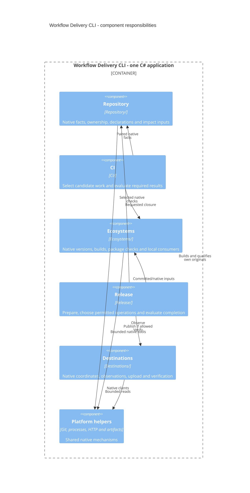

# Workflow Delivery v3 Middle-Level Design

## Scope and Authority

This overview zooms into the CLI in the [HLD](high-level-design.md), then routes
each reader to one scoped contract. The [requirements](requirements.md) govern
behavior. Modules below are internal responsibilities, not new services,
required projects, public interfaces or a persistent application model.

The five scoped designs separate repository selection, shared qualification,
CI, Release and execution boundaries because they have different consumers and
change points. Each owns its named contract; this page owns their component
relationships, domain vocabulary, project inventory and routing. Concrete
ecosystem and destination differences remain with the
[integration contracts](#integration-mapping).

## Component View

Arrows are responsibility dependencies, not a mandatory class/interface graph.
Repository's ecosystem readers and the use cases may share native mechanisms;
the view does not introduce an evaluation service or require all native code to
live behind one interface. Python and Ruby helpers are the separate processes
shown in the HLD, not C# components deployed as services.

## Components and Native Responsibilities

| Module           | Owned behavior                                                                                         | Principal consumers                              |
| ---------------- | ------------------------------------------------------------------------------------------------------ | ------------------------------------------------ |
| Repository       | Read native projects, ownership, dependencies, shared inputs, unit declarations and quality selections | CI impact selection; Release's requested closure |
| CI               | Resolve candidate/comparison, select work and reasons, evaluate required results                       | Static Actions jobs and the required CI check    |
| Release          | Resolve request, prepare/qualify complete outputs, choose remaining writes and evaluate completion     | Dry run, Buddy, Official and ordinary recovery   |
| Ecosystems       | Native version projection, build, package inspection and clean consumption                             | Repository facts and the CI/Release use cases    |
| Destinations     | Native coordinates, observation, upload and verification semantics                                     | Release only                                     |
| Platform helpers | Git, bounded processes/HTTP, Actions artifacts and native execution facts                              | Actual callers of those mechanisms               |

CI and Release share ordinary functions and data where behavior is shared.
They have separate executions and result ownership, not symmetric planners,
finalizers or aggregate hierarchies. Static registration selects supported
ecosystem/destination combinations. Add a project or boundary only for an
actual independent consumer, dependency or runtime reason.

Native tools own evaluation, compilation ordering, dependency resolution,
version computation and caches. Actions owns job scheduling and concurrency;
Environments and destination trust configuration own authorization. The HLD's
[native boundary](high-level-design.md#native-integrations) governs the modules.
Helpers belong to the selected control revision. Internal interfaces and field
names may change with all producers and consumers, without compatibility aliases.

### Owned Projects

| Owner                                                               | Responsibility                                                                                                     |
| ------------------------------------------------------------------- | ------------------------------------------------------------------------------------------------------------------ |
| `src/private/app/workflow-delivery/WorkflowDelivery.csproj`         | Internal CI and Release entry point, native readers, selection, execution, package and destination operations      |
| `tests/private/app/workflow-delivery/WorkflowDelivery.Tests.csproj` | Managed scenario, algorithm, transfer and native integration tests                                                 |
| `tests/private/app/workflow-delivery/Native/{Python,Ruby}/`         | Tests of the corresponding native-language helpers                                                                 |
| `tests/private/app/workflow-delivery/fixtures/products/`            | Four ordinary npm, NuGet, Python and Ruby inputs, with native manifests, versions and quality/release declarations |
| `src/private/app/workflow-delivery/docs/`                           | Current requirements/design/contracts and retained research/evidence readers                                       |
| `src/public/lib/nbgv-python/` and `src/sample/nbgv-hatch-demo/`     | Independent public NBGV component and sample, retaining their own consumers and authorities                        |

Native fixtures retain their package coordinates but have no old/new byte or
version continuity promise. Preserve their deliberate native version bases,
quality ancestry, workspace membership and imports. Moving a fixture does not
justify a discovery or scheduler service.

## Scope Routes

Read a route for its question, then follow only its affected concrete
integrations. Cross-cutting changes read the union of the affected scopes;
this routing does not narrow the handoff's architecture or review obligations.

| Reader question                                                                | Contract owner                                                      | Collaborators                                                     |
| ------------------------------------------------------------------------------ | ------------------------------------------------------------------- | ----------------------------------------------------------------- |
| What changed, who consumes it, and which work is justified?                    | [Repository and selection](design/repository-and-selection.md)      | CI consumes the selection; Release resolves its requested closure |
| What native version, complete output set and local qualification are required? | [Build and qualification](design/build-and-qualification.md)        | CI and Release execute it independently                           |
| How does selected CI work become a required result?                            | [CI](design/ci.md)                                                  | Selection facts, shared qualification and actual runner transfers |
| May this request mutate, and when is it satisfied?                             | [Release](design/release.md)                                        | Shared qualification, destination conditions and native gates     |
| Which execution may read, write or trust each transferred value?               | [Execution and transfer boundaries](design/execution-boundaries.md) | All actual callers, helpers and workflows                         |

## Domain Values

| Value                   | Meaning and consumer                                                                                                                                                                                     |
| ----------------------- | -------------------------------------------------------------------------------------------------------------------------------------------------------------------------------------------------------- |
| Project                 | Native build/package unit, including non-published dependencies; used for ownership, impact and checks                                                                                                   |
| Release unit            | Independently versioned product with explicit native entry points and complete publishable variants                                                                                                      |
| Candidate               | Exact tree tested by CI and the event-appropriate comparison basis                                                                                                                                       |
| Endpoint, paired        | Comparison basis and candidate; paired facts or reasons combine both endpoints' native facts                                                                                                             |
| Release request         | One release unit, full source commit, channel, destination and explicit live/dry-run mode                                                                                                                |
| Selected work           | Projects, variants, required/advisory checks and real prerequisites, with selection reasons                                                                                                              |
| Retained job            | Root CI job outside native ecosystem groups; [retained-job scope](design/repository-and-selection.md#shared-inputs-and-retained-job-scope) selects it                                                    |
| Input-only member       | Native workspace member without a runnable check; remains a producer or input owner in the graph                                                                                                         |
| Qualified output set    | Release's complete files, native coordinates, source/version bindings and successful required qualification                                                                                              |
| Destination observation | Required native state: absent, exact, partial, conflicting or unknown                                                                                                                                    |
| Package control         | Registry package-level type, name, visibility and owner/repository association, read before version state                                                                                                |
| Release result          | Business satisfaction, attempted effects, command outcomes, verification and uncertainty                                                                                                                 |
| Buddy channel           | Distributable previews from allowed development branches ([WD-CHN-001](requirements.md#buddy-and-official-channels))                                                                                     |
| Official channel        | Canonical NBGV or WD-REL-001 static version from an eligible reviewed ref ([WD-CHN-002](requirements.md#buddy-and-official-channels)); [implemented scope](integration/common.md#official-channel-scope) |
| Control                 | Application built from the candidate in CI or selected release revision in Release; transferred as a prepared CLI artifact                                                                               |
| Control distribution    | Complete prepared application output, transferred once to the CI jobs that run it                                                                                                                        |
| Original                | Exact qualified package file of one request; no substitute or older artifact, and fresh recovery qualifies its own rebuilt set ([WD-OPS-004](requirements.md#observation-retry-and-recovery))            |

These are values, not required persistent aggregates. Historical terminology
belongs to the [original records](validation/historical-readers.md#retired-campaign-records).
Product version, source commit and execution are distinct; different commits
can share an NBGV version without equal bytes or a global version-to-commit index.

## Validation and Integration

### Behavioral Validation Basis

Each scoped contract names its required behavioral cases at its use point:
[selection](design/repository-and-selection.md#validation-scenarios),
[qualification](design/build-and-qualification.md#validation-scenarios),
[CI execution](design/ci.md#validation-scenarios),
[Release](design/release.md#validation-scenarios) and
[isolation/transfers](design/execution-boundaries.md#validation-scenarios).

Use focused unit tests for selection and outcome algorithms, scenario tests for
journeys and contract tests for actual transfers. Exercise native integrations
where their behavior matters. Do not preserve tests solely enforcing retired
record chains or duplicating platform authorization. Measure ordinary-PR latency
against the ordinary-PR 12-minute objective separately from legitimately broad
changes; fast full execution is not successful
impact selection.

Local/controlled results do not establish live platform acceptance. The owner's
[Windows assumption](high-level-design.md#design-assumptions) remains accepted
without a separate experiment gate. Completed campaigns remain closed; validation
cannot silently consume a spent external grant.

### Integration Mapping

This overview owns the [project inventory](#owned-projects) and scoped routing.
The [execution scope](design/execution-boundaries.md) owns
[runtime and CLI consumers](design/execution-boundaries.md#runtime-and-cli-consumers),
[workflow caller boundaries](design/execution-boundaries.md#workflow-caller-boundaries)
and [root tooling](design/execution-boundaries.md#root-tooling-declarations-and-record-readers).
Each scope owns its common contract; the [.NET/NuGet](integration/dotnet.md),
[Node/npm](integration/node.md), [Python](integration/python.md),
[Ruby](integration/ruby.md), [GitHub Releases](integration/github-release.md)
and [browser-store](integration/browser-store.md) contracts own only their
ecosystem-specific native facts, CI group, Release caller and destination conditions.

The [common integration tables](integration/common.md) own only the Official
channel scope and CLI/boundary payload table. Keep each inventory with its actual
caller changes in its single owner. The
[Release review core](design/release.md#release-integration-review) applies to
affected integrations. None of these records grants execution or publication;
the [Wave](../../../../../docs/delivery-wave.md) and
[handoff](agent-handoff.md#authorization-and-closed-campaigns) retain those bounds.

The former caller inventory and migration order remain at their
[immutable source][former-plan]. Historical producer identities and exact
implementation, fixture and outcome readers route through the
[historical readers](validation/historical-readers.md) and
[historical source rule](README.md#historical-source-rule).
Current source acceptance neither requalifies those originals nor reopens
closed campaigns. Retired public control, admission/scanner and compatibility
groups are not runtime fallbacks; independently useful public components keep
their own consumers.

[former-plan]: https://github.com/hcoona/three/blob/67f294cfd864a6376c14bee4a9f2ed0b92af9552/src/public/lib/three-workflow-delivery-v3/docs/migration-strategy.md
