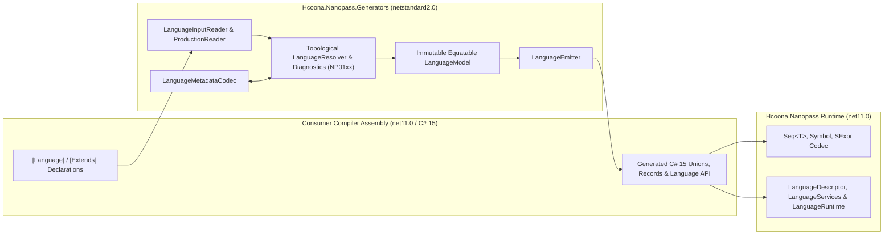

# Architecture and Design Invariants

This record owns the internal structure, dependency boundaries, and compile-time invariants of `Hcoona.Nanopass`.

## Design Principles

1. **Grammar Metamodel as Single Source of Truth**:
   Both native C# 15 type-first declarations (`partial union` + `sealed record`) and S-expression clause attributes (`[Terminal]`, `[NonTerminalDef]`, `[ExtendNonTerminal]`) normalize into one immutable, value-equatable `LanguageModel`. Neither Roslyn symbols nor emitted C# AST classes serve as the sole authority.
2. **Deep Modules Over Boilerplate**:
   Users declare only language grammars and incremental deltas (`[Extends]`, `[Remove]`, `[PrunedLanguage]`). AST record synthesis, structural equality, S-expression parsing, raw and pretty unparsing, node counting, and grammar diffing/pruning remain encapsulated behind generated static members and runtime descriptors.
3. **Reasonable Platform Trust and Fail-Closed Boundaries**:
   Generated IR types rely directly on C# 15 unions (`System.Runtime.CompilerServices.UnionAttribute`, `IUnion`, and `IUnionMembers`), closed hierarchies (`closed record SExpr`), and Roslyn `5.12.0` exhaustiveness checking. Malformed grammar definitions fail closed at compile time (`NP0101`–`NP0105`), and malformed runtime S-expressions or cross-language unparse inputs fail closed with `NanopassParseException` or `NanopassException`.

## Component View

## Key Technical Invariants

### Single-Pass Roslyn Resolution and Cross-Assembly Metadata

Roslyn `IIncrementalGenerator` implementations execute in a single pass and do not observe C# types emitted by generators within the same compilation. If `L1` extends `L0` and `L2` extends `L1` in the same project, `L2` cannot inspect Roslyn `INamedTypeSymbol` members synthesized for `L1`.

`Hcoona.Nanopass.Generators` solves both intra-compilation and cross-assembly inheritance uniformly:

- **Intra-compilation**: `LanguagePipeline` collects all `[Language]` syntax inputs in the compilation, topologically sorts the `[Extends]` / `[PrunedLanguage]` graph, detects cycles (`NP0102`), and resolves derived `LanguageModel`s directly in memory.
- **Cross-assembly**: `LanguageEmitter` annotates every generated language class with `[LanguageMetadata("...")]` carrying lossless canonical metadata encoded by `LanguageMetadataCodec`. When `[Extends(typeof(ExternalLang))]` targets a compiled assembly, `LanguageInputReader` reconstructs `ExternalLang`'s `LanguageModel` from its `[LanguageMetadata]` attribute.
- **Incremental Caching**: Every pipeline intermediate uses `EquatableArray<T>` and `LocationInfo` value types; no `ISymbol`, `SyntaxNode`, or `Compilation` instance is retained across incremental steps.

### C# 15 Union Lowering and `CS0542` Avoidance

- For generated nonterminals whose identifier is not `Value`, `LanguageEmitter` emits native C# 15 `public partial union <NonTerminal>(<Case1>, <Case2>, ...)` declarations augmented with `IEquatable<T>`, `==`, and `!=`. Because C# 15 allows only one `partial union` declaration to specify a case parameter list (`CS8863`), user-authored `partial union` declarations must enumerate all resolved cases of that nonterminal; derived or hybrid nonterminals that combine inherited/clause cases with newly added nested records use `[NonTerminal] public readonly partial struct <NonTerminal>` (reporting `NP0105` otherwise).
- In C# 15, a `union` declaration synthesizes an instance property named `Value`, which causes compiler error `CS0542` (`member names cannot be the same as their enclosing type`) when a grammar defines a nonterminal literally named `Value` (a standard nonterminal name in Nanopass compilers). For `Value` nonterminals (and user-declared `partial struct` nonterminals), `LanguageEmitter` emits C# 15's custom union provider pattern (`[Union] public readonly partial struct Value : Value.IUnionMembers`) with explicit `object? IUnionMembers.Value`, preserving implicit union conversions and exhaustive `switch` checking without member-name collision; declaring `partial union Value(...)` directly reports `NP0105`.
- Case creation and `TryGetValue` members are deduplicated by CLR case type so multiple standalone terminals backed by the same CLR representation (such as `Symbol`-typed `variable` and `primitive` terminals distinguished by terminal predicates) coexist in one union.
- Generated top-level production record names are disambiguated against reserved static language member names (`Parse`, `Unparse`, `Prune`, `Descriptor`, `CountNodes`, `ToSExpression`, `DiffTo`, `IsLanguageTerm`), and productions shared by name across multiple nonterminals in one language nest under their owning nonterminal.

### Structural Value Equality and S-Expression Dispatch

- Standard .NET arrays and `ImmutableArray<T>` use reference or handle equality, which breaks structural equality on `record` AST nodes containing variadic (`...`) fields. `Seq<T>` wraps `ImmutableArray<T>` with element-wise `EqualityComparer<T>.Default` equality and hash aggregation at arbitrary nesting depth (`Seq<Seq<Expr?>>`), while supporting C# collection expressions and list patterns.
- `SExpr` is a C# 15 `closed record` hierarchy (`Nil`, `Bool`, `Int`, `Float`, `Char`, `Str`, `Sym`, `Pair`, `Vector`, `Boxed`). `SExpr.FromValue` canonicalizes CLR primitives into their dedicated `SExpr` cases and reserves `Boxed` strictly for opaque CLR terminal values during `raw: true` unparsing; text formatting fails closed on `Boxed`.
- Matching upstream Nanopass `parser.rkt`, nonterminal parsing dispatches in four ordered phases: (1) non-implicit nonterminal inclusions, (2) pair productions (keyword-tagged before implicit) when and only when the input datum is `SExpr.Pair`, (3) standalone terminal predicates when and only when the input datum is not `SExpr.Pair`, and (4) implicit nonterminal inclusions. Gating standalone terminals to non-pairs prevents catch-all `datum` terminals from shadowing list productions.

## Compile-Time Diagnostic Codes (`define-language`)

| Code     | Condition                                                                                         |
| -------- | ------------------------------------------------------------------------------------------------- |
| `NP0101` | Unrecognized base or source language in `[Extends]` or `[PrunedLanguage]`.                        |
| `NP0102` | Cyclic `[Extends]` chain, duplicate `[Extends]` / `[Entry]`, or unknown entry nonterminal.        |
| `NP0103` | Unrecognized terminal, nonterminal, or production in a subtraction (`-` / `[Remove]`).            |
| `NP0104` | Duplicate terminal or duplicate production within a base nonterminal or extension addition (`+`). |
| `NP0105` | Malformed terminal/production pattern syntax or unrecognized metavariable reference.              |
